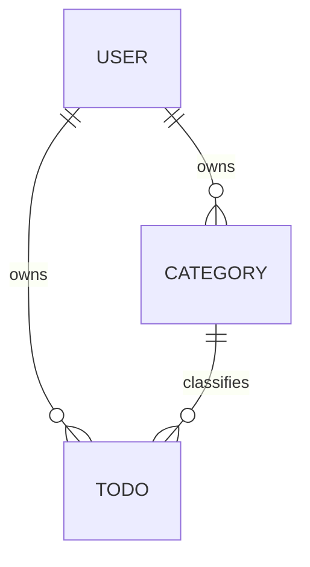

# TodoList 도메인 정의서 (초안)

## 문서 이력

| 버전 | 일자 | 작성자 | 변경 내용 |
|------|------|--------|-----------|
| 0.1 | 2026-11-03 | MinjeYu | 초안 작성 |
| 0.2 | 2026-11-03 | MinjeYu | 문서 이력 섹션 추가 |
| 0.3 | 2026-11-03 | MinjeYu | 평가 반영: 요구사항 ID(FR)와 추적 열 추가, BR-01·02 공통 적용, 모순 해소(시간대·email·ERD), BR-13~15 추가, 수용 기준 확대, 미결정/가정 목록(OI) 표로 정리 |
| 0.4 | 2026-11-04 | MinjeYu | PRD v0.2 의사결정과 일치화: OI-02 확정, OI-03에 시간대 변경 추가(UC-03), BR-01에 로그아웃 인증 명시, AC-07·08에 startDate 보완(BR-08 일치) |
| 0.5 | 2026-11-04 | MinjeYu | PRD v0.3과 일치화: 표기 범례 '확정'에 사용자 의사결정 포함, User.passwordHash에 알고리즘·파라미터 저장 명시, 시간대 변경 수용 기준 AC-13 추가(UC-03), OI-03에 시간대 변경 P0 반영 |
| 0.6 | 2026-11-04 | MinjeYu | 위임 결정(2026-11-04) 반영, PRD v0.4·사용자 시나리오 v0.2와 일치화: 표기 범례에 위임 결정 추가, BR-01(로그아웃은 인증 불요, 적용 UC-03~09), BR-02(categoryId 참조), BR-06(삭제 확인), BR-10(삭제 위치), BR-11(기본 정렬), BR-14(중복 비교 기준), BR-15(UC-03 추가), UC-03 관련 규칙에 BR-15, AC-13 현재 시각 기준 명시, AC-14~AC-21 추가, OI-08·OI-09 MVP 범위 외 확정 |
| 0.7 | 2026-11-04 | MinjeYu | 위임 결정(2026-11-04) 반영(와이어프레임 v0.1 7장 3·10번), PRD v0.5·사용자 시나리오 v0.3·와이어프레임 v0.2와 일치화: OI-06을 주간·월간 모두 월요일 시작으로 확장, UC-09 문구 수정, OI-08에 헤더 '+ 새 할일'과의 구분 추가 |
| 0.8 | 2026-11-04 | MinjeYu | 아키텍처 다이어그램 AQ·ERD EQ 위임 결정(2026-11-04) 반영, PRD v0.7과 일치화: 3장에 개념 모델과 물리 이름·타입의 단일 출처(7-erd.md) 안내(EQ-09), Todo description이 없으면 null임을 비고에 추가(EQ-08) |
| 0.9 | 2026-11-04 | MinjeYu | 사용자 결정(2026-11-04: JWT HS384 + Refresh Token 적용) 반영, PRD v0.8과 일치화: 사용자 결정으로 기존 '리프레시 토큰 없음·24시간 만료·무상태' 결정을 대체. 표기 범례에 사용자 결정 명시, 2장에 액세스 토큰·리프레시 토큰 용어, 3장에 refresh_tokens는 기술 테이블이라 도메인 엔티티가 아님을 명시, BR-01(로그아웃 시 리프레시 쿠키 삭제·계열 폐기)·BR-16 신설(세션 유지), UC-02 확장, AC-16·AC-20 보완, AC-22~AC-24 추가 |
| 0.10 | 2026-11-04 | MinjeYu | 위임 결정(2026-11-04) 반영(미결 항목을 추천 방향으로 확정), PRD v0.9와 일치화: 표기 범례와 BR-01·BR-16의 리프레시 세부 가정을 위임 결정으로 확정. BR-16에 동시 갱신 오판 방지 추가(회전으로 폐기된 토큰이 폐기 후 10초 이내에 다시 오면 재사용으로 보지 않고 계열을 유지한 채 그 요청만 거부), AC-24 보완(10초를 넘긴 폐기 값만 계열 폐기, 10초 이내는 거부만 하고 최신 토큰은 유효) |
| 0.11 | 2026-11-05 | MinjeYu | 사용자 요청(2026-11-05) 반영: FR-09(다국어: 한국어·영어·일본어), FR-10(라이트·다크 모드) 추가. 도메인 엔티티·BR 변화 없음(화면 표시 설정이라 서버 데이터가 아니다) |

**표기 범례**
- **확정**: 요구사항 원문 또는 사용자 의사결정(2026-11-04)에 근거한 결정
  - 인증 방식은 '사용자 결정(2026-11-04)'(JWT, 서명 알고리즘 HS384, Refresh Token 적용)이 출처이며 기존 확정(리프레시 토큰 없음, 24시간 만료, 무상태)을 대체한다. 그 세부(만료 시간, 회전 방식 등)는 사용자가 정하지 않아 위임 결정(2026-11-04)으로 확정했다 (PRD OI-18~21)
  - 사용자가 위임한 결정 포함: 사용자가 추천 방향으로 정하도록 맡긴 항목은 출처를 '위임 결정(2026-11-04)'으로 밝힌다
- **가정**: 원문에 없는 잠정 결정. 일단 이대로 구현하고 이해관계자가 확인하면 확정한다
- **미결정**: 결정하기 전에는 구현을 보류한다
- 가정과 미결정은 BR-xx 또는 OI-xx(7장) ID로 참조한다

## 1. 개요와 문제 정의

TodoList는 인증된 사용자가 자기 할일을 시작일·종료일과 함께 관리하고, 캘린더(월·주·일)에서 볼 수 있게 하는 앱이다.

| # | 문제 | 해결 방향 | 관련 FR |
|---|------|-----------|---------|
| P1 | 인증된 사용자가 자기 할일만 따로 관리할 수 있는 앱이 없다 | 회원가입/로그인, 사용자별 데이터 분리 | FR-01, FR-03, FR-06, FR-07 |
| P2 | 할일에 시작일과 종료일을 지정할 수 없다 | 할일마다 시작일자·종료일자를 두고 캘린더에서 선택 | FR-04 |
| P3 | 할일을 캘린더에서 한꺼번에 보기 어렵다 | 월별·주별·일별 캘린더 화면 | FR-08 |

**기능 요구사항 (원문 기준)**

| ID | 요구사항 | 관련 UC |
|----|----------|---------|
| FR-01 | 회원가입 후 로그인(인증)해야 앱을 사용할 수 있다 | UC-01, UC-02 |
| FR-02 | 할일은 카테고리별로 등록하며, 카테고리를 지정하지 않으면 '기본' 카테고리로 간주한다 | UC-04, UC-05 |
| FR-03 | 로그인한 사용자는 자신의 정보를 수정할 수 있다 | UC-03 |
| FR-04 | 할일 등록 시 시작일자·종료일자를 캘린더에서 선택한다 | UC-05 |
| FR-05 | 할일 목록을 카테고리 / 시작 전 / 진행 중 / 완료 / 기한 초과로 필터링한다 | UC-06 |
| FR-06 | 인증된 사용자는 할일을 삭제할 수 있다 | UC-08 |
| FR-07 | 인증된 사용자는 편집 화면에서 할일을 수정할 수 있다 | UC-07 |
| FR-08 | 할일은 캘린더 화면(월·주·일)에 표시된다 | UC-09 |
| FR-09 | 화면 문구를 한국어·영어·일본어 중 하나로 바꿔 볼 수 있다 (사용자 요청(2026-11-05)) | — |
| FR-10 | 화면을 라이트 모드·다크 모드 중 하나로 바꿔 볼 수 있다 (사용자 요청(2026-11-05)) | — |

## 2. 유비쿼터스 언어

| 용어 | 영문 | 정의 |
|------|------|------|
| 사용자 | User | 회원가입한 사람. 로그인해야 앱을 쓸 수 있다 |
| 인증 | Authentication | 로그인으로 사용자 신원을 확인하는 것. 인증되지 않으면 앱 기능을 쓸 수 없다 |
| 액세스 토큰 | Access Token | 앱 기능을 쓸 때 신원을 증명하는 짧은 수명의 토큰(JWT, 서명 알고리즘 HS384). 만료되면 리프레시 토큰으로 새로 받는다 (사용자 결정(2026-11-04), PRD NFR-07) |
| 리프레시 토큰 | Refresh Token | 액세스 토큰을 다시 받기 위한 긴 수명의 토큰. 사용할 때마다 새것으로 바꾸고 이전 것은 폐기한다 (BR-16, 사용자 결정(2026-11-04)) |
| 할일 | Todo | 사용자가 등록한 작업 하나. 시작일자와 종료일자가 있다 |
| 카테고리 | Category | 할일을 묶는 분류. 사용자마다 따로 둔다 |
| 기본 카테고리 | Default Category | 카테고리를 지정하지 않은 할일이 속하는 '기본' 카테고리 |
| 시작일자 | Start Date | 할일을 시작하는 날짜 (시간 없이 날짜만) |
| 종료일자 | End Date | 할일을 끝내야 하는 날짜 (시간 없이 날짜만) |
| 완료 여부 | Completed | 사용자가 완료로 표시했는지 나타내는 저장값 (true/false) |
| 할일 상태 | Todo Status | 시작 전 / 진행 중 / 완료 / 기한 초과 중 하나. 저장하지 않고 계산한다 (4장) |
| 기한 초과 | Overdue | 종료일자가 지났는데 아직 완료하지 않은 상태 |
| 오늘 | Today | 상태를 판정하는 기준 날짜. 기준 시간대는 OI-02를 따른다 |
| 캘린더 뷰 | Calendar View | 할일을 월·주·일 단위로 보여 주는 화면 |
| 필터 | Filter | 할일 목록을 카테고리나 상태로 좁혀서 보는 조건 |

## 3. 핵심 엔티티

속성은 이 표에서만 관리하고, 아래 다이어그램은 관계만 보여 준다. 이 장은 개념 모델이며 물리 테이블·컬럼 이름과 타입은 [7-erd.md](./7-erd.md)가 단일 출처다 (위임 결정(2026-11-04)).

| 엔티티 | 주요 속성 | 비고 |
|--------|-----------|------|
| User | id, email(로그인 ID, 고유), passwordHash, name, timezone, createdAt, updatedAt | 수정 가능 범위는 OI-03, timezone은 OI-02. passwordHash에는 해시 알고리즘·파라미터·salt를 함께 저장한다 (PRD NFR-06) |
| Category | id, userId, name, isDefault, createdAt | 이름 규칙은 BR-14. 사용자마다 isDefault=true인 카테고리가 정확히 1개 있다 |
| Todo | id, userId, categoryId, title, description(선택), startDate, endDate, completed, completedAt, createdAt, updatedAt | 상태는 저장하지 않는다 (4장). completedAt은 BR-13. description이 없으면(빈 입력 포함) null이다 (PRD VR-06) |

리프레시 토큰은 로그인 상태를 유지하기 위한 기술 데이터(`refresh_tokens` 테이블)이고 업무 개념이 아니므로 도메인 엔티티로 넣지 않는다. 저장 형태는 [7-erd.md](./7-erd.md)(ER-08)에서 다룬다 (사용자 결정(2026-11-04)).

## 4. 할일 상태 정의와 판정 규칙

**결정: 상태는 저장하지 않고 조회할 때 계산한다.** 이유: '기한 초과'처럼 날짜가 바뀌기만 해도 달라지는 상태를 저장해 두면 배치 작업 없이는 실제 상태와 어긋나기 때문이다. 판정에 쓰는 저장값은 `completed`, `startDate`, `endDate`뿐이다.

아래 순서대로 판정해서 처음 맞는 상태로 정한다 (날짜만 비교하고 시간은 보지 않는다. '오늘'의 기준은 OI-02).

| 순서 | 조건 | 상태 |
|------|------|------|
| 1 | `completed = true` | 완료 |
| 2 | `completed = false` 이고 `오늘 > endDate` | 기한 초과 |
| 3 | `completed = false` 이고 `오늘 < startDate` | 시작 전 |
| 4 | `completed = false` 이고 `startDate ≤ 오늘 ≤ endDate` | 진행 중 |

- 네 상태는 서로 겹치지 않고, 모든 할일은 반드시 이 중 하나에 속한다 (BR-07, BR-08 전제).
- 종료일자 당일에는 아직 '진행 중'이고, 다음 날부터 '기한 초과'가 된다.
- 완료한 할일은 날짜와 상관없이 '완료'다. 완료를 해제하면 위 규칙으로 다시 판정한다.

## 5. 비즈니스 규칙

| ID | 규칙 | 구분 | 적용 UC |
|----|------|------|---------|
| BR-01 | 인증되지 않은 사용자는 회원가입, 로그인, 로그아웃만 할 수 있다(토큰 갱신은 앱 기능이 아니라 BR-16의 리프레시 토큰으로 하는 세션 유지 동작이다). 로그아웃은 토큰이 없거나 만료돼도 항상 인증 상태(액세스·리프레시·CSRF 쿠키)를 지우고 성공으로 처리한다. 리프레시 쿠키가 있으면 그 토큰 계열을 서버에서 폐기하고, 폐기에 실패해도 쿠키는 지운다 | 확정 (로그아웃 처리는 위임 결정(2026-11-04)) / 확정 (리프레시 쿠키 삭제·계열 폐기, 사용자 결정(2026-11-04)의 세부, 위임 결정(2026-11-04), PRD OI-18) | UC-03 ~ UC-09 |
| BR-02 | 소유권: 사용자는 자기 User, Category, Todo만 조회·등록·수정·삭제할 수 있다. 목록·캘린더 조회 결과에는 본인 데이터만 나온다. 다른 사람의 데이터를 ID로 접근하면 '없음'으로 응답한다(데이터 존재를 드러내지 않기 위함). 할일 등록·수정이나 목록 필터에 다른 사용자의(또는 없는) categoryId를 넣어도 같은 '없음'으로 응답한다 | 확정 ('없음' 응답 방식은 가정. categoryId 참조를 같은 방식으로 처리하는 것은 위임 결정(2026-11-04)) | UC-03 ~ UC-09 |
| BR-03 | 회원가입하면 그 사용자의 '기본' 카테고리가 자동으로 생긴다 | 가정 | UC-01 |
| BR-04 | 할일을 등록할 때 카테고리를 지정하지 않으면 기본 카테고리에 넣는다. 할일에는 항상 카테고리가 1개 있다 | 확정 | UC-05, UC-07 |
| BR-05 | 기본 카테고리는 삭제할 수도, 이름을 바꿀 수도 없다 | 가정 | UC-04 |
| BR-06 | 카테고리를 삭제하면 그 카테고리의 할일은 기본 카테고리로 옮긴다 (할일을 잃지 않기 위함). 삭제하기 전에 옮겨질 할일 개수를 보여 주고 확인을 받는다. 확인을 취소하면 삭제하지 않는다 | 가정 (이동, OI-04) / 확정 (삭제 확인, 위임 결정(2026-11-04)) | UC-04 |
| BR-07 | `startDate ≤ endDate`여야 한다. 같은 날이어도 된다 | 확정 | UC-05, UC-07 |
| BR-08 | 시작일자와 종료일자는 둘 다 필수다 | 가정 (OI-01) | UC-05, UC-07 |
| BR-09 | 할일 제목은 필수이고 공백만으로 이루어질 수 없다 | 가정 | UC-05, UC-07 |
| BR-10 | 할일 삭제는 물리 삭제이고, 삭제 버튼은 편집 화면에 둔다(OI-07과 같은 위치). 삭제하기 전에 확인을 받는다. 확인을 취소하면 삭제하지 않는다 | 가정 / 확정 (삭제 위치, 위임 결정(2026-11-04)) | UC-08 |
| BR-11 | 할일 목록 필터는 카테고리 1개와 상태 1개를 함께(AND) 걸 수 있고, 지정하지 않으면 전체를 보여 준다. 목록의 기본 정렬은 endDate 오름차순, 같으면 startDate 오름차순, 같으면 createdAt 오름차순이다 | 가정 (필터) / 확정 (정렬, 위임 결정(2026-11-04)) | UC-06 |
| BR-12 | 캘린더에서 할일은 startDate부터 endDate까지 모든 날짜에 표시한다. 완료·기한 초과 할일도 표시하며 상태별로 시각적으로 구분한다 | 확정 (표시 범위·구분은 가정) | UC-09 |
| BR-13 | 완료로 표시하면 completedAt에 그 시각을 기록하고, 완료를 해제하면 null로 되돌린다 | 가정 | UC-07 |
| BR-14 | 카테고리 이름은 필수이고 공백만으로 이루어질 수 없으며, 같은 사용자 안에서 고유하다. 중복 검사는 앞뒤 공백을 제거한 뒤 대소문자를 무시해 비교하고, 기본 카테고리 이름 '기본'도 비교 대상이다. 저장은 앞뒤 공백을 제거한 입력 표기 그대로 한다 | 가정 / 확정 (중복 비교·저장 기준, 위임 결정(2026-11-04)) | UC-04 |
| BR-15 | 검증 규칙(BR-05, 07, 08, 09, 14와 PRD 4.1의 VR)을 위반하면 저장하지 않고 위반 사유를 사용자에게 알린다 | 가정 (UC-03 적용은 위임 결정(2026-11-04)) | UC-03, UC-04, UC-05, UC-07 |
| BR-16 | 세션 유지: 액세스 토큰이 만료돼도 유효한 리프레시 토큰이 있으면 사용자 개입 없이 새 토큰으로 바꿔 로그인 상태를 유지한다. 리프레시 토큰은 쓸 때마다 새것으로 바꾸고 이전 것은 폐기한다. 회전으로 폐기된 리프레시 토큰이 폐기 후 10초 이내(유예 시간, PRD NFR-07)에 다시 오면 재사용으로 보지 않고 계열을 유지한 채 그 요청만 거부한다(동시 갱신 오판 방지). 10초를 넘겨 다시 오면(재사용) 그 로그인 계열의 리프레시 토큰을 모두 폐기하고 로그인을 요구한다. 로그아웃, 비밀번호 변경(다른 기기), 7일 미사용으로 리프레시 토큰이 폐기·만료되면 갱신하지 않고 로그인을 요구한다 | 확정 (리프레시 토큰 기법 적용, 사용자 결정(2026-11-04)) / 확정 (7일 슬라이딩 만료, 회전, 재사용 감지의 계열 폐기와 폐기 후 10초 유예, 사용자 결정(2026-11-04)의 세부, 위임 결정(2026-11-04), PRD OI-18~21) | UC-02 ~ UC-09 |

## 6. 주요 유스케이스

BR-01(인증), BR-02(소유권), BR-16(세션 유지)은 표에 적힌 범위의 모든 UC에 공통으로 적용되므로 '관련 규칙' 열에서는 생략한다.

| ID | 유스케이스 | 요구사항 | 관련 규칙 | 수용 기준 | 구현/테스트 참조 |
|----|------------|----------|-----------|-----------|------------------|
| UC-01 | 회원가입 | FR-01 | BR-03 | AC-01 | |
| UC-02 | 로그인 / 로그아웃 / 세션 유지(토큰 갱신) | FR-01 | BR-01, BR-16 | AC-02, AC-14, AC-15, AC-16, AC-22, AC-23, AC-24 | |
| UC-03 | 내 정보 수정 (name, 비밀번호, 시간대 / OI-03) | FR-03 | BR-15 | AC-13, AC-19, AC-20, AC-21 | |
| UC-04 | 카테고리 등록 / 수정 / 삭제 | FR-02 | BR-05, BR-06, BR-14, BR-15 | AC-03, AC-04 | |
| UC-05 | 할일 등록 (시작일자·종료일자는 캘린더에서 선택) | FR-02, FR-04 | BR-04, BR-07, BR-08, BR-09, BR-15 | AC-05, AC-06 | |
| UC-06 | 할일 목록 조회와 필터 (카테고리 / 시작 전 / 진행 중 / 완료 / 기한 초과) | FR-05 | 4장, BR-11 | AC-07, AC-08, AC-09 | |
| UC-07 | 할일 수정 (편집 화면에서, 완료 표시와 해제 포함 / OI-07) | FR-07 | BR-04, BR-07, BR-08, BR-09, BR-13, BR-15 | AC-10, AC-17 | |
| UC-08 | 할일 삭제 | FR-06 | BR-10 | AC-11 | |
| UC-09 | 캘린더 조회 (월 / 주 / 일, 주간·월간의 주 시작 요일은 OI-06) | FR-08 | BR-12 | AC-12, AC-18 | |

**수용 기준** (날짜 예시는 오늘 = 2026-11-03 기준. AC-13만 예외)

| ID | UC | Given | When | Then |
|----|----|-------|------|------|
| AC-01 | UC-01 | 가입하지 않은 사람 | 회원가입을 마친다 | 그 사용자의 '기본' 카테고리가 1개 생긴다 |
| AC-02 | UC-02 | 로그인하지 않은 상태 | 할일 목록에 접근한다 | 목록을 보여 주지 않고 로그인을 요구한다 |
| AC-03 | UC-04 | 기본 카테고리 | 삭제하거나 이름을 바꾼다 | 거부되고 사유를 알린다 |
| AC-04 | UC-04 | '업무' 카테고리에 할일 2개 | '업무'를 삭제한다 | 할일 2개가 기본 카테고리로 옮겨진다 |
| AC-05 | UC-05 | 카테고리를 지정하지 않은 입력 | 할일을 등록한다 | 기본 카테고리에 등록된다 |
| AC-06 | UC-05 | startDate=11-05, endDate=11-04 | 할일을 등록한다 | 저장되지 않고 사유를 알린다 |
| AC-07 | UC-06 | startDate=10-30, endDate=11-02, completed=false | '기한 초과' 필터를 선택한다 | 목록에 나오고 '진행 중' 필터에는 나오지 않는다 |
| AC-08 | UC-06 | completed=false인 할일 3개: ① start=end=11-03 ② start=11-01, end=11-03 ③ start=11-04, end=11-06 | 상태를 판정한다 | ①② 진행 중, ③ 시작 전 |
| AC-09 | UC-06 | 다른 사용자의 할일이 있다 | 목록을 조회한다 | 다른 사용자의 할일은 나오지 않는다 |
| AC-10 | UC-07 | 완료된 할일 | 완료를 해제한다 | completedAt이 null이 되고 날짜로 상태를 다시 판정한다 |
| AC-11 | UC-08 | 할일 1개 | 삭제를 누르고 확인을 취소한다 | 할일이 남아 있다 |
| AC-12 | UC-09 | start=11-03, end=11-05인 할일 | 11월 월간 캘린더를 연다 | 3일, 4일, 5일 칸에 모두 표시된다 |
| AC-13 | UC-03 | timezone=`Asia/Seoul`인 사용자, start=end=11-03, completed=false인 할일, 현재 시각 2026-11-03 20:00 UTC (서울은 11-04). 이 AC만 현재 시각 기준을 따로 둔다 | 설정 화면에서 시간대를 `UTC`로 바꾼다 | 저장되고, 그 할일이 '기한 초과'에서 '진행 중'으로 다시 판정된다. startDate·endDate 값은 바뀌지 않는다 |
| AC-14 | UC-02 | 가입된 계정 `a@example.com`, 가입되지 않은 `b@example.com` | a로 틀린 비밀번호, b로 아무 비밀번호를 넣어 각각 로그인한다 | 둘 다 로그인되지 않고 같은 메시지를 보여 준다 (email 존재 여부를 드러내지 않는다) |
| AC-15 | UC-02 | `a@example.com`에 계정별 실패 한도(PRD NFR-10)만큼 로그인 실패가 쌓였다 | 시간 창 안에 같은 계정으로 올바른 비밀번호를 넣어 로그인한다 | 비밀번호를 확인하지 않고 거부하며 잠시 후 다시 시도하라고 알린다. 시간 창이 지나면 같은 비밀번호로 로그인된다 |
| AC-16 | UC-02 | 로그인한 상태, 또는 액세스 토큰이 만료된 상태 | 로그아웃한다 | 성공으로 처리되고 인증 쿠키가 지워지며 서버는 그 로그인 계열의 리프레시 토큰을 폐기한다. 이후 할일 목록에 접근하면 로그인을 요구하고, 로그아웃 전의 리프레시 토큰 값으로 갱신을 시도해도 거부된다 (BR-01, BR-16) |
| AC-17 | UC-07 | start=11-03, end=11-05, completed=false인 할일 ('진행 중') | 편집 화면에서 제목을 바꾸고 startDate를 11-04로 바꿔 저장한다 | 바뀐 값으로 저장되고 updatedAt이 갱신되며, '시작 전'으로 다시 판정된다 |
| AC-18 | UC-09 | start=11-03, end=11-05인 할일 | 오늘이 속한 주간 캘린더를 연다 | 11-02(월) ~ 11-08(일)이 표시되고, 3일, 4일, 5일 칸에 할일이 표시된다 (OI-06) |
| AC-19 | UC-03 | 로그인한 사용자 | 설정 화면에서 name을 바꿔 저장한다 | 새 name으로 저장되고 email은 바뀌지 않는다 (OI-03) |
| AC-20 | UC-03 | 로그인한 사용자 | 맞는 현재 비밀번호와 PRD VR-02를 만족하는 새 비밀번호로 비밀번호를 바꾼다 | 저장되고 현재 기기의 로그인은 유지된다. 이후 로그인에는 새 비밀번호만 통하고 이전 비밀번호는 거부된다. 다른 기기의 리프레시 토큰은 폐기돼 그 기기는 액세스 토큰이 만료된 뒤(최대 15분) 로그인을 요구한다 (BR-16) |
| AC-21 | UC-03 | 로그인한 사용자 | 틀린 현재 비밀번호로 비밀번호 변경을 계정별 로그인 실패 한도(PRD NFR-10)보다 많이 시도한다 | 모두 저장되지 않고 현재 비밀번호 필드에 사유를 알린다. 이 실패는 로그인 실패 횟수에 넣지 않으므로 이후 올바른 비밀번호로 로그인된다 |
| AC-22 | UC-02 | 로그인한 지 15분이 넘어 액세스 토큰은 만료됐고 리프레시 토큰은 유효한 상태 | 할일을 저장하거나 목록에 접근한다 | 로그인을 다시 요구하지 않고 토큰이 자동으로 갱신된 뒤 요청이 성공한다. 이전 리프레시 토큰은 폐기되고 새 리프레시 토큰이 발급된다 (BR-16) |
| AC-23 | UC-02 | 리프레시 토큰이 만료(마지막 로그인·갱신 후 7일 경과)됐거나 로그아웃·비밀번호 변경으로 폐기된 상태 | 갱신이 필요한 요청을 한다 | 갱신이 거부되고 로그인을 요구하며 만료 안내를 보여 준다. 입력하던 내용은 보존하지 않는다 (BR-16) |
| AC-24 | UC-02 | 이미 갱신에 쓰여 폐기된 지 10초를 넘긴 리프레시 토큰 값(복제·탈취 가정)과 그 계열의 최신 리프레시 토큰. 별도로, 갱신에 쓰여 폐기된 지 10초 이내인 값과 그 계열의 최신 토큰 | (1) 10초를 넘긴 폐기 값으로 갱신을 시도한 뒤, 최신 토큰으로 갱신을 시도한다. (2) 10초 이내의 폐기 값으로 갱신을 시도한 뒤, 최신 토큰으로 갱신을 시도한다 | (1) 폐기된 값은 거부되고, 그 계열의 토큰이 모두 폐기되므로 최신 토큰도 거부되어 로그인을 요구한다. (2) 폐기된 값은 거부되지만 계열은 폐기되지 않으므로 최신 토큰으로는 갱신된다 (BR-16) |

## 7. 범위 외 항목과 미결정/가정 목록

**범위 외**
- 다른 사용자와 할일 공유·협업, 반복 일정, 알림, 하위 할일, 우선순위·태그
- 소셜 로그인

**미결정/가정 목록**

| ID | 내용 | 현재 가정 | 영향 항목 | 상태 |
|----|------|-----------|-----------|------|
| OI-01 | 시작일자·종료일자를 생략할 수 있게 할지 | 둘 다 필수 | BR-08, 4장 (생략 허용 시 판정 규칙 변경) | 가정 |
| OI-02 | '오늘'을 정하는 기준 시간대 | 사용자별 시간대(User.timezone, IANA 형식). 입력·변경·저장 정책은 PRD 4.2 | 2장, 3장, 4장 | 확정 |
| OI-03 | 내 정보 수정 범위 | email 변경 불가, name·비밀번호·시간대 변경 가능(시간대 변경은 확정, 설정 화면에서 필수 제공). 비밀번호 변경 시 현재 비밀번호를 다시 확인 (세부 처리는 PRD 4.4) | UC-03, 3장 User | 가정 |
| OI-04 | 카테고리 삭제 시 할일을 옮길지, 함께 삭제할지 | 기본 카테고리로 옮김 | BR-06, AC-04 | 가정 |
| OI-05 | 날짜만 쓸지 시간까지 쓸지 | 날짜만 | 2장, 4장 | 가정 |
| OI-06 | 캘린더(주간·월간)의 주 시작 요일 | 주간·월간 모두 월요일 | UC-09, AC-18 | 확정 (월요일 시작과 월간 포함 통일, 위임 결정(2026-11-04)) |
| OI-07 | 완료 표시/해제를 어디서 할지 | 편집 화면에서만 | UC-07 | 가정 |
| OI-08 | 캘린더에서 직접 할일을 등록하거나 드래그로 일정을 옮기는 기능 | MVP 범위 외. 다음 버전에서 검토. 헤더의 '+ 새 할일'은 등록 화면으로 이동만 하고 캘린더의 날짜를 미리 채우지 않으므로 이 항목과 별개다 (위임 결정(2026-11-04)) | UC-09 | 확정 (위임 결정(2026-11-04)) |
| OI-09 | 회원 탈퇴 지원 여부 | MVP 범위 외. 운영 출시 전에 개인정보 삭제 요구 대응을 위해 재검토 (PRD R-10) | UC-03 | 확정 (위임 결정(2026-11-04)) |

인증 토큰 방식(JWT, HS384, Refresh Token)은 사용자 결정(2026-11-04)이며 세부 가정은 PRD 10.2장의 OI-11, OI-18~OI-21에서 관리한다.
