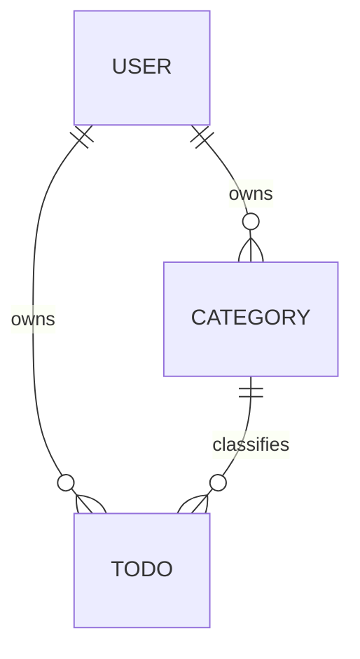

# TodoList 도메인 정의서 (초안)

## 문서 이력

| 버전 | 일자 | 작성자 | 변경 내용 |
|------|------|--------|-----------|
| 0.1 | 2026-11-03 | MinjeYu | 초안 작성 |
| 0.2 | 2026-11-03 | MinjeYu | 문서 이력 섹션 추가 |
| 0.3 | 2026-11-03 | MinjeYu | 평가 반영: 요구사항 ID(FR)와 추적 열 추가, BR-01·02 공통 적용, 모순 해소(시간대·email·ERD), BR-13~15 추가, 수용 기준 확대, 미결정/가정 목록(OI) 표로 정리 |

**표기 범례**
- **확정**: 요구사항 원문에 근거한 결정
- **가정**: 원문에 없는 잠정 결정. 일단 이대로 구현하고 이해관계자가 확인하면 확정한다
- **미결정**: 결정하기 전에는 구현을 보류한다
- 가정과 미결정은 BR-xx 또는 OI-xx(7장) ID로 참조한다

## 1. 개요와 문제 정의

TodoList는 인증된 사용자가 자기 할일을 시작일·종료일과 함께 관리하고, 캘린더(월·주·일)에서 볼 수 있게 하는 앱이다.

| # | 문제 | 해결 방향 | 관련 FR |
|---|------|-----------|---------|
| P1 | 인증된 사용자가 자기 할일만 따로 관리할 수 있는 앱이 없다 | 회원가입/로그인, 사용자별 데이터 분리 | FR-01, FR-03, FR-06, FR-07 |
| P2 | 할일에 시작일과 종료일을 지정할 수 없다 | 할일마다 시작일자·종료일자를 두고 캘린더에서 선택 | FR-04 |
| P3 | 할일을 캘린더에서 한꺼번에 보기 어렵다 | 월별·주별·일별 캘린더 화면 | FR-08 |

**기능 요구사항 (원문 기준)**

| ID | 요구사항 | 관련 UC |
|----|----------|---------|
| FR-01 | 회원가입 후 로그인(인증)해야 앱을 사용할 수 있다 | UC-01, UC-02 |
| FR-02 | 할일은 카테고리별로 등록하며, 카테고리를 지정하지 않으면 '기본' 카테고리로 간주한다 | UC-04, UC-05 |
| FR-03 | 로그인한 사용자는 자신의 정보를 수정할 수 있다 | UC-03 |
| FR-04 | 할일 등록 시 시작일자·종료일자를 캘린더에서 선택한다 | UC-05 |
| FR-05 | 할일 목록을 카테고리 / 시작 전 / 진행 중 / 완료 / 기한 초과로 필터링한다 | UC-06 |
| FR-06 | 인증된 사용자는 할일을 삭제할 수 있다 | UC-08 |
| FR-07 | 인증된 사용자는 편집 화면에서 할일을 수정할 수 있다 | UC-07 |
| FR-08 | 할일은 캘린더 화면(월·주·일)에 표시된다 | UC-09 |

## 2. 유비쿼터스 언어

| 용어 | 영문 | 정의 |
|------|------|------|
| 사용자 | User | 회원가입한 사람. 로그인해야 앱을 쓸 수 있다 |
| 인증 | Authentication | 로그인으로 사용자 신원을 확인하는 것. 인증되지 않으면 앱 기능을 쓸 수 없다 |
| 할일 | Todo | 사용자가 등록한 작업 하나. 시작일자와 종료일자가 있다 |
| 카테고리 | Category | 할일을 묶는 분류. 사용자마다 따로 둔다 |
| 기본 카테고리 | Default Category | 카테고리를 지정하지 않은 할일이 속하는 '기본' 카테고리 |
| 시작일자 | Start Date | 할일을 시작하는 날짜 (시간 없이 날짜만) |
| 종료일자 | End Date | 할일을 끝내야 하는 날짜 (시간 없이 날짜만) |
| 완료 여부 | Completed | 사용자가 완료로 표시했는지 나타내는 저장값 (true/false) |
| 할일 상태 | Todo Status | 시작 전 / 진행 중 / 완료 / 기한 초과 중 하나. 저장하지 않고 계산한다 (4장) |
| 기한 초과 | Overdue | 종료일자가 지났는데 아직 완료하지 않은 상태 |
| 오늘 | Today | 상태를 판정하는 기준 날짜. 기준 시간대는 OI-02를 따른다 |
| 캘린더 뷰 | Calendar View | 할일을 월·주·일 단위로 보여 주는 화면 |
| 필터 | Filter | 할일 목록을 카테고리나 상태로 좁혀서 보는 조건 |

## 3. 핵심 엔티티

속성은 이 표에서만 관리하고, 아래 다이어그램은 관계만 보여 준다.

| 엔티티 | 주요 속성 | 비고 |
|--------|-----------|------|
| User | id, email(로그인 ID, 고유), passwordHash, name, timezone, createdAt, updatedAt | 수정 가능 범위는 OI-03, timezone은 OI-02 |
| Category | id, userId, name, isDefault, createdAt | 이름 규칙은 BR-14. 사용자마다 isDefault=true인 카테고리가 정확히 1개 있다 |
| Todo | id, userId, categoryId, title, description(선택), startDate, endDate, completed, completedAt, createdAt, updatedAt | 상태는 저장하지 않는다 (4장). completedAt은 BR-13 |

## 4. 할일 상태 정의와 판정 규칙

**결정: 상태는 저장하지 않고 조회할 때 계산한다.** 이유: '기한 초과'처럼 날짜가 바뀌기만 해도 달라지는 상태를 저장해 두면 배치 작업 없이는 실제 상태와 어긋나기 때문이다. 판정에 쓰는 저장값은 `completed`, `startDate`, `endDate`뿐이다.

아래 순서대로 판정해서 처음 맞는 상태로 정한다 (날짜만 비교하고 시간은 보지 않는다. '오늘'의 기준은 OI-02).

| 순서 | 조건 | 상태 |
|------|------|------|
| 1 | `completed = true` | 완료 |
| 2 | `completed = false` 이고 `오늘 > endDate` | 기한 초과 |
| 3 | `completed = false` 이고 `오늘 < startDate` | 시작 전 |
| 4 | `completed = false` 이고 `startDate ≤ 오늘 ≤ endDate` | 진행 중 |

- 네 상태는 서로 겹치지 않고, 모든 할일은 반드시 이 중 하나에 속한다 (BR-07, BR-08 전제).
- 종료일자 당일에는 아직 '진행 중'이고, 다음 날부터 '기한 초과'가 된다.
- 완료한 할일은 날짜와 상관없이 '완료'다. 완료를 해제하면 위 규칙으로 다시 판정한다.

## 5. 비즈니스 규칙

| ID | 규칙 | 구분 | 적용 UC |
|----|------|------|---------|
| BR-01 | 인증되지 않은 사용자는 회원가입과 로그인만 할 수 있다 | 확정 | UC-01·02를 뺀 전체 |
| BR-02 | 소유권: 사용자는 자기 User, Category, Todo만 조회·등록·수정·삭제할 수 있다. 목록·캘린더 조회 결과에는 본인 데이터만 나온다. 다른 사람의 데이터를 ID로 접근하면 '없음'으로 응답한다(데이터 존재를 드러내지 않기 위함) | 확정 ('없음' 응답 방식은 가정) | UC-03 ~ UC-09 |
| BR-03 | 회원가입하면 그 사용자의 '기본' 카테고리가 자동으로 생긴다 | 가정 | UC-01 |
| BR-04 | 할일을 등록할 때 카테고리를 지정하지 않으면 기본 카테고리에 넣는다. 할일에는 항상 카테고리가 1개 있다 | 확정 | UC-05, UC-07 |
| BR-05 | 기본 카테고리는 삭제할 수도, 이름을 바꿀 수도 없다 | 가정 | UC-04 |
| BR-06 | 카테고리를 삭제하면 그 카테고리의 할일은 기본 카테고리로 옮긴다 (할일을 잃지 않기 위함) | 가정 (OI-04) | UC-04 |
| BR-07 | `startDate ≤ endDate`여야 한다. 같은 날이어도 된다 | 확정 | UC-05, UC-07 |
| BR-08 | 시작일자와 종료일자는 둘 다 필수다 | 가정 (OI-01) | UC-05, UC-07 |
| BR-09 | 할일 제목은 필수이고 공백만으로 이루어질 수 없다 | 가정 | UC-05, UC-07 |
| BR-10 | 할일 삭제는 물리 삭제이고, 삭제하기 전에 확인을 받는다. 확인을 취소하면 삭제하지 않는다 | 가정 | UC-08 |
| BR-11 | 할일 목록 필터는 카테고리 1개와 상태 1개를 함께(AND) 걸 수 있고, 지정하지 않으면 전체를 보여 준다 | 가정 | UC-06 |
| BR-12 | 캘린더에서 할일은 startDate부터 endDate까지 모든 날짜에 표시한다. 완료·기한 초과 할일도 표시하며 상태별로 시각적으로 구분한다 | 확정 (표시 범위·구분은 가정) | UC-09 |
| BR-13 | 완료로 표시하면 completedAt에 그 시각을 기록하고, 완료를 해제하면 null로 되돌린다 | 가정 | UC-07 |
| BR-14 | 카테고리 이름은 필수이고 공백만으로 이루어질 수 없으며, 같은 사용자 안에서 고유하다 | 가정 | UC-04 |
| BR-15 | 검증 규칙(BR-05, 07, 08, 09, 14)을 위반하면 저장하지 않고 위반 사유를 사용자에게 알린다 | 가정 | UC-04, UC-05, UC-07 |

## 6. 주요 유스케이스

BR-01(인증)과 BR-02(소유권)는 표에 적힌 범위의 모든 UC에 공통으로 적용되므로 '관련 규칙' 열에서는 생략한다.

| ID | 유스케이스 | 요구사항 | 관련 규칙 | 수용 기준 | 구현/테스트 참조 |
|----|------------|----------|-----------|-----------|------------------|
| UC-01 | 회원가입 | FR-01 | BR-03 | AC-01 | |
| UC-02 | 로그인 / 로그아웃 | FR-01 | BR-01 | AC-02 | |
| UC-03 | 내 정보 수정 (name, 비밀번호 / OI-03) | FR-03 | — | — | |
| UC-04 | 카테고리 등록 / 수정 / 삭제 | FR-02 | BR-05, BR-06, BR-14, BR-15 | AC-03, AC-04 | |
| UC-05 | 할일 등록 (시작일자·종료일자는 캘린더에서 선택) | FR-02, FR-04 | BR-04, BR-07, BR-08, BR-09, BR-15 | AC-05, AC-06 | |
| UC-06 | 할일 목록 조회와 필터 (카테고리 / 시작 전 / 진행 중 / 완료 / 기한 초과) | FR-05 | 4장, BR-11 | AC-07, AC-08, AC-09 | |
| UC-07 | 할일 수정 (편집 화면에서, 완료 표시와 해제 포함 / OI-07) | FR-07 | BR-04, BR-07, BR-08, BR-09, BR-13, BR-15 | AC-10 | |
| UC-08 | 할일 삭제 | FR-06 | BR-10 | AC-11 | |
| UC-09 | 캘린더 조회 (월 / 주 / 일, 주 시작 요일은 OI-06) | FR-08 | BR-12 | AC-12 | |

**수용 기준** (날짜 예시는 오늘 = 2026-11-03 기준)

| ID | UC | Given | When | Then |
|----|----|-------|------|------|
| AC-01 | UC-01 | 가입하지 않은 사람 | 회원가입을 마친다 | 그 사용자의 '기본' 카테고리가 1개 생긴다 |
| AC-02 | UC-02 | 로그인하지 않은 상태 | 할일 목록에 접근한다 | 목록을 보여 주지 않고 로그인을 요구한다 |
| AC-03 | UC-04 | 기본 카테고리 | 삭제하거나 이름을 바꾼다 | 거부되고 사유를 알린다 |
| AC-04 | UC-04 | '업무' 카테고리에 할일 2개 | '업무'를 삭제한다 | 할일 2개가 기본 카테고리로 옮겨진다 |
| AC-05 | UC-05 | 카테고리를 지정하지 않은 입력 | 할일을 등록한다 | 기본 카테고리에 등록된다 |
| AC-06 | UC-05 | startDate=11-05, endDate=11-04 | 할일을 등록한다 | 저장되지 않고 사유를 알린다 |
| AC-07 | UC-06 | endDate=11-02, completed=false | '기한 초과' 필터를 선택한다 | 목록에 나오고 '진행 중' 필터에는 나오지 않는다 |
| AC-08 | UC-06 | completed=false인 할일 3개: ① start=end=11-03 ② end=11-03 ③ start=11-04 | 상태를 판정한다 | ①② 진행 중, ③ 시작 전 |
| AC-09 | UC-06 | 다른 사용자의 할일이 있다 | 목록을 조회한다 | 다른 사용자의 할일은 나오지 않는다 |
| AC-10 | UC-07 | 완료된 할일 | 완료를 해제한다 | completedAt이 null이 되고 날짜로 상태를 다시 판정한다 |
| AC-11 | UC-08 | 할일 1개 | 삭제를 누르고 확인을 취소한다 | 할일이 남아 있다 |
| AC-12 | UC-09 | start=11-03, end=11-05인 할일 | 11월 월간 캘린더를 연다 | 3일, 4일, 5일 칸에 모두 표시된다 |

## 7. 범위 외 항목과 미결정/가정 목록

**범위 외**
- 다른 사용자와 할일 공유·협업, 반복 일정, 알림, 하위 할일, 우선순위·태그
- 소셜 로그인

**미결정/가정 목록**

| ID | 내용 | 현재 가정 | 영향 항목 | 상태 |
|----|------|-----------|-----------|------|
| OI-01 | 시작일자·종료일자를 생략할 수 있게 할지 | 둘 다 필수 | BR-08, 4장 (생략 허용 시 판정 규칙 변경) | 가정 |
| OI-02 | '오늘'을 정하는 기준 시간대 | 사용자별 시간대(User.timezone) | 2장, 3장, 4장 | 가정 |
| OI-03 | 내 정보 수정 범위 | email 변경 불가, name·비밀번호 변경 가능. 비밀번호 변경 시 현재 비밀번호를 다시 확인 | UC-03, 3장 User | 가정 |
| OI-04 | 카테고리 삭제 시 할일을 옮길지, 함께 삭제할지 | 기본 카테고리로 옮김 | BR-06, AC-04 | 가정 |
| OI-05 | 날짜만 쓸지 시간까지 쓸지 | 날짜만 | 2장, 4장 | 가정 |
| OI-06 | 주별 캘린더의 주 시작 요일 | 월요일 | UC-09 | 가정 |
| OI-07 | 완료 표시/해제를 어디서 할지 | 편집 화면에서만 | UC-07 | 가정 |
| OI-08 | 캘린더에서 직접 할일을 등록하거나 드래그로 일정을 옮기는 기능 | — | UC-09 | 미결정 |
| OI-09 | 회원 탈퇴 지원 여부 | — | UC-03 | 미결정 |
