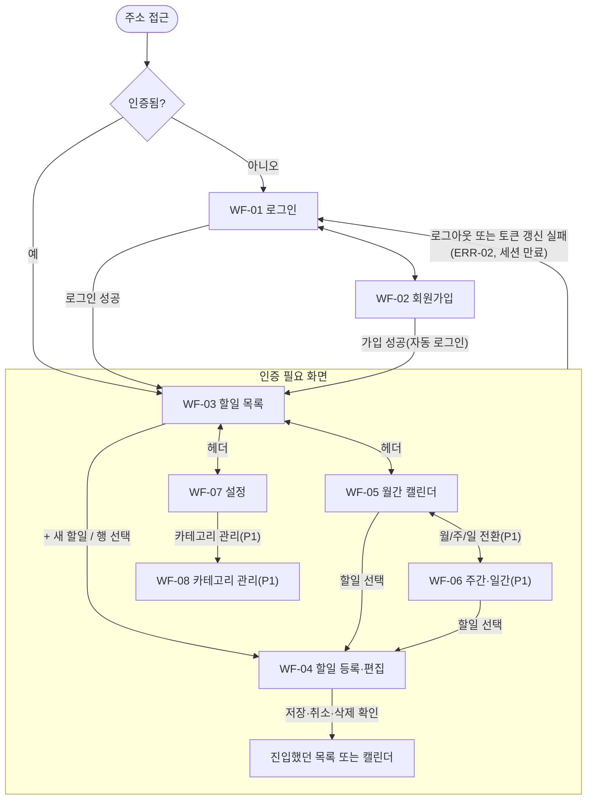

# TodoList 와이어프레임 (저충실도)

## 문서 이력

| 버전 | 일자 | 작성자 | 변경 내용 |
|------|------|--------|-----------|
| 0.1 | 2026-11-04 | MinjeYu | 도메인 정의서 v0.6·PRD v0.4·사용자 시나리오 v0.2 기반 초안 |
| 0.2 | 2026-11-04 | MinjeYu | 위임 결정(2026-11-04)으로 7장 1~10번 해결, 도메인 정의서 v0.7·PRD v0.5·사용자 시나리오 v0.3과 일치화: 확정된 (가정) 표시를 근거 ID로 교체(1장, 2장, 3.1, WF-01·04·05·06·07·08), 5장에 확정 항목 열 추가, 7장을 해결 기록으로 전환, WF-07 컷 라인 설명 수정 |
| 0.3 | 2026-11-04 | MinjeYu | 아키텍처 다이어그램 AQ-04 위임 결정(2026-11-04) 반영, 도메인 정의서 v0.8·PRD v0.7·사용자 시나리오 v0.4와 일치화: WF-01 입력란 검증 범위를 PRD 4.1 로그인 입력 검증으로 연결, 참조 문서 버전 갱신 |
| 0.4 | 2026-11-04 | MinjeYu | 사용자 결정(2026-11-04: JWT HS384 + Refresh Token 적용) 반영, 도메인 정의서 v0.9·PRD v0.8·사용자 시나리오 v0.5와 일치화: 만료 안내 표시 조건을 'ERR-02를 받을 때'에서 '토큰 갱신 실패 시'로 변경(2장 흐름, WF-01, WF-04), 액세스 토큰만 만료돼 갱신에 성공하면 화면 이동·안내가 없음을 명시, SC-03 제목 변경과 SC-16 연결, 7장 11번 추가 |
| 0.5 | 2026-11-04 | MinjeYu | 위임 결정(2026-11-04) 반영, 도메인 정의서 v0.10·PRD v0.9·사용자 시나리오 v0.6과 일치화: 7장 11번 해결(갱신 중 화면 표시 없음 확정), 갱신 실패 시 원 요청 1회 재전송 후에도 ERR-02일 때만 WF-01 만료 안내(2장 흐름, WF-01 만료 메시지, WF-04 오류 흐름) |
| 0.6 | 2026-11-05 | MinjeYu | PRD v0.13(VR-02 KISA 기준 변경)·사용자 시나리오 v0.7과 일치화: WF-01 로그인 입력란의 '15자 미만' 표현을 VR-02 참조로, WF-02 비밀번호 '길이 안내 문구'를 '규칙 안내 문구'로 변경. 머리말 참조 버전 갱신 |
| 0.7 | 2026-11-05 | MinjeYu | 코드 리뷰 반영: 2장 화면 흐름에 로그인 상태의 WF-01·WF-02 접근은 WF-03으로, 미로그인 접근은 만료 안내 없이 WF-01로(가정) 추가. WF-05 월/주/일 전환은 선택한 날짜 기준(가정). 5장 WF-01·WF-06 행 갱신 |
| 0.8 | 2026-11-05 | MinjeYu | PRD v0.14(FR-09 다국어·FR-10 테마) 반영: 3.1에 모든 화면 헤더의 언어 선택·테마 전환 요소(가정), 5장 WF-00 행 갱신. 이 문서의 문구 예시는 한국어 원문이다 |
| 0.9 | 2026-11-05 | MinjeYu | 사용자 결정(2026-11-05) 반영: 3.1 헤더 탭을 캘린더·목록 순서로, 로고는 WF-05로 이동, 설정은 탭에서 빼 로그아웃 왼쪽의 '⚙ 설정' 버튼으로(모든 화면 ASCII 갱신). 언어·테마는 헤더에서 빼 WF-07 '화면' 섹션 드롭다운으로. WF-03 빈 상태·필터 결과 없음에도 표 머리 유지. 5장 WF-00·WF-03 행 갱신 |
| 0.10 | 2026-11-06 | MinjeYu | 사용자 요청(2026-11-06)·PRD v0.16 반영: 3.1 헤더 맨 오른쪽 프로필 버튼과 팝업(이름·이메일·로그아웃), 로그아웃을 헤더·모바일 메뉴에서 팝업으로(모든 화면 ASCII 갱신). WF-05·06 그리드 왼쪽 카테고리 체크 목록(만들기·숨김, FR-11). WF-07 테마 6가지. 5장 WF-00·WF-05 행 갱신 |
| 0.11 | 2026-11-06 | MinjeYu | 최종 코드 기준 일치화: WF-05에 카테고리 체크 목록 ASCII 추가, 6.2 FR → WF 표에 FR-09·FR-10·FR-11 행 추가. 프로필 팝업은 밖 클릭·Esc·경로 변경(뒤로 가기 포함) 때 닫힘을 구현에서 확인 |
| 0.12 | 2026-11-06 | MinjeYu | 최종 코드 기준 일치화(E2E 결함 수정): 3.2 상단 알림에 세션 만료 안내는 닫기·로그인 시도 전까지 다른 오류에 덮이지 않음(D-1), WF-07 시간대 목록 맨 앞에 `UTC`(D-2) |
| 0.13 | 2026-11-06 | MinjeYu | 사용자 결정(2026-11-06) 반영: CSRF 방어 제거. 3.2 상단 알림 대상 오류와 5장 WF-01 로그인 버튼 설명, 시나리오 추적(SC-15)에서 ERR-08·CSRF 쿠키 문구 삭제 |
| 0.14 | 2026-11-06 | MinjeYu | 단일 출처 머리말의 PRD 참조를 v0.18에 맞춤(쿠키 SameSite 운영 값 변경, 화면 변경 없음) |
| 0.15 | 2026-11-06 | MinjeYu | 사용자 요청(2026-11-06) 반영: 3.2 공통 요소에 오류 화면(Fallback, 404·예기치 못한 렌더링 오류) 행과 ASCII 추가(FE-27) |

**표기 범례** (도메인 정의서·PRD·사용자 시나리오와 같음)
- **확정**: 요구사항 원문 또는 사용자 의사결정(2026-11-04)에 근거한 결정
  - 사용자가 위임한 결정 포함: 사용자가 추천 방향으로 정하도록 맡긴 항목은 출처를 '위임 결정(2026-11-04)'으로 밝힌다
- **가정**: 원문에 없는 잠정 결정. 일단 이대로 구현하고 이해관계자가 확인하면 확정한다
- **미결정**: 결정하기 전에는 구현을 보류한다
- 이 문서에서 원문에 없는 UI 결정은 문장·표 안에 **(가정)**으로 표시하고 5장에 모은다. 원문 사이의 공백·모순은 7장에 모은다

**단일 출처 원칙**: 엔티티 속성, 상태 판정 규칙, BR·UC·AC는 [도메인 정의서 v0.13](./1-domain-definition.md), FR 우선순위·VR·ERR·NFR은 [PRD v0.18](./2-prd.md), SC는 [사용자 시나리오 v0.8](./3-user-scenario.md)에만 둔다. 이 문서는 규칙 원문을 복사하지 않고 FR/UC/BR/AC/VR/ERR/NFR/SC ID로 참조한다. 와이어프레임 안의 `사유 메시지 (ID)`는 해당 규칙 위반 사유가 그 자리에 표시된다는 뜻이다. 이 문서에서 새로 만든 ID는 화면용 `WF-xx`뿐이다.

**작성 범위**: 저충실도다. 레이아웃, 요소 배치, 상태별 변화만 보여 주고 색·글꼴·아이콘은 정하지 않는다. 접근성은 PRD 범위 외(NFR-14)이므로 다루지 않는다. 화면의 문구는 모두 예시다.

**그림 기호** (ASCII `+ - |`로 통일, 한글은 2칸 폭 기준으로 맞춤)

| 기호 | 뜻 | 기호 | 뜻 |
|------|----|------|----|
| `[저장]` | 버튼 | `[ 값        ]` | 입력란 |
| `[ 값      v]` | 드롭다운(`v`) | `[x]` `[ ]` | 체크박스 |
| `(o)` `( )` | 선택됨 / 선택 안 됨(라디오) | `{목록}` | 링크·탭, 현재 탭은 `*{목록}` |
| `<진행 중>` | 상태 라벨(텍스트) | `! 사유 메시지` | 필드 옆 검증 메시지(오류일 때만 표시) |

## 1. 화면 목록

우선순위는 PRD 4장의 P0/P1을 따른다. 한 화면에 P0와 P1이 섞이면 둘 다 적는다.

| WF ID | 화면 | 우선순위 | 관련 FR | 관련 UC | 관련 SC | 진입 경로 |
|-------|------|----------|---------|---------|---------|-----------|
| WF-00 | 공통 레이아웃 (헤더·내비게이션·알림·확인 대화상자) | P0 | FR-01 | UC-02 | SC-03, SC-04, SC-15, SC-16 | 로그인 이후 모든 화면 (3장) |
| WF-01 | 로그인 | P0 | FR-01 | UC-02 | SC-02, SC-03, SC-16 | 미인증 접근, 토큰 갱신 실패(ERR-02), 로그아웃 후, WF-02의 링크 |
| WF-02 | 회원가입 | P0 | FR-01, FR-02 | UC-01 | SC-01 | WF-01의 링크 |
| WF-03 | 할일 목록 + 필터 | P0 | FR-02, FR-05 | UC-06 | SC-09, SC-15 | 로그인·가입 직후(가정), 헤더 '목록' |
| WF-04 | 할일 등록·편집 (삭제·완료 포함) | P0 | FR-02, FR-04, FR-06, FR-07 | UC-05, UC-07, UC-08 | SC-05, SC-06, SC-07, SC-08, SC-15 | 등록: 헤더 '+ 새 할일' / 편집: 목록·캘린더에서 할일 선택 |
| WF-05 | 월간 캘린더 | P0 | FR-08 | UC-09 | SC-10, SC-15 | 헤더 '캘린더' |
| WF-06 | 주간·일간 캘린더 | P1 | FR-08 | UC-09 | SC-11 | WF-05의 월/주/일 전환 |
| WF-07 | 설정 (시간대 / name·비밀번호) | P0 (시간대) / P1 (name·비밀번호) | FR-03 | UC-03 | SC-12 (P0), SC-14 (P1) | 헤더 '설정' |
| WF-08 | 카테고리 관리 | P1 | FR-02 | UC-04 | SC-13 | WF-07의 링크 (PRD 7장) |

## 2. 화면 흐름



- 로그인(가입 후 자동 로그인 포함) 후 첫 화면은 할일 목록이다 (SC-01 6 가정, SC-03 4).
- 로그인된 상태로 WF-01·WF-02에 오면 할일 목록으로 보낸다. 로그인한 적 없거나 로그아웃한 상태로 인증 필요 화면에 오면 만료 안내 없이 WF-01로 보낸다. 만료 안내는 로그인 중이던 화면에서 갱신이 실패했을 때만 표시한다 (가정).
- 액세스 토큰 만료로 ERR-02를 받으면 클라이언트가 화면 표시 없이 토큰 갱신을 한 번 시도하고, 성공하면 화면 이동·안내 없이 원래 요청을 다시 보낸다 (SC-16, 사용자 결정(2026-11-04)). 갱신이 실패(ERR-02)하면 원 요청을 한 번만 재전송해 보고(다른 탭이 받은 새 쿠키가 있을 수 있음, SC-16 3a), 그래도 ERR-02일 때만 어느 화면에서든 WF-01로 보내고 만료 안내를 표시한다 (SC-03 3). 입력하던 내용은 보존하지 않는다 (SC-03 1a).
- 삭제는 WF-04의 확인 대화상자(BR-10)를 거친다. 취소하면 WF-04에 남는다.

## 3. 공통 레이아웃 (WF-00)

### 3.1 헤더·내비게이션

| 구간 | 구성 |
|------|------|
| 데스크톱 (≥ 1024px) | 상단 한 줄 헤더: 로고(누르면 WF-05 캘린더), 탭(캘린더·목록), 오른쪽에 '+ 새 할일', '⚙ 설정', 프로필 버튼 순서. 프로필 버튼은 맨 오른쪽에 이름 첫 글자를 원 안에 보이고, 누르면 이름·이메일·'로그아웃'이 든 팝업이 열린다 (사용자 요청(2026-11-06). 사용자 결정(2026-11-05)의 '이름·설정·로그아웃' 배치를 대체, PRD 7장) |
| 모바일 (< 768px, 최소 360px) | 상단 바: 메뉴 버튼, 로고, '+ 새', 프로필 버튼. 메뉴 버튼을 누르면 캘린더·목록·'⚙ 설정'이 세로로 펼쳐진다. 로그아웃은 프로필 팝업 안 (가정, 사용자 요청(2026-11-06). PRD 7장) |
| 태블릿 (768~1023px) | 데스크톱 구성을 쓰고 본문 폭만 줄어든다. 월간 칸은 제목을 표시한다 (NFR-12는 768px 미만만 개수 표시, 가정) |

로그인·회원가입 화면의 헤더에는 로고만 둔다 (인증 전에는 BR-01 범위 밖 기능이 없다). 언어·테마는 헤더가 아니라 WF-07 설정 화면에서 바꾼다 (사용자 결정(2026-11-05), PRD 4.5).

| 요소 | 동작 | 관련 ID |
|------|------|---------|
| 로고 | 누르면 WF-05 월간 캘린더로 이동 (사용자 결정(2026-11-05)) | WF-05 |
| ⚙ 설정 | 기어 기호와 '설정' 문구를 함께 표시해 언어가 달라도 설정 버튼임을 알아보게 한다. 누르면 WF-07. 프로필 버튼 바로 왼쪽 (사용자 결정(2026-11-05), 사용자 요청(2026-11-06)) | WF-07, FR-09 |
| 프로필 버튼·팝업 | 헤더 맨 오른쪽. 누르면 버튼 아래 오른쪽 정렬 팝업에 이름, 이메일(muted), '로그아웃'을 보인다. 팝업 밖을 누르거나 Esc·화면 이동이면 닫힌다. 이름 변경은 바로 반영된다(AC-19) (사용자 요청(2026-11-06)) | SC-04, AC-16, AC-19 |

데스크톱 헤더

```text
+------------------------------------------------------------------------------+
| {TodoList}   {캘린더}  *{목록}             [+ 새 할일]  [⚙ 설정]  [(홍)]      |
+------------------------------------------------------------------------------+
| (본문 영역: 화면별 내용)                                                     |
+------------------------------------------------------------------------------+
```

프로필 팝업 (프로필 버튼 `(홍)`을 누른 상태)

```text
                                                   +------------------------+
                                                   | 홍길동                 |
                                                   | a@example.com          |
                                                   +------------------------+
                                                   | {로그아웃}             |
                                                   +------------------------+
```

모바일 헤더 (닫힘 / 메뉴 펼침)

```text
+------------------------------------+
| [=]  TodoList       [+ 새]  [(홍)] |
+------------------------------------+
| (본문 영역)                        |
+------------------------------------+
```

```text
+------------------------------------+
| [=]  TodoList       [+ 새]  [(홍)] |
+------------------------------------+
|  *{캘린더}                         |
|  {목록}                            |
|  {⚙ 설정}                         |
+------------------------------------+
| (본문 위에 펼쳐짐)                 |
+------------------------------------+
```

### 3.2 공통 요소

| 요소 | 위치·동작 | 관련 ID |
|------|-----------|---------|
| 필드 옆 검증 메시지 | 해당 입력란 바로 아래에 사유를 표시한다. 클라이언트·서버 검증 결과 모두 같은 자리 (가정: 데스크톱·모바일 공통) | ERR-01, BR-15, PRD 7장 |
| 상단 알림 | 헤더 바로 아래 본문 맨 위에 한 줄. 필드를 특정할 수 없는 오류(ERR-03, ERR-06, ERR-07)와 만료 안내에 쓴다. 닫기 버튼이 있고 화면은 이동하지 않는다 (가정). 세션 만료 안내는 닫거나 로그인을 시도하기 전까지 다른 오류 알림에 덮이지 않는다 (E2E 결함 D-1 수정) | ERR-03, ERR-06, ERR-07, ERR-02 |
| 확인 대화상자 | 화면 위에 띄우는 모달. 버튼은 '취소'와 실행 버튼 두 개. 취소하면 아무것도 바뀌지 않는다. 쓰는 곳은 할일 삭제(WF-04), 카테고리 삭제(WF-08) | BR-10, BR-06 |
| 로딩 | 본문 영역에 '불러오는 중...' 한 줄, 저장·로그인 중에는 해당 버튼 비활성 (가정) | — |
| 오류 화면 (Fallback) | 없는 주소(404)와 화면 그리기 중 예기치 못한 오류 때 앱 전체를 대신한다. 헤더 없이 가운데 카드: 404는 '페이지를 찾을 수 없습니다', 그 밖은 '문제가 발생했습니다. 잠시 후 다시 시도하세요.'와 '새로고침'. 둘 다 '목록으로'(`/todos`, 페이지를 새로 불러온다). 오류 세부(스택)는 화면에 보이지 않는다 | SO-06, FE-27 |

```text
+---------------------------------------------------------------------+
| [!] 문제가 발생했습니다. 잠시 후 다시 시도하세요.            [닫기] |
+---------------------------------------------------------------------+
```

```text
+----------------------------------------+
|               TodoList                 |
|                                        |
|   페이지를 찾을 수 없습니다            |
|   (그 밖: 문제가 발생했습니다. ...)    |
|                                        |
|        [목록으로]  ([새로고침])        |
+----------------------------------------+
```

```text
+----------------------------------------+
| 할일을 삭제할까요?                     |
| 삭제하면 복구할 수 없습니다.           |
|                                        |
|              [취소]  [삭제]            |
+----------------------------------------+
```

## 4. 화면별 와이어프레임

각 화면은 데스크톱(≥ 1024px)과 모바일(360px 기준) 두 버전을 그린다. 태블릿은 3.1의 한 줄 규칙을 따른다.

### 4.1 WF-01 로그인 (P0)

데스크톱

```text
+------------------------------------------------------------------------------+
| {TodoList}                                                                   |
+------------------------------------------------------------------------------+
|                                                                              |
|                              로그인                                          |
|                                                                              |
|        [!] 상단 메시지 영역: ERR-03 또는 ERR-06 또는 만료 안내 (평소 숨김)   |
|                                                                              |
|                       이메일                                                 |
|                       [ a@example.com                ]                       |
|                       비밀번호                                               |
|                       [ ************                 ]                       |
|                                                                              |
|                       [           로그인           ]                         |
|                                                                              |
|                       계정이 없나요?  {회원가입}                             |
|                                                                              |
+------------------------------------------------------------------------------+
```

모바일

```text
+------------------------------------+
| TodoList                           |
+------------------------------------+
|                                    |
|           로그인                   |
|                                    |
| [!] 상단 메시지 (ERR-03/06/만료)   |
|                                    |
| 이메일                             |
| [ a@example.com            ]       |
| 비밀번호                           |
| [ ************             ]       |
|                                    |
| [          로그인          ]       |
|                                    |
| 계정이 없나요?  {회원가입}         |
|                                    |
+------------------------------------+
```

| 요소 | 동작 | 관련 ID |
|------|------|---------|
| 이메일·비밀번호 입력란 | 비밀번호는 공백을 제거하지 않는다. 빈 값·형식 위반(로그인 입력 검증 범위)은 필드 아래에 사유 표시. VR-02 하한·문자 종류에 맞지 않는 비밀번호는 위반이 아니다 | PRD 4.1, ERR-01, SC-02 1a |
| 로그인 버튼 | 성공하면 WF-03으로 이동 (SC-03 4). 인증 쿠키(액세스·리프레시) 발급은 화면과 무관 | UC-02, NFR-07, SC-03 |
| 상단 메시지: 실패 | 없는 email이든 틀린 비밀번호든 같은 메시지 | ERR-03, AC-14, SC-02 |
| 상단 메시지: 제한 | 제한에 걸리면 '잠시 후 다시 시도' 안내. 올바른 비밀번호여도 같은 결과이며 남은 시간은 표시하지 않는다 (가정) | ERR-06, NFR-10, AC-15 |
| 상단 메시지: 만료 | 토큰 갱신이 ERR-02로 실패하고 원 요청 1회 재전송도 ERR-02여서(리프레시 토큰 만료·폐기·재사용, 로그인하지 않은 접근 포함) 이 화면에 왔을 때 만료 안내를 표시. 갱신이나 재전송에 성공하면 이 화면에 오지 않는다 | ERR-02, SC-03 3, SC-16, AC-23 |
| 회원가입 링크 | WF-02로 이동 | UC-01 |

상태: 로딩은 버튼 비활성과 '로그인 중...'. 검증 오류는 필드 아래(ERR-01). 빈 상태는 없다.

### 4.2 WF-02 회원가입 (P0)

시간대 입력란은 화면에 두지 않는다. 브라우저에서 자동 감지해 함께 보낸다 (PRD 4.2).

데스크톱

```text
+------------------------------------------------------------------------------+
| {TodoList}                                                                   |
+------------------------------------------------------------------------------+
|                                                                              |
|                              회원가입                                        |
|                                                                              |
|                       이메일                                                 |
|                       [ a@example.com                ]                       |
|                       ! 사유 메시지 (ERR-01 VR-01 / ERR-04 중복)             |
|                       이름                                                   |
|                       [ 홍길동                       ]                       |
|                       ! 사유 메시지 (ERR-01 VR-03)                           |
|                       비밀번호                                               |
|                       [ ************                 ]                       |
|                       규칙 안내 문구 (VR-02)                                 |
|                       ! 사유 메시지 (ERR-01 VR-02)                           |
|                                                                              |
|                       [          가입하기          ]                         |
|                                                                              |
|                       이미 계정이 있나요?  {로그인}                          |
|                                                                              |
+------------------------------------------------------------------------------+
```

모바일

```text
+------------------------------------+
| TodoList                           |
+------------------------------------+
|                                    |
|          회원가입                  |
|                                    |
| 이메일                             |
| [ a@example.com            ]       |
| ! 사유 메시지 (ERR-01/04)          |
| 이름                               |
| [ 홍길동                   ]       |
| ! 사유 메시지 (ERR-01)             |
| 비밀번호                           |
| [ ************             ]       |
| 규칙 안내 문구 (VR-02)             |
| ! 사유 메시지 (ERR-01)             |
|                                    |
| [         가입하기         ]       |
|                                    |
| 이미 계정이 있나요?  {로그인}      |
|                                    |
+------------------------------------+
```

| 요소 | 동작 | 관련 ID |
|------|------|---------|
| 이메일·이름·비밀번호 입력란 | 저장 전에 클라이언트가 검증하고 서버가 다시 검증한다. 비밀번호는 공백을 제거하지 않는다. 비밀번호 확인란·표시 토글은 두지 않는다 (가정) | VR-01, VR-02, VR-03, PRD 4.1 |
| 이메일 중복 | 이메일 필드 아래에 사유 표시 | ERR-04, SC-01 3a |
| 가입하기 버튼 | 성공하면 자동 로그인되어 WF-03(빈 목록)으로 이동 (가정). 기본 카테고리는 서버가 자동 생성하며 화면 요소 없음 | UC-01, BR-03, AC-01, NFR-07, SC-01 |
| 로그인 링크 | WF-01로 이동 | UC-02 |

상태: 로딩은 버튼 비활성과 '가입 중...'. 검증 오류는 필드 아래. 빈 상태는 없다.

### 4.3 WF-03 할일 목록 + 필터 (P0)

필터는 카테고리 1개 × 상태 1개를 AND로 건다. 정렬은 고정이며 정렬 선택 UI는 없다 (BR-11).

데스크톱

```text
+----------------------------------------------------------------------------------------------+
| {TodoList}   {캘린더}  *{목록}                             [+ 새 할일]  [⚙ 설정]  [(홍)]      |
+----------------------------------------------------------------------------------------------+
| 할일 목록                                                                                    |
|                                                                                              |
| 카테고리 [ 전체         v]    상태 [ 전체         v]    [필터 해제]                          |
|                                                                                              |
| +----------------+----------+-------------------------+-------------+                        |
| | 제목           | 카테고리 | 기간                    | 상태        |                        |
| +----------------+----------+-------------------------+-------------+                        |
| | 보고서 정리    | 업무     | 2026-10-30 ~ 2026-11-02 | <기한 초과> |                        |
| | 주간 회의 자료 | 기본     | 2026-11-01 ~ 2026-11-03 | <진행 중>   |                        |
| | 팀 회의        | 업무     | 2026-11-03 ~ 2026-11-03 | <진행 중>   |                        |
| | 발표 준비      | 업무     | 2026-11-04 ~ 2026-11-06 | <시작 전>   |                        |
| +----------------+----------+-------------------------+-------------+                        |
|                                                                                              |
+----------------------------------------------------------------------------------------------+
```

모바일

```text
+------------------------------------+
| [=]  TodoList       [+ 새]  [(홍)] |
+------------------------------------+
| 카테고리 [ 전체         v]         |
| 상태     [ 전체         v]         |
| [필터 해제]                        |
+------------------------------------+
| 보고서 정리            <기한 초과> |
| 업무  2026-10-30 ~ 2026-11-02      |
+------------------------------------+
| 주간 회의 자료           <진행 중> |
| 기본  2026-11-01 ~ 2026-11-03      |
+------------------------------------+
| 팀 회의                  <진행 중> |
| 업무  2026-11-03 ~ 2026-11-03      |
+------------------------------------+
| 발표 준비                <시작 전> |
| 업무  2026-11-04 ~ 2026-11-06      |
+------------------------------------+
```

| 요소 | 동작 | 관련 ID |
|------|------|---------|
| 카테고리 드롭다운 | '전체'와 사용자의 카테고리. 고르면 즉시 적용 (가정) | FR-05, BR-11 |
| 상태 드롭다운 | '전체', 시작 전, 진행 중, 완료, 기한 초과. 카테고리와 AND로 적용. 즉시 적용 (가정) | FR-05, BR-11, AC-07, AC-08 |
| 필터 해제 | 두 드롭다운을 '전체'로 되돌려 전체 목록 표시 | BR-11, SC-09 5 |
| 목록 행 | 제목·카테고리·기간·상태 라벨(텍스트). 행을 누르면 WF-04(편집). 목록에는 완료 체크박스·삭제 버튼을 두지 않는다 | FR-07, OI-07, BR-10 |
| 정렬 | BR-11의 기본 정렬로 고정. 변경 UI 없음 | BR-11 |
| + 새 할일 | WF-04(등록)로 이동 | FR-02, UC-05 |
| 본인 데이터만 | 다른 사용자의 할일은 어떤 필터에서도 나오지 않는다. 화면 요소 없음 | BR-02, AC-09, SC-15 |

상태
- 빈 상태(할일 0건): 표 머리(제목·카테고리·기간·상태)는 그대로 보이고 그 아래 목록 영역에 '아직 할일이 없습니다' 안내와 '+ 새 할일' 버튼 (사용자 결정(2026-11-05), SC-01 6). 모바일 카드 목록은 머리가 없어 안내만 보인다
- 필터 결과 없음: 표 머리 아래에 '조건에 맞는 할일이 없습니다' 안내 (사용자 결정(2026-11-05), SC-09 3a)
- 로딩: '불러오는 중...' 한 줄
- 필터한 카테고리가 없어졌거나 접근 불가(ERR-05): 필터를 '전체'로 되돌린다 (가정, SC-09 3b)

### 4.4 WF-04 할일 등록·편집 (P0)

등록과 편집은 같은 폼이다. 아래 그림은 편집 모드이며 등록 모드와의 차이는 표 아래에 적는다. 날짜 입력은 브라우저 기본 date picker를 쓴다 (FR-04).

데스크톱 (편집 모드)

```text
+------------------------------------------------------------------------------+
| {TodoList}   {캘린더}  *{목록}             [+ 새 할일]  [⚙ 설정]  [(홍)]      |
+------------------------------------------------------------------------------+
| {< 뒤로}     할일 편집                                                       |
|                                                                              |
| 제목 *       [ 주간 회의 자료                              ]                 |
|              ! 사유 메시지 (ERR-01 BR-09 VR-05)                              |
| 설명         [ 회의 안건 정리                              ]                 |
|              [                                             ]                 |
|              ! 사유 메시지 (ERR-01 VR-06)                                    |
| 카테고리     [ 기본              v]                                          |
| 시작일 *     [ 2026-11-03 ]  (브라우저 date picker)                          |
|              ! 사유 메시지 (ERR-01 BR-08)                                    |
| 종료일 *     [ 2026-11-05 ]  (브라우저 date picker)                          |
|              ! 사유 메시지 (ERR-01 BR-07 BR-08)                              |
| 완료         [x] 완료로 표시        현재 상태 <진행 중>                      |
|                                                                              |
| 마지막 수정  2026-11-04 05:10                                                |
|                                                                              |
| [저장]  [취소]                                                        [삭제] |
+------------------------------------------------------------------------------+
```

모바일 (편집 모드)

```text
+------------------------------------+
| [=]  TodoList       [+ 새]  [(홍)] |
+------------------------------------+
| {< 뒤로}   할일 편집               |
|                                    |
| 제목 *                             |
| [ 주간 회의 자료           ]       |
| ! 사유 메시지 (ERR-01)             |
| 설명                               |
| [ 회의 안건 정리           ]       |
| [                          ]       |
| ! 사유 메시지 (ERR-01)             |
| 카테고리                           |
| [ 기본                   v]        |
| 시작일 *                           |
| [ 2026-11-03 ]                     |
| ! 사유 메시지 (ERR-01)             |
| 종료일 *                           |
| [ 2026-11-05 ]                     |
| ! 사유 메시지 (ERR-01)             |
| [x] 완료로 표시                    |
| 현재 상태 <진행 중>                |
| 마지막 수정 2026-11-04 05:10       |
|                                    |
| [          저장          ]         |
| [          취소          ]         |
+------------------------------------+
| [          삭제          ]         |
+------------------------------------+
```

| 요소 | 동작 | 관련 ID |
|------|------|---------|
| 제목·설명 | 필수·길이 위반은 필드 아래에 사유 표시 | BR-09, VR-05, VR-06, ERR-01 |
| 카테고리 드롭다운 | 기본 선택값은 '기본'이고 빈 선택지는 없다 (PRD 7장). 카테고리 등록 화면이 컷되면(PRD 8장) '기본'만 보인다 | FR-02, BR-04, SC-05 3a, SC-06 3b |
| 시작일·종료일 | 브라우저 기본 date picker. 둘 다 필수. 시작일이 종료일보다 늦으면 종료일 아래에 사유 표시 (가정: 위치) | FR-04, BR-07, BR-08, AC-06 |
| 완료 체크박스 (편집 모드만) | 표시·해제는 이 화면에서만 하고 저장 버튼으로 반영한다. 해제하면 날짜로 상태를 다시 판정한다 | FR-07, OI-07, BR-13, AC-10, SC-07 |
| 현재 상태 라벨 (편집 모드만) | 읽기 전용 텍스트. 저장된 값 기준 (가정) | 도메인 4장 |
| 마지막 수정 (편집 모드만) | 읽기 전용, updatedAt을 사용자 시간대로 변환해 표시 | PRD 4.2, SC-12 5 |
| 저장 | 검증 통과 시 저장하고 진입했던 화면(목록 또는 캘린더)으로 돌아간다 (가정). 실패하면 화면에 머문다 | UC-05, UC-07, BR-15, AC-05, AC-17 |
| 취소 / 뒤로 | 아무것도 바꾸지 않고 진입했던 화면으로 돌아간다 | SC-06 1b |
| 삭제 (편집 모드만) | 삭제 버튼은 편집 화면에만 둔다. 누르면 확인 대화상자(3.2)를 띄우고, 확인하면 삭제 후 진입했던 화면으로, 취소하면 그대로 남는다. 데스크톱은 오른쪽 끝, 모바일은 저장 버튼과 분리해 맨 아래 (가정: 배치) | FR-06, BR-10, AC-11, SC-08 |

등록 모드와의 차이: 제목이 '할일 등록', 완료 체크박스·현재 상태·마지막 수정·삭제 버튼이 없고, 모든 입력란은 비어 있다(카테고리만 '기본'). 날짜 입력란은 비워 둔다 (BR-08에 따라 둘 다 입력해야 저장된다).

상태
- 로딩: 편집 모드는 불러오는 동안 '불러오는 중...', 저장 중에는 저장 버튼 비활성
- 검증 오류: 필드 아래에 사유 (ERR-01). 저장되지 않는다
- 없는 할일·다른 사용자의 할일(ERR-05): 폼 대신 '할일을 찾을 수 없습니다' 안내와 `{목록으로}` 링크 (가정, SC-15, SC-06 1a)
- 액세스 토큰 만료(ERR-02): 갱신에 성공하면 화면 변화 없이 저장 요청이 다시 전송된다 (SC-16, AC-22). 갱신이 실패하면 원 요청을 한 번 재전송해 보고 그래도 ERR-02면 WF-01로 이동하고 입력 내용은 보존하지 않음 (SC-03 1a, SC-16 3a, AC-23)

### 4.5 WF-05 월간 캘린더 (P0)

2026년 11월, 오늘 = 11-03 예시 (SC-10의 할일 A 11-03~11-05, B 10-30~11-02, C 11-10 완료, 여기에 SC-09의 팀 회의 11-03을 더한 것). 처음에는 오늘이 속한 달을 연다 (SC-10 1). 칸에는 할일이 시작일부터 종료일까지 모든 날짜에 반복해서 나온다 (BR-12). 상태는 색과 텍스트 라벨을 함께 쓴다. 이 그림은 색을 정하지 않으므로 텍스트 라벨만 보인다.

데스크톱

```text
+--------------------------------------------------------------------------------------------------------+
| {TodoList}   *{캘린더}  {목록}                                       [+ 새 할일]  [⚙ 설정]  [(홍)]      |
+--------------------------------------------------------------------------------------------------------+
| 캘린더    (o)월  ( )주  ( )일          {<}  2026년 11월  {>}  [오늘]                                   |
|                                                                                                        |
| +-------------+--------------+--------------+--------------+-------------+-------------+-------------+ |
| | 월          | 화           | 수           | 목           | 금          | 토          | 일          | |
| +-------------+--------------+--------------+--------------+-------------+-------------+-------------+ |
| | 26          | 27           | 28           | 29           | 30          | 31          | 1           | |
| |             |              |              |              | 보고서 정리 | 보고서 정리 | 보고서 정리 | |
| |             |              |              |              | <기한 초과> | <기한 초과> | <기한 초과> | |
| +-------------+--------------+--------------+--------------+-------------+-------------+-------------+ |
| | 2           | 3 (오늘)     | 4            | 5            | 6           | 7           | 8           | |
| | 보고서 정리 | A 문서 작성  | A 문서 작성  | A 문서 작성  |             |             |             | |
| | <기한 초과> | <진행 중>    | <진행 중>    | <진행 중>    |             |             |             | |
| |             | 팀 회의      |              |              |             |             |             | |
| |             | <진행 중>    |              |              |             |             |             | |
| +-------------+--------------+--------------+--------------+-------------+-------------+-------------+ |
| | 9           | 10           | 11           | 12           | 13          | 14          | 15          | |
| |             | 회의록       |              |              |             |             |             | |
| |             | <완료>       |              |              |             |             |             | |
| +-------------+--------------+--------------+--------------+-------------+-------------+-------------+ |
| (이하 주 생략)                                                                                         |
+--------------------------------------------------------------------------------------------------------+
```

모바일

```text
+--------------------------------------+
| [=]  TodoList         [+ 새]  [(홍)] |
+--------------------------------------+
| 캘린더   (o)월 ( )주 ( )일           |
| {<}  2026년 11월  {>}  [오늘]        |
| +----+----+----+----+----+----+----+ |
| | 월 | 화 | 수 | 목 | 금 | 토 | 일 | |
| +----+----+----+----+----+----+----+ |
| | 26 | 27 | 28 | 29 | 30 | 31 | 1  | |
| |    |    |    |    | (1)| (1)| (1)| |
| +----+----+----+----+----+----+----+ |
| | 2  |[3] | 4  | 5  | 6  | 7  | 8  | |
| | (1)| (2)| (1)| (1)|    |    |    | |
| +----+----+----+----+----+----+----+ |
| | 9  | 10 | 11 | 12 | 13 | 14 | 15 | |
| |    | (1)|    |    |    |    |    | |
| +----+----+----+----+----+----+----+ |
+--------------------------------------+
| 11월 3일 (화)  선택한 날짜 [3]       |
+--------------------------------------+
| A 문서 작성                <진행 중> |
| 2026-11-03 ~ 2026-11-05              |
+--------------------------------------+
| 팀 회의                    <진행 중> |
| 2026-11-03 ~ 2026-11-03              |
+--------------------------------------+
```

카테고리 체크 목록 (데스크톱 그리드 왼쪽. 모바일은 도구줄 위에 항목을 가로로 줄바꿈해 놓는다, FR-11)

```text
+----------------------+  +--------------------------------------------
| 카테고리             |  | {<} {>} [오늘]   2026.11       (o)월 ( )주 ( )일
| [v] 기본             |  | +------+------+------+ ...
| [ ] 업무   (숨김)    |  | | 월   | 화   | 수   | ...
| [새 카테고리   ][추가]|  | (업무 카테고리 할일은 칸에 나오지 않는다)
| ! 사유 (ERR-04)      |  |
+----------------------+  +--------------------------------------------
```

| 요소 | 동작 | 관련 ID |
|------|------|---------|
| 월/주/일 전환 | '월'이 기본. '주'·'일'은 P1이며 컷되면 이 전환 자체를 숨긴다 (가정). 선택한 날짜가 있으면 그 날짜가 속한 주·그날로 전환한다 (가정) | FR-08, PRD 8장 컷 라인 2 |
| 이전·다음·오늘 | 달 이동, 오늘이 속한 달로 복귀. 이전 달로 가면 10월 30·31일 칸에도 B가 나온다 (오늘 버튼은 가정) | BR-12, SC-10 4 |
| 요일 헤더·칸 배치 | 월요일 시작으로 통일 | OI-06 |
| 데스크톱 칸 | 날짜 + 할일 제목 + 상태 라벨(텍스트). 한 칸에 3건까지 보이고 넘으면 '+N개 더'를 표시하며, 누르면 모바일과 같은 그날 할일 목록을 연다 (그림은 2건이라 생략, 목록 위치는 그리드 아래로 확정, 위임 결정(2026-11-04)). 제목을 누르면 WF-04(편집) | BR-12, AC-12, NFR-12, SC-10 3·6 |
| 모바일 칸 | 제목 대신 개수 `(n)`만 표시한다. 날짜를 누르면 그리드 아래에 그날 할일 목록(제목·상태 라벨·기간)이 나오고, 항목을 누르면 WF-04. 처음 선택된 날짜는 오늘 (가정). `[3]`은 선택된 날짜 | NFR-12, SC-10 1a |
| 여러 날짜에 걸친 할일 | 시작일~종료일 모든 칸에 표시. 모바일 개수에도 포함 (예: A는 3·4·5일 칸 모두) | BR-12, AC-12 |
| 상태 구분 | 색과 텍스트 라벨(`<진행 중>` 등)을 함께 쓴다. 모바일은 날짜 선택 목록에서 라벨을 보인다 | BR-12, PRD 7장 |
| 캘린더에서의 등록·드래그 | 제공하지 않는다. 등록은 헤더 '+ 새 할일'이며 날짜를 미리 채우지 않는다 | OI-08, SC-10 6a |
| 카테고리 체크 목록 (P1) | 그리드 왼쪽 세로 목록(모바일은 도구줄 위에 가로로 줄바꿈). 카테고리마다 체크박스 + 이름('기본'은 고른 언어). 해제하면 그 카테고리 할일을 월·주·일과 그날 목록에서 숨긴다. 맨 아래 '새 카테고리' 입력란 + '추가'로 만들고, 검증 오류는 입력란 아래 사유 (사용자 요청(2026-11-06)) | FR-11, PRD 4.6, UC-04, VR-05, ERR-04 |

상태
- 빈 상태(그 달에 할일 없음): 그리드는 그대로 그리고 칸은 비어 있다. 모바일 날짜 목록에는 '할일이 없습니다' (가정)
- 로딩: 그리드 위에 '불러오는 중...'
- 모바일에서 가로 스크롤은 없다 (NFR-12)

### 4.6 WF-06 주간·일간 캘린더 (P1)

주 시작은 월요일 (OI-06). 예시는 11-02(월) ~ 11-08(일) (AC-18). 컷 라인 2에 따라 빠질 수 있다.

데스크톱 주간

```text
+-----------------------------------------------------------------------------------------------------+
| {TodoList}   *{캘린더}  {목록}                                    [+ 새 할일]  [⚙ 설정]  [(홍)]      |
+-----------------------------------------------------------------------------------------------------+
| 캘린더    ( )월  (o)주  ( )일          {<}  2026-11-02 ~ 2026-11-08  {>}  [오늘]                    |
|                                                                                                     |
| +-------------+-------------+-------------+-------------+-------------+-------------+-------------+ |
| | 월 2        | 화 3 (오늘) | 수 4        | 목 5        | 금 6        | 토 7        | 일 8        | |
| +-------------+-------------+-------------+-------------+-------------+-------------+-------------+ |
| | 보고서 정리 | A 문서 작성 | A 문서 작성 | A 문서 작성 |             |             |             | |
| | <기한 초과> | <진행 중>   | <진행 중>   | <진행 중>   |             |             |             | |
| |             | 팀 회의     |             |             |             |             |             | |
| |             | <진행 중>   |             |             |             |             |             | |
| +-------------+-------------+-------------+-------------+-------------+-------------+-------------+ |
+-----------------------------------------------------------------------------------------------------+
```

모바일 주간 (날짜별 세로 목록, NFR-12)

```text
+--------------------------------------+
| [=]  TodoList         [+ 새]  [(홍)] |
+--------------------------------------+
| 캘린더   ( )월 (o)주 ( )일           |
| {<}  11-02 ~ 11-08  {>}  [오늘]      |
+--------------------------------------+
| 11-02 (월)                           |
| 보고서 정리              <기한 초과> |
+--------------------------------------+
| 11-03 (화) 오늘                      |
| A 문서 작성                <진행 중> |
| 팀 회의                    <진행 중> |
+--------------------------------------+
| 11-04 (수)                           |
| A 문서 작성                <진행 중> |
+--------------------------------------+
| 11-05 (목)                           |
| A 문서 작성                <진행 중> |
+--------------------------------------+
| 11-06 (금) ~ 11-08 (일)  할일 없음   |
+--------------------------------------+
```

데스크톱 일간

```text
+------------------------------------------------------------------------------+
| {TodoList}   *{캘린더}  {목록}             [+ 새 할일]  [⚙ 설정]  [(홍)]      |
+------------------------------------------------------------------------------+
| 캘린더    ( )월  ( )주  (o)일          {<}  2026-11-03 (화)  {>}  [오늘]     |
|                                                                              |
| A 문서 작성       2026-11-03 ~ 2026-11-05       <진행 중>                    |
| 팀 회의           2026-11-03 ~ 2026-11-03       <진행 중>                    |
|                                                                              |
+------------------------------------------------------------------------------+
```

모바일 일간

```text
+--------------------------------------+
| [=]  TodoList         [+ 새]  [(홍)] |
+--------------------------------------+
| 캘린더   ( )월 ( )주 (o)일           |
| {<}  11-03 (화)  {>}  [오늘]         |
+--------------------------------------+
| A 문서 작성                <진행 중> |
| 2026-11-03 ~ 2026-11-05              |
+--------------------------------------+
| 팀 회의                    <진행 중> |
| 2026-11-03 ~ 2026-11-03              |
+--------------------------------------+
```

| 요소 | 동작 | 관련 ID |
|------|------|---------|
| 주간 헤더·칸 | 월요일부터 7칸. 데스크톱은 칸에 제목과 상태 라벨. 모바일은 칸을 만들지 않고 날짜별 세로 목록 | OI-06, AC-18, BR-12, NFR-12 |
| 일간 목록 | 그날에 걸친 할일을 한 열로 나열(모바일도 같은 목록). 제목을 누르면 WF-04 | BR-12, SC-11 3, NFR-12 |
| 이전·다음·오늘 | 주 또는 일 단위로 이동 (오늘 버튼은 가정) | SC-11 4 |
| 월/주/일 전환 | WF-05와 같은 전환 | SC-11 1 |

상태: 빈 날짜는 '할일 없음', 로딩은 '불러오는 중...'.

### 4.7 WF-07 설정 (P0 시간대 / P1 name·비밀번호)

P0는 '시간대' 섹션만 있는 최소 화면이다 (PRD 7장). 계정·비밀번호 변경 섹션(P1)은 컷 라인 1, 카테고리 관리 링크(P1)는 컷 라인 4에 따라 빠질 수 있고, 모두 빠지면 시간대 섹션만 남는다 (PRD 8장).

데스크톱

```text
+------------------------------------------------------------------------------+
| {TodoList}   {캘린더}  {목록}             [+ 새 할일]  *[⚙ 설정]  [(홍)]      |
+------------------------------------------------------------------------------+
| 설정                                                                         |
|                                                                              |
| 시간대 (P0)                                                                  |
|    [ Asia/Seoul                 v]  [저장]                                   |
|    ! 사유 메시지 (ERR-01 VR-04)                                              |
+------------------------------------------------------------------------------+
| 계정 (P1)                                                                    |
|    이메일   a@example.com  (읽기 전용)                                       |
|    이름     [ 홍길동                     ]  [저장]                           |
|             ! 사유 메시지 (ERR-01 VR-03)                                     |
+------------------------------------------------------------------------------+
| 비밀번호 변경 (P1)                                                           |
|    현재 비밀번호  [ ************            ]                                |
|                   ! 사유 메시지 (ERR-01 currentPassword)                     |
|    새 비밀번호    [ ************            ]                                |
|                   ! 사유 메시지 (ERR-01 VR-02)                               |
|                   [비밀번호 변경]                                            |
+------------------------------------------------------------------------------+
| 카테고리 (P1)      {카테고리 관리 >}                                         |
+------------------------------------------------------------------------------+
| 화면 (P1)                                                                    |
|    언어   [ 한국어          v]                                               |
|    테마   [ 라이트          v]                                               |
+------------------------------------------------------------------------------+
```

모바일

```text
+------------------------------------+
| [=]  TodoList       [+ 새]  [(홍)] |
+------------------------------------+
| 설정                               |
|                                    |
| 시간대 (P0)                        |
| [ Asia/Seoul             v]        |
| ! 사유 메시지 (ERR-01)             |
| [저장]                             |
+------------------------------------+
| 계정 (P1)                          |
| 이메일 a@example.com (읽기 전용)   |
| 이름                               |
| [ 홍길동                  ]        |
| ! 사유 메시지 (ERR-01)             |
| [저장]                             |
+------------------------------------+
| 비밀번호 변경 (P1)                 |
| 현재 비밀번호                      |
| [ ************            ]        |
| ! 사유 메시지 (ERR-01)             |
| 새 비밀번호                        |
| [ ************            ]        |
| ! 사유 메시지 (ERR-01)             |
| [비밀번호 변경]                    |
+------------------------------------+
| 카테고리 (P1)  {카테고리 관리 >}   |
+------------------------------------+
| 화면 (P1)                          |
| 언어 [ 한국어          v]          |
| 테마 [ 라이트          v]          |
+------------------------------------+
```

| 요소 | 동작 | 관련 ID |
|------|------|---------|
| 시간대 드롭다운 + 저장 (P0) | 현재 시간대가 선택돼 있고, 목록(맨 앞 `UTC` + 브라우저 IANA 목록)에서 골라 저장한다. 저장 후 '오늘'과 상태 판정이 새 시간대 기준이 된다. 날짜 값은 바뀌지 않는다. 섹션마다 저장 버튼이 따로 있다 (가정) | FR-03, UC-03, VR-04, AC-13, SC-12 |
| 시간대 오류 (P0) | 허용되지 않은 값이면 대체하지 않고 거부하며 필드 아래에 사유 표시 | PRD 4.2, ERR-01, SC-12 3a |
| 이메일 표시 (P1) | 읽기 전용 텍스트. 변경 불가 | OI-03, AC-19 |
| 이름 + 저장 (P1) | 검증 오류는 필드 아래에 사유 표시 | VR-03, AC-19, SC-14 |
| 현재·새 비밀번호 + 변경 (P1) | 현재 비밀번호를 다시 입력해야 변경된다. 현재 비밀번호 불일치는 현재 비밀번호 필드 아래에 사유 표시. 두 입력란 모두 공백을 제거하지 않는다. 변경 후에도 현재 화면의 로그인은 유지 | OI-03, VR-02, PRD 4.1, PRD 4.4, ERR-01, AC-20, AC-21, SC-14 |
| 카테고리 관리 링크 (P1) | WF-08로 이동 | FR-02, UC-04, PRD 7장 |
| 언어·테마 드롭다운 (P1) | 언어 `한국어`·`English`·`日本語`, 테마 `라이트`·`다크`·`블루/블랙`·`블루/화이트`·`오렌지/화이트`·`그린/화이트`. 고르면 저장 버튼 없이 바로 바뀌고 이 브라우저에 저장된다 (사용자 결정(2026-11-05)) | FR-09, FR-10, PRD 4.5 |

상태: 저장 성공은 상단 알림 한 줄 또는 버튼 옆 '저장됨' 표시 (가정, 문구 예시). 로딩은 저장 버튼 비활성. 빈 상태는 없다.

### 4.8 WF-08 카테고리 관리 (P1)

컷 라인 3·4에 따라 수정·삭제 또는 등록 화면이 빠질 수 있다. 기본 카테고리는 이름 변경·삭제가 불가하며 화면에서 버튼을 감추고 불가 표시를 둔다 (BR-05, SC-13).

데스크톱

```text
+------------------------------------------------------------------------------------------+
| {TodoList}   {캘린더}  {목록}                         [+ 새 할일]  *[⚙ 설정]  [(홍)]      |
+------------------------------------------------------------------------------------------+
| {< 설정}     카테고리 관리                                                               |
|                                                                                          |
| 새 카테고리  [ 업무                     ]  [추가]                                        |
|              ! 사유 메시지 (ERR-01 BR-14 VR-07 / ERR-04 중복)                            |
|                                                                                          |
| +------+---------+---------------------------------------+                               |
| | 이름 | 할일 수 | 동작                                  |                               |
| +------+---------+---------------------------------------+                               |
| | 기본 | 3       | 기본 카테고리: 이름 변경·삭제 불가    |                               |
| | 업무 | 2       | [이름 변경]  [삭제]                   |                               |
| | 집   | 0       | [이름 변경]  [삭제]                   |                               |
| +------+---------+---------------------------------------+                               |
|                                                                                          |
+------------------------------------------------------------------------------------------+
```

모바일

```text
+------------------------------------+
| [=]  TodoList       [+ 새]  [(홍)] |
+------------------------------------+
| {< 설정}  카테고리 관리            |
|                                    |
| 새 카테고리                        |
| [ 업무                   ]         |
| ! 사유 메시지 (ERR-01/04)          |
| [추가]                             |
+------------------------------------+
| 기본  (할일 3개)                   |
| 기본 카테고리: 변경·삭제 불가      |
+------------------------------------+
| 업무  (할일 2개)                   |
| [이름 변경]  [삭제]                |
+------------------------------------+
| 집  (할일 0개)                     |
| [이름 변경]  [삭제]                |
+------------------------------------+
```

카테고리 삭제 확인 대화상자 (데스크톱·모바일 공통, 3.2의 대화상자와 같은 모달)

```text
+--------------------------------------------+
| '업무' 카테고리를 삭제할까요?              |
| 이 카테고리의 할일 2개가                   |
| '기본' 카테고리로 옮겨집니다.              |
|                                            |
|              [취소]  [삭제]                |
+--------------------------------------------+
```

| 요소 | 동작 | 관련 ID |
|------|------|---------|
| 새 카테고리 입력 + 추가 | 이름 오류는 입력란 아래에 사유 표시. 필수·공백은 ERR-01, 중복은 ERR-04. 성공하면 목록에 추가되고 WF-03 필터와 WF-04 드롭다운에도 나온다 | UC-04, BR-14, VR-07, ERR-01, ERR-04, SC-13 |
| 목록 행 | 이름과 할일 수(삭제 확인용으로도 쓴다, 가정). 할일 수는 카테고리 목록 응답에서 얻는다 (PRD 11장). 기본 카테고리 행은 '불가' 문구만 있고 버튼이 없다 | BR-05, AC-03, SC-13 |
| 이름 변경 | 행이 입력란 + 저장·취소로 바뀌는 인라인 편집 (가정). 검증은 등록과 같다 | UC-04, BR-14, BR-15 |
| 삭제 | 확인 대화상자에 옮겨질 할일 개수를 보여 준다. 확인하면 삭제하고 할일은 기본 카테고리로 옮겨진다. 취소하면 아무것도 바뀌지 않는다 | BR-06, AC-04, SC-13 |

상태
- 빈 상태: 기본 카테고리만 있는 상태가 최소이므로 '업무' 같은 사용자 카테고리가 없으면 기본 행만 보인다 (별도 빈 화면 없음)
- 검증 오류: 입력란 아래에 사유 (ERR-01, ERR-04)
- 로딩: '불러오는 중...'

## 5. 새로 둔 UI 가정 요약

v0.2에서 위임 결정(2026-11-04)으로 확정된 항목은 '가정' 열에서 빼고 오른쪽 열에 반영 위치와 함께 옮겼다.

| 위치 | 가정 | 확정으로 바뀐 항목 (반영 위치) |
|------|------|--------------------------------|
| WF-00 | 헤더 구성(탭 캘린더·목록, '+ 새 할일', '⚙ 설정', 맨 오른쪽 프로필 버튼 팝업에 로그아웃, 로고는 캘린더로), 모바일은 메뉴 버튼으로 펼침, 태블릿은 데스크톱 구성 + 월간 칸에 제목 표시 | 로그아웃은 헤더 맨 오른쪽 프로필 팝업 안 (PRD 7장) |
| WF-00 | 필드 메시지는 입력란 바로 아래, 상단 알림은 헤더 아래 한 줄(닫기 가능), 확인 대화상자는 모달, 로딩은 '불러오는 중...' 한 줄과 버튼 비활성 | — |
| WF-01 | ERR-03·ERR-06·만료 안내는 폼 상단 메시지, ERR-06은 남은 시간을 표시하지 않음, 로그인된 상태로 WF-01·WF-02에 오면 WF-03, 미로그인 접근은 만료 안내 없음 | 만료 안내 표시(토큰 갱신 실패 시), 재로그인 후 WF-03 (SC-03 3·4) |
| WF-02 | 비밀번호 확인란·표시 토글 없음, 성공 후 WF-03 (SC-01 6) | — |
| WF-03 | 드롭다운 2개와 '필터 해제', 선택 즉시 적용, 행을 누르면 편집, 목록에 완료·삭제 컨트롤 없음, 빈 목록 안내(표 머리는 유지), 카테고리 ERR-05 시 필터 해제 | — |
| WF-04 | BR-07 사유는 종료일 아래, 현재 상태 라벨 읽기 전용 표시, 저장·취소·삭제 후 진입했던 화면으로 복귀, 삭제 버튼 배치, ERR-05 안내 | 카테고리 드롭다운 기본값 '기본'(빈 선택지 없음) (PRD 7장), '마지막 수정'(updatedAt) 읽기 전용 표시 (PRD 4.2) |
| WF-05 | 이전·다음·오늘, 그리드 왼쪽 카테고리 체크 목록(FR-11), 모바일 날짜 목록은 그리드 아래·처음 선택일은 오늘, 데스크톱 '+N개 더' 목록도 그리드 아래, 주·일 전환은 P1 컷 시 숨김 | 월간도 월요일 시작 (OI-06), 칸당 3건 + '+N개 더'와 그날 목록 열기 (NFR-12), '+ 새 할일'은 날짜를 미리 채우지 않음 (OI-08) |
| WF-06 | 이전·다음·오늘 이동, 전환 시 선택한 날짜 기준 | 모바일 주간은 날짜별 세로 목록, 일간은 그날 할일 목록 (NFR-12) |
| WF-07 | 시간대는 드롭다운, 섹션별 저장 버튼, 저장 성공 표시 | 카테고리 관리 링크 (PRD 7장) |
| WF-08 | 목록에 할일 수 표시, 이름 변경은 인라인 편집 | 진입은 설정의 링크 (PRD 7장), 할일 수는 카테고리 목록 응답에 포함 (PRD 11장) |

## 6. 추적 표

### 6.1 SC → WF

| SC | 제목 | 우선순위 | 연결된 WF | 상태 |
|----|------|----------|-----------|------|
| SC-01 | 회원가입 후 첫 로그인 | P0 | WF-02, WF-03 | 연결 |
| SC-02 | 로그인 실패와 실패 횟수 제한 | P0 | WF-01 | 연결 |
| SC-03 | 미인증 접근과 세션 만료 후 재로그인 | P0 | WF-01, WF-00 (2장 흐름) | 연결 |
| SC-04 | 로그아웃 | P0 | WF-00 (헤더 프로필 팝업의 로그아웃), WF-01 | 연결 |
| SC-05 | 할일 등록 | P0 | WF-04, WF-03 | 연결 |
| SC-06 | 할일 수정 | P0 | WF-04 | 연결 |
| SC-07 | 할일 완료 표시·해제 | P0 | WF-04 | 연결 |
| SC-08 | 할일 삭제 (확인·취소) | P0 | WF-04, WF-00 (확인 대화상자) | 연결 |
| SC-09 | 할일 목록 필터와 상태 판정 경계 | P0 | WF-03 | 연결 |
| SC-10 | 월간 캘린더 조회 | P0 | WF-05 | 연결 |
| SC-11 | 주간·일간 캘린더 조회 | P1 | WF-06 | 연결 |
| SC-12 | 설정 화면에서 시간대 변경 | P0 | WF-07 | 연결 |
| SC-13 | 카테고리 관리 | P1 | WF-08 | 연결 |
| SC-14 | 내 정보 수정 (name, 비밀번호) | P1 | WF-07 | 연결 |
| SC-15 | 다른 사용자 데이터 접근 시도 | P0 | WF-04 (ERR-05 안내), WF-03·WF-05 (타인 데이터 미표시) | 연결 (전용 화면 없음. 시스템 응답 중심이라 화면에는 결과만 나타남) |
| SC-16 | 액세스 토큰 만료와 자동 갱신 | P0 | WF-04 (저장 요청 재전송, 화면 변화 없음), WF-01 (갱신 실패 시 만료 안내), WF-00 (2장 흐름) | 연결 (전용 화면 없음. 갱신은 화면에 표시하지 않으며 실패 때만 WF-01로 이동) |

미연결 SC는 없다.

### 6.2 FR → WF

| FR | 우선순위 | 연결된 WF | 상태 |
|----|----------|-----------|------|
| FR-01 | P0 | WF-01, WF-02, WF-00 | 연결 |
| FR-02 | P0 (기본 카테고리 자동 생성·배정) | WF-04 (카테고리 드롭다운), WF-03 (카테고리 필터) | 연결. 기본 카테고리 자동 생성(BR-03)은 서버 동작이라 **미연결** (화면 불필요) |
| FR-02 | P1 (카테고리 화면) | WF-08 | 연결 |
| FR-03 | P0 (시간대 변경) | WF-07 | 연결 |
| FR-03 | P1 (name·비밀번호) | WF-07 | 연결 |
| FR-04 | P0 | WF-04 | 연결 |
| FR-05 | P0 | WF-03 | 연결 |
| FR-06 | P0 | WF-04 | 연결 |
| FR-07 | P0 | WF-04 | 연결 |
| FR-08 | P0 (월간) | WF-05 | 연결 |
| FR-08 | P1 (주간·일간) | WF-06 | 연결 |
| FR-09 | P1 (다국어) | WF-07 (화면 섹션) | 연결 |
| FR-10 | P1 (화면 테마) | WF-07 (화면 섹션) | 연결 |
| FR-11 | P1 (캘린더 카테고리 체크 목록) | WF-05, WF-06 | 연결 |

P0 FR은 모두 화면을 갖는다. 화면이 없는 것은 위 FR-02의 기본 카테고리 자동 생성 한 가지뿐이다.

## 7. 확인 필요 사항

v0.1에서 와이어프레임을 그리다 발견한 기존 문서의 공백·모순이다. 1~11번은 모두 위임 결정(2026-11-04)으로 해결했다(11번은 사용자 결정(2026-11-04)의 후속). 결정 원문은 '반영 위치'에만 두고, 결정을 바꿀 때는 그 위치만 고친다.

| # | 원문 ID | 공백·모순 | 상태 | 반영 위치 |
|---|---------|-----------|------|-----------|
| 1 | PRD 7장, FR-02 (P1), SC-13, OI-16 | PRD 7장 화면 구성에 카테고리 관리 화면이 없고, 진입 경로도 어디에도 정해져 있지 않다 | 해결됨 | PRD 7장 (WF-07, WF-08) |
| 2 | SC-04, NFR-07, PRD 7장 | 로그아웃을 누르는 UI의 위치가 정해져 있지 않다 | 해결됨 | PRD 7장 (WF-00) |
| 3 | OI-06, BR-12 | OI-06은 '주별' 캘린더의 시작 요일만 정하고 월간 그리드의 첫 요일은 정하지 않았다 | 해결됨 | 도메인 OI-06, UC-09 (WF-05) |
| 4 | NFR-12, FR-08 (P1) | 모바일 규칙은 월간만 정의한다. 주간·일간(P1)을 모바일에서 어떻게 보이는지 없다 (7칸에 제목이 들어가지 않는다) | 해결됨 | PRD NFR-12 (WF-06) |
| 5 | PRD 4.2, SC-12 5 | '시각 데이터(createdAt·updatedAt·completedAt)는 사용자 시간대로 변환해 표시한다'고 하지만 어느 화면에 표시하는지 없어 검증할 지점이 없다 | 해결됨 | PRD 4.2, 사용자 시나리오 SC-12 5 (WF-04) |
| 6 | SC-03 3·4, ERR-02 | 로그인 화면으로 보낼 때 만료 안내를 보여 줄지 정해져 있지 않다. 안내가 없으면 사용자가 왜 로그인 화면에 왔는지 알 수 없다. 재로그인 후 이동 위치도 '목록'(원래 보던 화면이 아님)뿐이다 | 해결됨 | 사용자 시나리오 SC-03 3·4 (WF-01) |
| 7 | BR-12, NFR-12, SC-10 | 데스크톱 월간 칸에 할일이 많을 때의 표시 한도와 넘친 항목 처리가 없다 | 해결됨 | PRD NFR-12 (WF-05) |
| 8 | BR-06, PRD 11장 | 카테고리 삭제 확인에 옮겨질 할일 개수를 보여야 하는데 개수를 얻는 방법이 PRD 11장의 설계서 이관 항목에 없다 | 해결됨 | PRD 11장 (WF-08) |
| 9 | SC-06 3b, BR-04 | 편집에서 '카테고리 선택을 비우면 기본으로 저장'하는 흐름이 있으나, 드롭다운에 '기본'이 항상 선택돼 있으면 비우는 동작이 불가능해 화면에서 도달하지 않는다 | 해결됨 | PRD 7장, 사용자 시나리오 SC-06 3b (WF-04) |
| 10 | OI-08, SC-10 6a | 캘린더에서 직접 등록은 범위 외인데, 캘린더 화면 헤더의 '+ 새 할일'이 같은 기능으로 보일 수 있다 | 해결됨 | 도메인 OI-08 (WF-05) |
| 11 | SC-16, PRD 11장 | 액세스 토큰 만료 시 갱신하는 동안과 갱신 후 요청을 재전송하는 동안 화면에 무엇을 보일지 정해져 있지 않다 | 해결됨 | 위임 결정(2026-11-04): 화면에 아무것도 표시하지 않고 기존 로딩·저장 중 상태를 그대로 쓴다(원 요청 1회 재전송 중에도 같다). 갱신이 실패하고 재전송도 ERR-02일 때만 WF-01 만료 안내 (SC-16 3a) |
