# TodoList 기술 아키텍처 다이어그램

## 문서 이력

| 버전 | 일자 | 작성자 | 변경 내용 |
|------|------|--------|-----------|
| 0.1 | 2026-11-04 | MinjeYu | 도메인 정의서 v0.7·PRD v0.6·사용자 시나리오 v0.3·와이어프레임 v0.2·프로젝트 구조 설계 원칙 v0.2 기반 초안 |
| 0.2 | 2026-11-04 | MinjeYu | AD-05(erDiagram)를 [7-erd.md](./7-erd.md)로 분리: 2.5장을 링크로 대체, 1장 목록·4.1 추적 표·AQ-08 영향 열 정리. AD-05 번호는 재사용하지 않음 |
| 0.3 | 2026-11-04 | MinjeYu | 위임 결정(2026-11-04) 반영: AQ-01~10 확정(4.3 열 이름 '추천 방향'을 '결정'으로, 구분 열 추가), AD-03 routes → `lib/cookies.js` 실선 연결(AQ-01), AD-04 `main.tsx` 콜백 연결 노드(AQ-02), AD-07 로그인 입력 형식 확인 분기(AQ-04), AD-10 대상 행 잠금 단계(AQ-08), AD-11 기간 최대 42일(AQ-07), 가정 문장과 4.1·4.2 정리, 범위 문구에 7-erd.md 참조(EQ-09), 참조 문서 버전 갱신 |
| 0.4 | 2026-11-04 | MinjeYu | 사용자 결정(2026-11-04: JWT HS384 + Refresh Token 적용) 반영, 도메인 정의서 v0.9·PRD v0.8·사용자 시나리오 v0.5·와이어프레임 v0.4·구조 설계 원칙 v0.4·ERD v0.3과 일치화: AD-02(공개 라우트에 토큰 갱신)·AD-03(`refreshToken.queries`, token 확장)·AD-04(single-flight 갱신)·AD-06·AD-07(리프레시 토큰 발급·저장)·AD-08(만료 → 갱신 → 재시도 흐름)·AD-13(리프레시 계열 폐기) 수정, AD-14(토큰 리프레시: 회전·재사용 감지) 신설, 4.1·4.2 갱신, AQ-11·AQ-12 추가 |
| 0.5 | 2026-11-04 | MinjeYu | 위임 결정(2026-11-04) 반영(AQ-11·AQ-12 확정, AQ-13 추가), 도메인 정의서 v0.10·PRD v0.9·사용자 시나리오 v0.6·와이어프레임 v0.5·구조 설계 원칙 v0.5·ERD v0.4와 일치화: 동시 갱신 오판 방지를 AD-08(갱신 실패 시 원 요청 1회 재전송 alt 분기 추가)과 AD-14(폐기 후 10초 유예 alt 분기 추가, 재전송 흐름)에 반영, 3.2·3.9의 리프레시 가정 문장과 4.2 가정 요약을 확정으로 정리(갱신 실패 시 리프레시 쿠키 삭제 안 함, 로그인 때 만료 행 정리) |
| 0.6 | 2026-11-04 | MinjeYu | 문서 간 일치화: AD-13(로그아웃)의 로그아웃 뒤 재접근 분기에 갱신 실패 뒤 원 요청 1회 재전송을 추가(DL-14, PRD NFR-07, AD-08·AD-14와 일치), 단일 출처 링크의 버전을 구조 설계 원칙 v0.6·ERD v0.5에 맞춤 |
| 0.7 | 2026-11-04 | MinjeYu | 사용자 결정(2026-11-04: Docker 미사용) 반영: AD-01을 로컬 프로세스 3개 직접 실행(PostgreSQL 17 localhost:5432, 백엔드 3000, Vite 5173)으로 변경하고 컨테이너·볼륨 노드 삭제, 근거 표·가정·4.2 갱신, AQ-05(`TRUST_PROXY=loopback`, `xfwd: true`)·AQ-06(헬스는 기동 확인용 수동 `curl`) 수정, 단일 출처 링크의 버전을 PRD v0.10·구조 설계 원칙 v0.7에 맞춤 |
| 0.8 | 2026-11-05 | MinjeYu | 사용자 결정(2026-11-05) 반영: k6 부하 테스트 제거. AQ-05 문제 설명에서 k6 부하 테스트 언급 삭제 |
| 0.9 | 2026-11-05 | MinjeYu | 사용자 결정(2026-11-05) 반영: 프록시 → CORS. AD-01(Vite 프록시·같은 출처 삭제, 브라우저 직접 호출·운영 서브도메인), AD-02(`cors` 노드), AD-04(`api/client.ts` `credentials: 'include'`, 호출 대상), 2.3 가정·AQ-05(`TRUST_PROXY` 비움)·4장 AD-01 요약 수정, 단일 출처 링크 버전을 PRD v0.12·구조 설계 원칙 v0.12에 맞춤 |

**표기 범례** (도메인 정의서·PRD·사용자 시나리오·와이어프레임·구조 설계 원칙과 같음)
- **확정**: 요구사항 원문 또는 사용자 의사결정(2026-11-04)에 근거한 결정
  - 사용자가 위임한 결정 포함: 사용자가 추천 방향으로 정하도록 맡긴 항목은 출처를 '위임 결정(2026-11-04)'으로 밝힌다
- **가정**: 원문에 없는 잠정 결정. 일단 이대로 그리고 이해관계자가 확인하면 확정한다
- **미결정**: 결정하기 전에는 구현을 보류한다
- 이 문서에서 원문에 없는 내용은 모두 **가정**이며 각 다이어그램 아래 '가정'에 적고 4.2에 모은다. 문서 사이의 공백·모순은 4.3(`AQ-xx`)에 모은다

**단일 출처 원칙**: 엔티티 속성·상태 판정·BR·UC·AC는 [도메인 정의서 v0.10](./1-domain-definition.md), FR·NFR·ERR·VR·KPI·R은 [PRD v0.12](./2-prd.md), SC는 [사용자 시나리오 v0.6](./3-user-scenario.md), WF는 [와이어프레임 v0.5](./4-wireframe.md), PR·DL·CN·TQ·SO·PQ와 디렉토리 구조는 [구조 설계 원칙 v0.12](./5-project-principle.md), 컬럼·타입·제약·인덱스 같은 데이터 모델(ERD, ER·EQ)은 [ERD v0.5](./7-erd.md)에만 둔다. 이 문서는 규칙 원문을 복사하지 않고 ID로 참조하며, 다이어그램 안의 짧은 문구는 해당 ID를 가리키는 표시일 뿐이다. 이 문서에서 새로 만든 ID는 다이어그램 `AD-xx`와 확인 필요 `AQ-xx`뿐이다.

**범위**: 구조와 흐름만 그린다. API 엔드포인트 경로, 요청·응답 필드 이름, 쿠키·헤더 이름, JWT·CSRF 토큰 구조, 리프레시 토큰 세부, scrypt 값, 카운터 저장 포맷, 컬럼 타입은 [ERD v0.5](./7-erd.md)가 단일 출처이므로 쓰지 않고, DDL은 후속 설계서(PRD 11장, PQ-01)에서 정하므로 쓰지 않는다. 필요한 곳은 '인증 쿠키', 'POST 로그인' 같은 일반 이름으로 쓰고 'PRD 11장 참조'로 표시한다.

## 1. 다이어그램 목록

| AD ID | 장 | 종류 | 내용 |
|-------|----|------|------|
| AD-01 | 2.1 | flowchart | 시스템 컨텍스트·배포 뷰 (로컬 프로세스 3개 직접 실행) |
| AD-02 | 2.2 | flowchart | 백엔드 미들웨어 순서 |
| AD-03 | 2.3 | flowchart | 백엔드 레이어와 lib 위치 |
| AD-04 | 2.4 | flowchart | 프런트엔드 구조 |
| AD-05 | 2.5 | (이관) | [7-erd.md](./7-erd.md)로 이관 - 번호는 재사용하지 않음 |
| AD-06 | 3.1 | sequenceDiagram | 회원가입 |
| AD-07 | 3.2 | sequenceDiagram | 로그인 |
| AD-08 | 3.3 | sequenceDiagram | 보호된 상태 변경 요청 공통 흐름 |
| AD-09 | 3.4 | sequenceDiagram | 할일 목록·상태 필터 조회 |
| AD-10 | 3.5 | sequenceDiagram | 카테고리 삭제 |
| AD-11 | 3.6 | sequenceDiagram | 캘린더 조회 |
| AD-12 | 3.7 | sequenceDiagram | 시간대 변경과 상태 재판정 |
| AD-13 | 3.8 | sequenceDiagram | 로그아웃 |
| AD-14 | 3.9 | sequenceDiagram | 토큰 리프레시 (회전·재사용 감지) |

## 2. 구조 다이어그램

### 2.1 시스템 컨텍스트·배포 뷰 (AD-01)

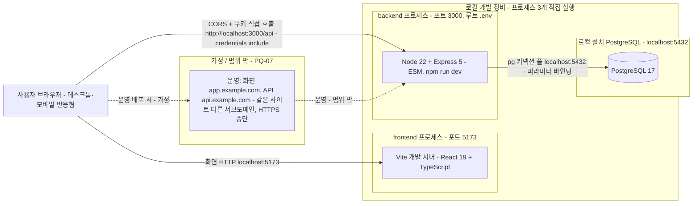

| 항목 | 근거 ID |
|------|---------|
| 로컬 프로세스 3개 직접 실행(PostgreSQL 17 `localhost:5432`, 백엔드 3000, Vite 5173), 실행 순서는 DB 먼저(기동 순서 보장 장치 없음), 백엔드는 루트 `.env`를 읽음. 출처: 사용자 결정(2026-11-04): Docker 미사용 | PRD 6장 개발 환경, SO-08 |
| Node 22, Express 5, ESM, `/api` 접두사 | PQ-05 |
| PostgreSQL 17, pg 직접 사용(Prisma 금지) | PRD 6장, NFR-08 |
| 브라우저가 화면(5173)과 API(3000)를 각각 호출한다: 프록시 없이 CORS + 쿠키(`credentials: 'include'`). 사용자 결정(2026-11-05) | PRD 6장, NFR-07, SO-08 |
| 개발·빌드 서버 구성(운영 배포 구성은 범위 밖) | SO-09 |
| 운영 배포(리버스 프록시, HTTPS, 클라이언트 IP)는 이 문서 범위 밖 | PQ-07, NFR-09, PRD 11장, OI-12 |
| 기동 확인용 헬스 체크(`/api/health`, 수동 `curl`) | SO-14, AQ-06 |
| 로컬 개발 클라이언트 IP: 앞단 프록시가 없으므로 `trust proxy`는 설정값(`TRUST_PROXY`)을 비워 불신 | SO-16, NFR-10, AQ-05 |

**가정**
- 점선 노드(운영)는 PQ-07의 변경된 결정(같은 사이트 서브도메인 + CORS)을 옮긴 것이다. 구성은 별도 배포 문서에서 정한다.
- 브라우저는 DB에 직접 접근하지 않는다. 화면(`http://localhost:5173`)과 API(`http://localhost:3000/api`)만 호출한다(SO-08).

### 2.2 백엔드 미들웨어 순서 (AD-02)

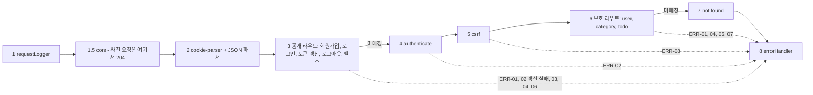

| 항목 | 근거 ID |
|------|---------|
| 미들웨어 순서 고정, 인증을 CSRF보다 먼저 검사 | DL-05, PRD 11장(검사 순서, 위임 결정(2026-11-04)) |
| 인증 없이 열린 라우트는 회원가입·로그인·로그아웃과 토큰 갱신(액세스 토큰 대신 리프레시 쿠키로 확인)뿐(헬스는 운영 보조) | BR-01, BR-16, SO-14 |
| 회원가입·로그인·토큰 갱신·로그아웃은 CSRF 대상 아님 | NFR-15 |
| 토큰 갱신은 만료된 액세스 토큰을 가진 사용자가 부르므로 `authenticate` 앞의 공개 그룹에 둠 | DL-05, NFR-07 |
| `authenticate`는 JWT 검증(HS384만 허용)만, `req.user = { id }`만 채움 | DL-06, SO-17, NFR-07 |
| 오류 응답은 `errorHandler` 한 곳, 내부 정보 미노출 | SO-07, ERR-07, NFR-11 |
| 요청 로그 항목과 금지 값 | SO-06 |
| `cors`는 로거 다음·파서와 인증·CSRF 앞(허용 출처에만 CORS 헤더, 사전 요청은 인증·CSRF 전에 종료) | SO-08 |

**가정**
- 안전한 메서드(GET)는 `csrf`가 검사하지 않는다. NFR-15가 상태 변경 API(POST·PUT·PATCH·DELETE)만 대상으로 정했기 때문이다.
- `/api`에 매칭되지 않는 경로는 `not found`가 ERR-05 형식으로 응답한다.

### 2.3 백엔드 레이어와 lib 위치 (AD-03)

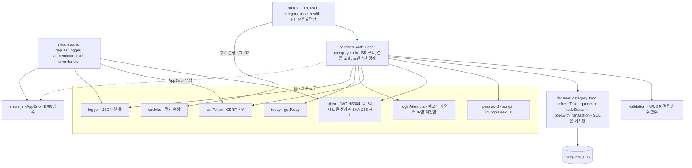

호출 방향은 `routes → services → db(queries)` 한 방향이다. 예외는 routes가 쿠키 설정을 위해 `lib/cookies.js` 하나만 import하는 것이다(DL-01, DL-02). 미들웨어는 별도 줄기이며 service·db를 호출하지 않는다.

| 항목 | 근거 ID |
|------|---------|
| 단방향 레이어, 모듈별 import 허용·금지, ESLint 기계 검증. routes의 `lib/` import는 `cookies.js`만 허용 | DL-01, 2.1장 의존 표, AQ-01 |
| routes는 HTTP 입출력만 / services는 BR·검증·트랜잭션, `express` 미사용 | DL-02, DL-03 |
| SQL은 `src/db/`에만, `userId` 조건 필수, 트랜잭션은 service의 `withTransaction`만 | DL-04, DL-07, DL-08 |
| 상태 판정 SQL 조각과 `getToday`는 서버 한 곳 | DL-09, PR-06 |
| 쿠키 속성·JWT·CSRF 토큰·서명 비교 코드 위치. 쿠키 발급·삭제는 routes가 `lib/cookies.js`로, service는 토큰 문자열만 반환 | SO-12, PQ-12, DL-02 |
| 리프레시 토큰: 무작위 값·해시는 `lib/token.js`(순수), 행 저장·잠금·폐기는 `db/refreshToken.queries.js`, 갱신 트랜잭션은 `auth.service`. 별도 session service 없음 | SO-17, DL-08, PQ-13, ER-08 |
| 로그인 실패 카운터: 메모리로 시작, `// LIMIT:` 주석, 만료 항목 정리·키 수 상한, 저장 위치는 PRD 11장 | NFR-10, PQ-10, CN-10, AQ-10 |
| scrypt는 비동기 API, 파라미터·저장 포맷은 PRD 11장 | NFR-06 |
| 날짜 관련 lib: 백엔드는 `lib/today.js`, 프런트는 `lib/date.ts` | CN-06, DL-09 |

**가정**
- 리프레시 토큰 행은 `auth.service`가 `refreshToken.queries`로 저장하고, 세션 토큰 묶음 발급은 DB를 모르는 `lib/token.js` 순수 함수가 한다(PQ-13). 그림에서는 `SV --> DQ` 선에 포함된다.
- 클라이언트 IP는 routes가 요청에서 꺼내 service에 인자로 넘기고, service가 `loginAttempts`를 호출한다(PRD 7장 매핑의 `auth.service`, `lib/loginAttempts`). IP 취득과 프록시 신뢰 범위는 SO-16과 PRD 11장 참조(AQ-05).
- 쿠키 설정은 routes가 service가 돌려준 토큰으로 `lib/cookies.js`를 호출해 한다(DL-02, AQ-01). 이 한 줄이 DL-01 표의 유일한 routes → `lib/` 허용이다.

### 2.4 프런트엔드 구조 (AD-04)

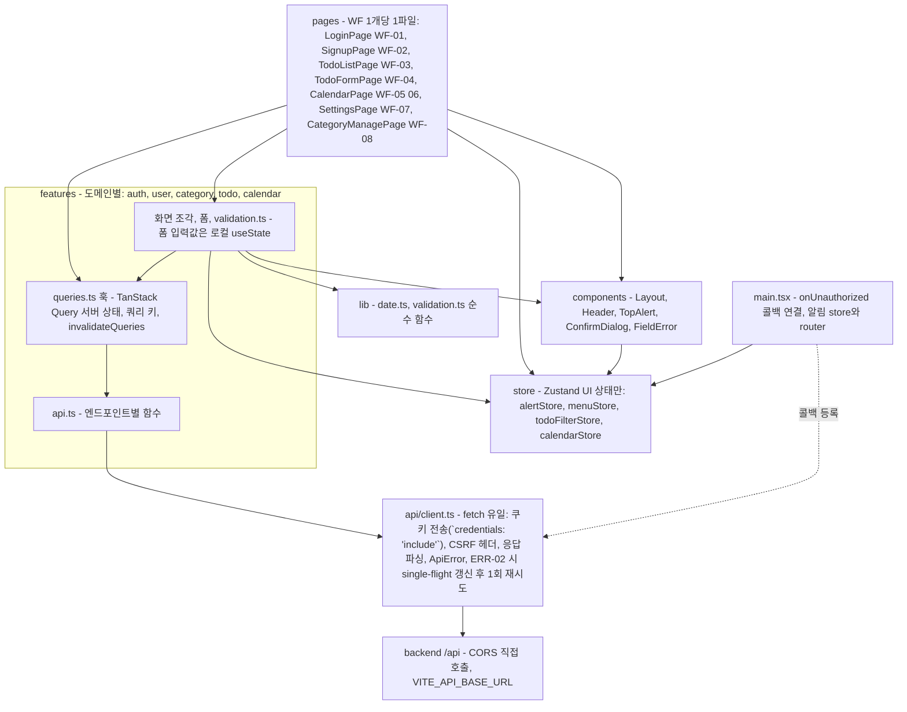

| 항목 | 근거 ID |
|------|---------|
| 의존 방향 `pages → features → (api, components, lib)`, `store`는 UI 상태 전용, ESLint 검증 | DL-11, 2.2장 의존 표 |
| 서버 상태는 TanStack Query에만, Zustand에 복사 금지, 변경 뒤 `invalidateQueries` | DL-12, PRD 6장 |
| Zustand는 알림·모바일 메뉴·목록 필터·캘린더 위치만 | DL-13, PQ-04 |
| `fetch`는 `client.ts` 한 곳, CSRF 헤더·ERR-02 처리(토큰 갱신 한 번, 동시 요청은 하나의 갱신 공유, 원 요청 1회 재시도). `api/`는 store를 import하지 않고 `onUnauthorized` 콜백만 노출, `main.tsx`가 연결 | DL-14, NFR-07, NFR-15, SC-03, SC-16, AQ-02 |
| `pages/`는 조립만, WF 1:1 | DL-15, WF-01~WF-08, 6.4장 화면·도메인 매핑 |
| 상태는 서버 `status`만 표시, 프런트 오늘 계산은 표시 전용 | PR-06, PQ-02, CN-09 |
| 날짜는 `YYYY-MM-DD` 문자열, 시각 표시는 `lib/date.ts` 한 곳 | CN-06, CN-07 |
| 서버 검증이 최종 판정, 서버 `fields`를 같은 입력란 아래에 표시 | PR-05, CN-08, ERR-01 |

**가정**
- 점선은 `api/`가 `store/`를 import하지 못하는 표와 DL-14의 ERR-02 처리(로그인 화면 이동·만료 안내) 사이의 충돌을 풀기 위한 콜백 연결이며 `main.tsx`가 맡는다(DL-14, AQ-02).
- 갱신 요청과 다시 보낸 요청이 ERR-02여도 다시 갱신하지 않고 `onUnauthorized`를 호출한다(AD-08, AD-14).
- 프런트는 서버의 사용자 정보(timezone 등)를 `features/user`의 쿼리로 얻는다. 경로는 설계서에서 정하고 '현재 사용자 조회' 항목은 PRD 11장에 있다(AQ-03).

### 2.5 데이터 모델 관계 (AD-05)

데이터 모델(ERD)은 [7-erd.md](./7-erd.md)로 이관했다. AD-05 번호는 재사용하지 않는다.

## 3. 시퀀스 다이어그램

공통 표기: 오류는 ERR ID로 쓰고, 오류가 나면 `errorHandler`가 PRD 4.3 형식으로 응답한다(SO-07, PR-08). 인증·CSRF 미들웨어는 3.3의 공통 흐름을 따르며 다른 다이어그램에서는 `MW`로 줄여 쓴다. HTTP 메서드는 일반 이름만 쓰고 경로는 설계서에서 정한다.

### 3.1 회원가입 (AD-06)

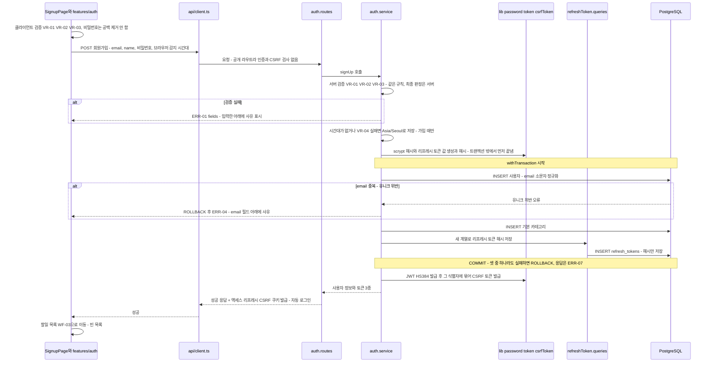

| 단계 | 근거 ID |
|------|---------|
| 프런트·백엔드 동일 검증, 서버가 최종 판정, 공백 비제거 | PRD 4.1, VR-01~03, PR-05, ERR-01, NFR-06 |
| 시간대 자동 감지와 `Asia/Seoul` 대체(가입 시에만) | PRD 4.2, VR-04, OI-10, PQ-06 |
| scrypt 해시는 트랜잭션 밖, 비동기 | DL-08, NFR-06, R-04 |
| User + 기본 카테고리 한 트랜잭션 | BR-03, DL-08, AC-01, UC-01 |
| email 소문자 정규화·대소문자 무시 중복 → ERR-04 (pg 오류를 service가 번역) | VR-01, ERR-04, SO-07 |
| 가입 직후 자동 로그인: 액세스·리프레시 쿠키 + CSRF 쿠키 발급, 가입은 CSRF 대상 아님 | NFR-07, NFR-15, SC-01, 위임 결정(2026-11-04), 사용자 결정(2026-11-04) |
| 리프레시 토큰 행 저장은 가입 트랜잭션 안(User + 기본 카테고리 + 리프레시 해시), 원문은 저장 안 함 | BR-03, DL-08, SO-17, ER-08, AQ-12 |
| 이후 화면은 할일 목록 | SC-01 6, WF-02, WF-03 |
| 쿠키 이름·속성, JWT·CSRF 토큰 구조. 쿠키 발급은 routes | SO-12, PRD 11장, DL-02 |
| 가입 요청 횟수 제한 없음(수용) | R-11, AQ-09 |

**가정**
- 시간대 대체와 email 정규화는 service(또는 service가 호출하는 validation)에서 한다. 문서가 위치를 정하지 않았다.
- 성공 응답은 사용자 정보를 담는다(PRD 11장 현재 사용자 조회, AQ-03). 쿠키는 routes가 `lib/cookies.js`로 설정한다(DL-02, AQ-01).
- 회원가입 요청 횟수 제한은 없다(NFR-10은 로그인만 대상). 해시를 먼저 계산하므로 중복 email 요청도 CPU를 쓰며 MVP에서는 수용한다(R-11, AQ-09).

### 3.2 로그인 (AD-07)

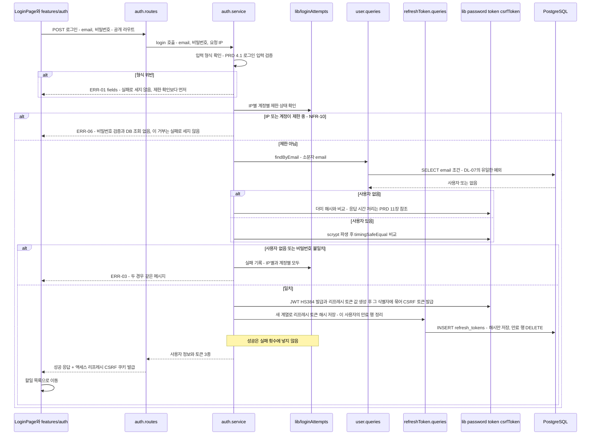

| 단계 | 근거 ID |
|------|---------|
| IP별·계정별 실패 카운터, 제한에 걸린 동안 비밀번호 미검증, 거부·성공은 카운트 안 함, 시간 창이 지나면 해제 | NFR-10, AC-15, SC-02, PRD 11장(카운터 세부), R-09 |
| ERR-06 표시는 상단 알림, 남은 시간 미표시 | ERR-06, WF-01 |
| 없는 email과 틀린 비밀번호는 같은 ERR-03, 응답 시간 은폐 방법은 11장 | ERR-03, AC-14, SO-07, PRD 11장 |
| scrypt 비동기 + `timingSafeEqual` | NFR-06, SO-12 |
| email 조회는 `userId` 조건 규칙의 유일한 예외 | DL-07 |
| 로그인 성공 시 액세스·리프레시 쿠키 + CSRF 쿠키, 로그인은 CSRF 대상 아님 | NFR-07, NFR-15 |
| 로그인마다 새 리프레시 계열(family)과 해시 행 1건 저장(NFR-16 측정에 포함), 만료 행 정리는 로그인 때 그 사용자의 행만(확정, OI-21) | NFR-16, OI-21, ER-08, SO-17 |
| 로그인 성공 뒤 이동 위치는 할일 목록 | SC-03 4, WF-01 |
| 로그인 입력 검증: 필수·email 형식·비밀번호 128자 초과만 ERR-01(실패로 세지 않음), 15자 미만은 ERR-03 경로 | PRD 4.1, ERR-01, AQ-04 |
| 카운터 저장 위치: 메모리로 시작, 만료 항목 정리·키 수 상한 | PQ-10, CN-10, AQ-10 |

**가정**
- 제한 확인을 DB 조회보다 먼저 한다. 제한 중에는 비밀번호는 물론 사용자 조회도 하지 않는다.
- 계정 카운터의 키는 소문자로 정규화한 email이고, 존재하지 않는 email도 같은 방식으로 센다(존재 여부를 드러내지 않기 위함, AC-14).
- 성공한 로그인이 기존 실패 횟수를 초기화하는지는 NFR-10이 정하지 않았다. 여기서는 초기화하지 않는 것으로 그렸다.
- 제한 여부는 IP와 계정 중 하나라도 걸리면 거부하는 것으로 본다(NFR-10 문구 기준).
- 비밀번호 변경의 현재 비밀번호 불일치는 이 카운터에 넣지 않는다(PRD 4.4, AC-21). 이 다이어그램 범위 밖이라 그리지 않았다.
- 로그인 때 그 사용자의 만료 리프레시 행을 정리한다(확정, 위임 결정(2026-11-04), PRD OI-21). 주기 정리는 하지 않는다.

### 3.3 보호된 상태 변경 요청 공통 흐름 (AD-08)

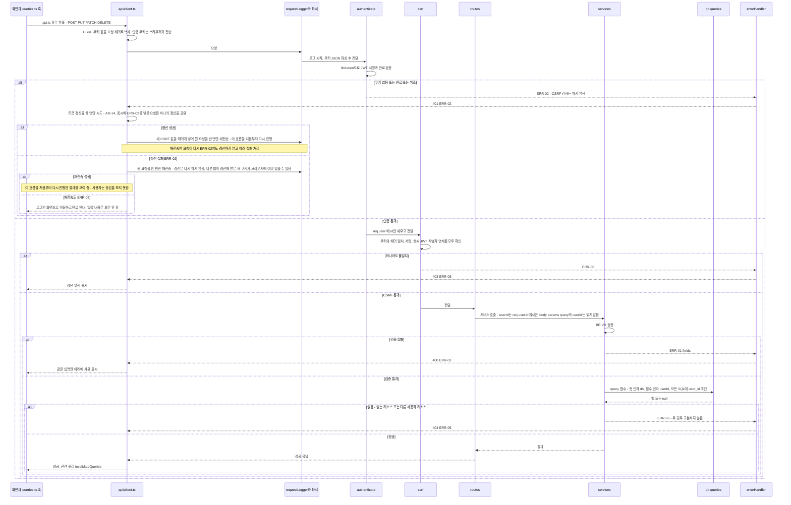

| 단계 | 근거 ID |
|------|---------|
| 인증(ERR-02)을 CSRF(ERR-08)보다 먼저 검사 | DL-05, PRD 11장(검사 순서, 위임 결정(2026-11-04)), NFR-15 |
| JWT 검증만 하고 `req.user = { id }`, HS384만 허용 | DL-06, SO-17, NFR-07 |
| 액세스 토큰 만료의 ERR-02는 갱신 한 번 → 성공하면 원 요청 1회 재전송(사용자는 끊김을 보지 못함), 실패해도 원 요청을 1회 재전송(다른 탭이 받은 새 쿠키 대비)하고 그래도 ERR-02면 로그인 화면 이동 + 만료 안내(입력 보존 안 함) | SC-03, SC-16, WF-01, DL-14, AC-22, AC-23, BR-16, OI-20 |
| Signed Double-Submit: 쿠키·헤더 일치, 서명, JWT 식별자 연계, 실패 시 ERR-08 | NFR-15, SO-12, SC-15 1b |
| 클라이언트의 CSRF 헤더 처리는 `client.ts` 한 곳 | DL-14 |
| `userId`는 `req.user.id`에서만, 쿼리마다 `user_id` 조건, 결과 없으면 service가 ERR-05 | DL-07, BR-02, NFR-09, ERR-05, SC-15, KPI-04 |
| 서버 ERR-01 `fields`를 같은 입력란 아래에 표시 | PR-05, BR-15, ERR-01, CN-08 |
| 뮤테이션 성공 뒤 관련 쿼리 무효화 | DL-12 |
| 예상 못한 예외(미표시)는 `errorHandler`가 ERR-07로 바꾸고 서버 로그에만 상세 기록 | SO-07, NFR-11, ERR-07 |

**가정**
- GET 같은 읽기 요청은 같은 `authenticate`를 거치지만 `csrf`는 건너뛴다(2.2장 가정).
- 오류는 service가 던지고 Express가 `errorHandler`로 넘기는 것을 `-->>EH`로 그렸다(Express 5의 비동기 오류 전달, PQ-05).
- 입력을 보존하지 않는 동작은 SC-03 1a를 따른다. 갱신에 성공하면 요청이 그대로 다시 나가므로 입력은 보존된다(SC-16).
- 갱신이 실패했을 때의 원 요청 1회 재전송과 갱신 성공 뒤 재전송은 확정이다(위임 결정(2026-11-04), PRD NFR-07, AQ-13).
- 재전송은 원 요청이 상태 변경이어도 한 번 한다. 첫 요청은 ERR-02로 거부돼 저장되지 않았으므로 중복 저장이 생기지 않는다(AD-02의 인증 먼저 검사 순서).

### 3.4 할일 목록·상태 필터 조회 (AD-09)

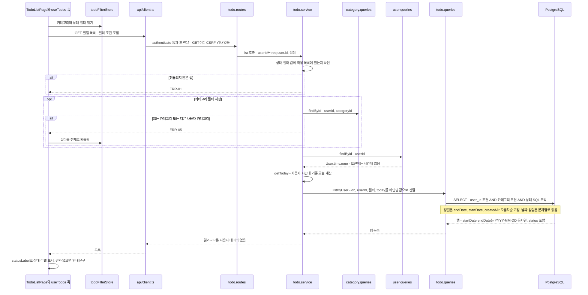

| 단계 | 근거 ID |
|------|---------|
| 카테고리 1개 × 상태 1개 AND 필터, 미지정은 전체 | FR-05, BR-11, UC-06, SC-09 |
| 오늘은 사용자 시간대 기준으로 서버 한 곳에서 계산 | PR-06, DL-09, OI-02, PRD 4.2, R-05 |
| 시간대는 토큰에 넣지 않고 service가 DB에서 읽음 | DL-06 |
| 상태는 저장하지 않고 SQL 조건으로 계산(판정 순서는 도메인 4장), 같은 SQL 조각을 `status` 컬럼과 필터가 공유 | 도메인 4장, PRD 6장, DL-09, AC-07, AC-08 |
| `today`는 바인딩 값, 쿼리 함수는 시계를 읽지 않음, 정렬은 허용 목록 상수 | DL-09, DL-10, NFR-08 |
| 고정 정렬 | BR-11 |
| 소유권: 모든 쿼리 `user_id` 조건, 다른 사용자 카테고리 필터는 ERR-05 | BR-02, DL-07, ERR-05, AC-09, SC-15 |
| 조회는 `userId`로 시작하는 인덱스 | NFR-05 |
| 날짜는 문자열 그대로(DB type parser, 변환 없음) | PR-07, CN-06, PRD 6장 |
| 프런트는 서버 `status`를 표시만 하고 라벨은 한 곳에서 매핑 | PR-06, CN-09, WF-03 |
| 필터는 Zustand, 서버 데이터는 TanStack Query | DL-12, DL-13, PQ-04 |
| 페이지네이션 없음 | OI-15 |
| 카테고리 ERR-05 시 필터 해제, 빈 결과 안내 | WF-03, SC-09 3a·3b |

**가정**
- 허용되지 않은 상태 필터 값은 ERR-01로 거부한다(문서에 없는 입력 처리).
- 필터 조건의 쿼리 파라미터 이름과 상태 값 표기는 설계서에서 정한다(CN-09).

### 3.5 카테고리 삭제 (AD-10)

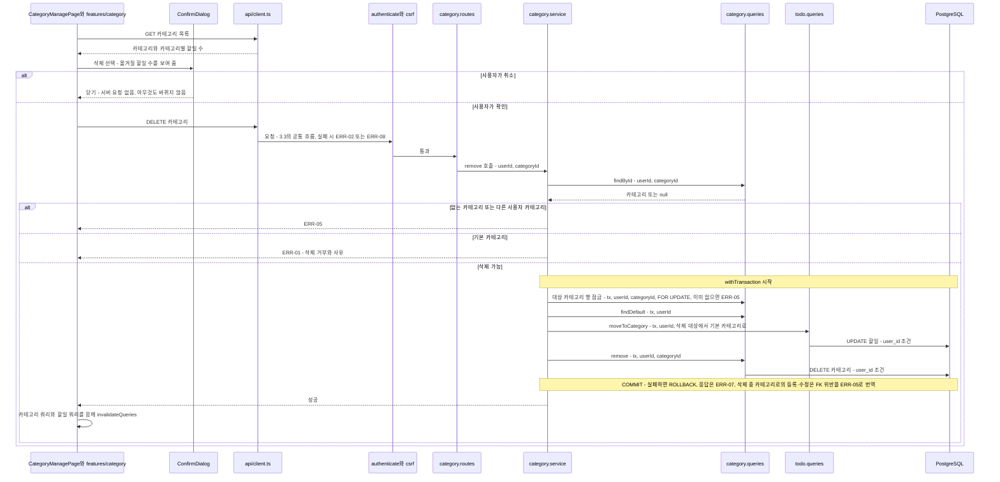

| 단계 | 근거 ID |
|------|---------|
| 삭제 확인 대화상자에 옮겨질 할일 수 표시, 취소하면 삭제 안 함 | BR-06, WF-08, SC-13 |
| 할일 수는 카테고리 목록 응답에 포함 | PRD 11장(위임 결정(2026-11-04)), WF-08 |
| 삭제하면 그 카테고리의 할일은 기본 카테고리로 이동(함께 삭제하지 않음) | BR-06, OI-04, AC-04 |
| 이동 + 삭제는 한 트랜잭션, 트랜잭션은 service에서만. 대상 행 `FOR UPDATE` 잠금, FK는 RESTRICT, FK 위반은 ERR-05로 번역 | DL-08, DL-03, SO-07, 7-erd.md 4장, AQ-08 |
| 기본 카테고리 삭제 거부는 ERR-01 | BR-05, AC-03, ERR-01 |
| 없는·타인 카테고리는 ERR-05, 모든 SQL에 `user_id` 조건 | BR-02, DL-07, ERR-05 |
| service가 다른 도메인의 `todo.queries`는 호출 가능, 다른 service는 불가 | DL-03, 6.4장 매핑 |
| 삭제 뒤 카테고리·할일 쿼리 함께 무효화 | DL-12 |

**가정**
- 존재·소유권 확인 → 기본 카테고리 확인 → 트랜잭션 순서로 그렸다(문서는 순서를 정하지 않음).
- 할일 이동은 `todo.queries`의 함수가 맡는다(6.4장 '삭제 시 `todo.queries` 호출').
- 확인 대화상자의 개수는 목록을 조회한 시점의 안내 값이다. 실제 이동 건수와 다를 수 있다(PRD 11장). FK 삭제 동작은 7-erd.md EQ-04, 동시성은 DL-08의 행 잠금으로 정했다(AQ-08).

### 3.6 캘린더 조회 (AD-11)

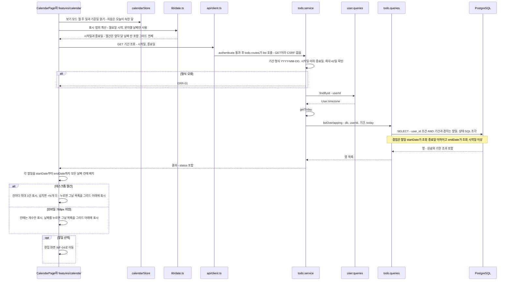

| 단계 | 근거 ID |
|------|---------|
| 월간(P0)·주간·일간(P1), 월요일 시작(주간·월간 모두) | FR-08, OI-06, AC-18, WF-05, WF-06 |
| startDate~endDate 모든 날짜에 표시, 완료·기한 초과도 표시 | BR-12, AC-12, SC-10 |
| 날짜 계산은 `lib/date.ts`에서 UTC 기준·문자열로만 | CN-06, PR-07, PRD 4.2 |
| 기간 조회 계약: 시작·종료일 `YYYY-MM-DD`, 겹침 조건, `status` 포함, 그리드 전체 범위, 형식 오류·시작>종료·42일 초과는 ERR-01 | PRD 11장, AQ-07 |
| 기간 조건으로만 조회, `userId`로 시작하는 인덱스 | NFR-05, R-03, BR-02, DL-07 |
| 상태 라벨은 서버 `status` 표시, 오늘 계산·상태 판정은 서버 | PR-06, DL-09, BR-12 |
| 칸당 3건 + `+N개 더`, 모바일은 개수 표시·날짜 선택 시 그날 목록, 목록 위치는 그리드 아래 | NFR-12, WF-05 |
| 첫 화면은 오늘이 속한 달, 보기 모드·기준일은 Zustand | SC-10 1, DL-13, PQ-04 |
| 캘린더에서 직접 등록·드래그 없음 | OI-08, SC-10 6a |
| 별도 캘린더 도메인 없이 `todo.*` 사용 | 6.4장 화면·도메인 매핑 |

**가정**
- 기간 조회 계약(`status` 포함, 최대 42일, 형식 오류의 ERR-01)은 PRD 11장에서 정했고(AQ-07), 파라미터·응답 필드 이름은 설계서에서 정한다.
- 겹침 조건은 BR-12(시작일~종료일 모든 날짜 표시)에서 도출한 것이다.
- `+N개 더`와 개수 표시는 프런트 표시 규칙이며 서버는 모든 할일을 돌려준다(OI-15: 페이지네이션 없음).
- 캘린더 강조용 오늘은 프런트가 시간대 기준으로 표시 전용으로 계산한다(PQ-02).

### 3.7 시간대 변경과 상태 재판정 (AD-12)

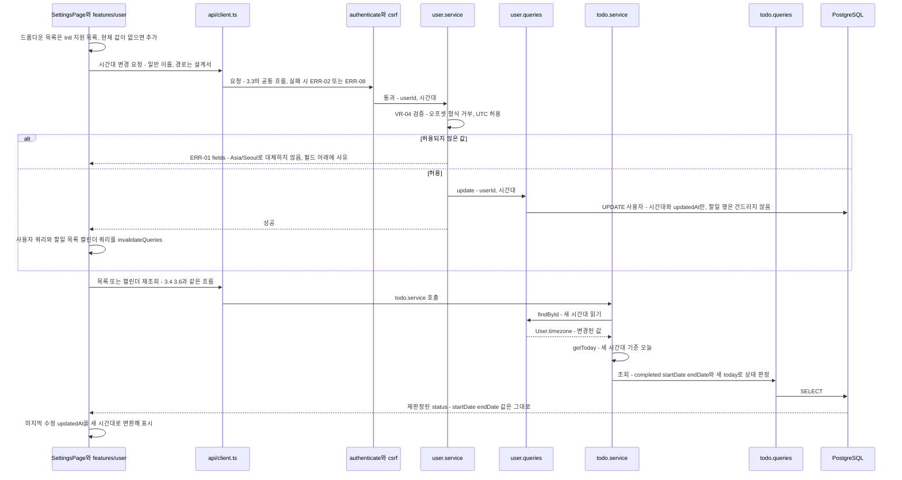

| 단계 | 근거 ID |
|------|---------|
| 설정 화면에서 시간대 변경(P0), 변경 뒤 오늘과 상태 판정이 새 시간대 기준 | FR-03, UC-03, PRD 4.2, AC-13, SC-12, WF-07 |
| VR-04 검증, 오프셋 거부·`UTC` 허용, 설정 화면은 대체하지 않고 ERR-01 | VR-04, PRD 4.2, PQ-06, ERR-01 |
| 시간대는 토큰에 없고 요청마다 DB에서 읽으므로 바로 반영 | DL-06, DL-09 |
| 상태는 저장하지 않으므로 날짜 값은 안 바뀌고 판정만 달라짐 | 도메인 4장, OI-02, OI-05, PR-06 |
| 시각 표시 변환은 `lib/date.ts` 한 곳, 표시 위치는 '마지막 수정' 하나 | CN-07, PRD 4.2, WF-04, SC-12 5 |
| 변경 성공 뒤 사용자·할일(목록·캘린더) 쿼리 무효화 | DL-12, AQ-03 |
| 드롭다운 목록과 현재 값 보정 | 6.3장 말미, PQ-06 |
| 경계 테스트용 시간대 | TQ-03 |

**가정**
- 시간대 변경 성공 뒤 사용자·할일·캘린더 쿼리를 모두 무효화한다. 캐시된 `status`가 낡지 않게 하려는 규칙이며 DL-12에 있다(AQ-03).
- 현재 시간대 표시는 PRD 11장의 '현재 사용자 조회'를 쓴다(AQ-03).

### 3.8 로그아웃 (AD-13)

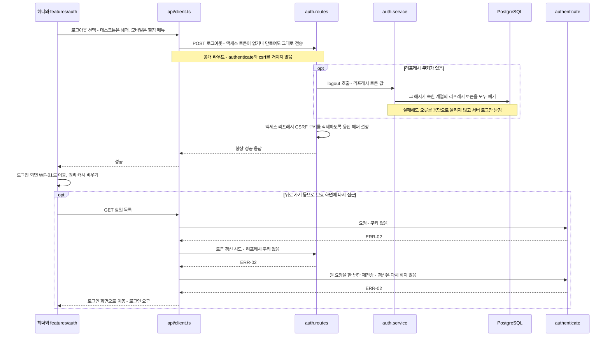

| 단계 | 근거 ID |
|------|---------|
| 인증 없이 항상 쿠키 삭제·성공, 토큰이 없거나 만료여도 동일 | BR-01, AC-16, SC-04 1a, 위임 결정(2026-11-04) |
| 로그아웃은 CSRF 대상 아님(강제 로그아웃 CSRF는 수용) | NFR-15 |
| 액세스·리프레시·CSRF 쿠키 모두 삭제, 리프레시 쿠키가 있으면 그 계열을 서버에서 폐기(실패해도 쿠키는 삭제·성공) | NFR-07, NFR-15, BR-01, BR-16, SC-04 2, AC-16 |
| 이후 접근은 ERR-02 → 갱신 실패 → 원 요청 1회 재전송도 ERR-02 → 로그인 요구 (DL-14, SC-03 2) | AC-16, AC-23, SC-03, WF-01 |
| 로그아웃 버튼 위치 | PRD 7장, WF-00 |
| 액세스 토큰은 서버 측 즉시 무효화 없음(최대 15분, 잔여 위험, 설계서에 명시할 항목), 리프레시 토큰은 즉시 폐기 | NFR-07, R-08 |

**가정**
- 로그아웃 뒤 클라이언트가 TanStack Query 캐시를 비운다. 문서에 없지만 다른 사용자가 같은 브라우저에서 이전 사용자의 캐시를 보지 않도록 하려는 가정이다.
- 쿠키 삭제는 routes가 `lib/cookies.js`로 한다(DL-02, AQ-01).
- 리프레시 계열 폐기는 쿠키 삭제와 독립이다. 폐기가 실패해도 쿠키는 삭제하고 성공으로 응답한다(BR-01).

### 3.9 토큰 리프레시 (AD-14)

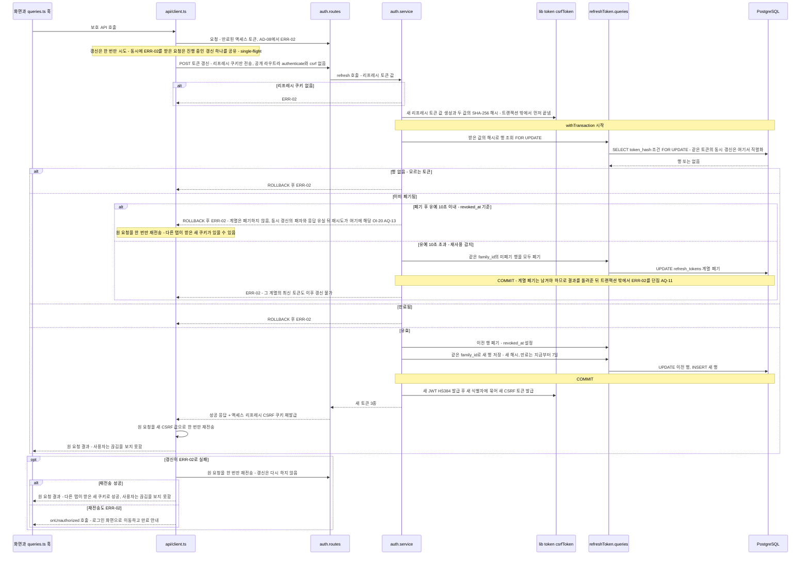

| 단계 | 근거 ID |
|------|---------|
| 토큰 갱신은 공개 라우트, 액세스 토큰 없이 리프레시 쿠키로 호출, CSRF 검사 제외 | NFR-07, NFR-15, DL-05, BR-16 |
| 해시 계산(새 값 생성 포함)은 트랜잭션 밖, 해시로만 조회, DB에는 원문이 없음 | DL-08, SO-17, ER-08, EQ-11 |
| 행 잠금(`FOR UPDATE`)으로 같은 토큰의 동시 갱신을 직렬화 | NFR-07, DL-08 |
| 회전: 이전 행 폐기 + 같은 계열의 새 행 저장(만료 7일 슬라이딩), 한 트랜잭션 | BR-16, OI-18, ER-08, AC-22 |
| 폐기 후 유예 10초(설정값) 이내의 폐기된 토큰은 계열 폐기 없이 거부만(`revoked_at`만 사용, 스키마 변경 없음). 유예를 넘긴 폐기된 토큰이 오면 재사용 감지로 계열 전체 폐기 후 ERR-02 | BR-16, AC-24, OI-20, SO-17, ER-09, EQ-10 |
| 없음·만료·폐기·재사용은 모두 ERR-02 | PRD 4.3 ERR-02, AC-23 |
| 성공 시 새 액세스·리프레시·CSRF 쿠키 재발급, 새 CSRF는 새 JWT 식별자에 연계 | NFR-07, NFR-15, SO-12 |
| 프런트 single-flight와 원 요청 1회 재전송, 갱신이 실패해도 원 요청 1회 재전송 후 ERR-02면 `onUnauthorized` | DL-14, SC-16, PQ-14, R-14 |
| 갱신 요청은 로그인 실패 제한(NFR-10)과 무관 | NFR-10, NFR-07 |

**가정**
- 재사용 감지의 계열 폐기는 커밋해야 하므로 `withTransaction`이 예외로 ROLLBACK하는 점을 피해, 트랜잭션 함수가 결과 코드를 돌려주고 밖에서 `AppError`를 던진다(AQ-11, 확정, 위임 결정(2026-11-04)).
- 같은 토큰으로 동시에 온 요청 중 락을 늦게 잡은 요청은 '이미 폐기됨'을 보지만 폐기 후 10초 이내(유예)라 재사용으로 보지 않고 계열을 유지한 채 ERR-02로 거부만 한다. 먼저 성공한 요청의 새 토큰은 유효하다(OI-20, R-14, PQ-14, AQ-13, 확정, 위임 결정(2026-11-04)). 판단은 `revoked_at`만 쓴다. 로그아웃·비밀번호 변경·재사용 감지로 계열이 이미 폐기된 토큰은 유예 안이든 밖이든 거부되므로 구분하지 않는다.
- 갱신 실패 응답에서 리프레시 쿠키는 지우지 않는다(확정, 위임 결정(2026-11-04)). 남아 있어도 다음 갱신이 같은 이유로 실패하고 다음 로그인이 덮어쓴다.
- 만료 행 정리는 로그인 때 그 사용자의 행만 지우므로 이 다이어그램에 그리지 않고 AD-07에 둔다(PRD OI-21, 확정).

## 4. 추적 표와 확인 필요 사항

### 4.1 다이어그램 ↔ 문서 ID 추적 표

| AD | 다이어그램 | 도메인 정의서 (BR/UC/AC/OI) | PRD (FR/NFR/ERR/VR) | 시나리오·와이어프레임 | 구조 원칙 (PR/DL/CN/SO/PQ) |
|----|------------|------------------------------|---------------------|-----------------------|----------------------------|
| AD-01 | 컨텍스트·배포 | — | NFR-07, NFR-08, NFR-09, NFR-10, PRD 6장, OI-12 | — | SO-08, SO-09, SO-14, SO-16, PQ-05, PQ-07 |
| AD-02 | 미들웨어 순서 | BR-01, BR-16 | NFR-07, NFR-15, ERR-02, ERR-08, PRD 11장 | SC-03, SC-16 | DL-05, DL-06, SO-06, SO-07, SO-17 |
| AD-03 | 백엔드 레이어·lib | BR-02, BR-16 | NFR-06, NFR-07, NFR-10, NFR-15 | — | DL-01~DL-04, DL-07~DL-10, SO-12, SO-16, SO-17, PQ-10, PQ-12, PQ-13 |
| AD-04 | 프런트 구조 | — | NFR-07, NFR-15 | WF-01~WF-08, SC-03, SC-16 | DL-11~DL-15, PR-06, PQ-02, PQ-04, PQ-14, CN-06, CN-07 |
| AD-05 | 7-erd.md로 이관 (추적은 [7-erd.md](./7-erd.md) 5장) | — | — | — | — |
| AD-06 | 회원가입 | UC-01, AC-01, BR-03 | FR-01, VR-01~04, NFR-06, NFR-07, NFR-15, ERR-01, ERR-04, OI-10, R-11, PRD 11장 | SC-01, WF-02 | DL-02, DL-08, PR-05, PQ-06, SO-17 |
| AD-07 | 로그인 | UC-02, AC-14, AC-15, BR-01, BR-16 | FR-01, PRD 4.1, NFR-06, NFR-07, NFR-10, NFR-15, NFR-16, ERR-01, ERR-03, ERR-06 | SC-02, SC-03, WF-01 | DL-02, DL-07, SO-07, SO-12, SO-16, SO-17, PQ-10 |
| AD-08 | 보호된 요청 공통 | BR-01, BR-02, BR-15, BR-16, AC-02, AC-09, AC-22, AC-23 | NFR-07, NFR-09, NFR-15, ERR-01, ERR-02, ERR-05, ERR-07, ERR-08 | SC-03, SC-15, SC-16 | DL-05~DL-07, DL-12, DL-14, PR-05, SO-07 |
| AD-09 | 목록·필터 | UC-06, AC-07, AC-08, AC-09, BR-02, BR-11, 4장 | FR-05, NFR-05, OI-15 | SC-09, WF-03 | PR-06, DL-09, DL-10, CN-09 |
| AD-10 | 카테고리 삭제 | UC-04, AC-03, AC-04, BR-05, BR-06, OI-04 | FR-02, ERR-01, ERR-05, PRD 11장 | SC-13, WF-08 | DL-03, DL-08, DL-12, SO-07 |
| AD-11 | 캘린더 | UC-09, AC-12, AC-18, BR-12, OI-06, OI-08 | FR-08, NFR-05, NFR-12, ERR-01, PRD 11장 | SC-10, SC-11, WF-05, WF-06 | CN-06, DL-13, PR-06 |
| AD-12 | 시간대 변경 | UC-03, AC-13, OI-02, OI-03 | FR-03, VR-04, ERR-01 | SC-12, WF-07 | DL-06, DL-09, DL-12, CN-07, PQ-06, TQ-03 |
| AD-13 | 로그아웃 | UC-02, AC-16, BR-01, BR-16 | NFR-07, NFR-15, ERR-02, R-08 | SC-04, WF-00 | DL-02, SO-12, SO-17 |
| AD-14 | 토큰 리프레시 | UC-02, AC-22, AC-23, AC-24, BR-16 | FR-01, NFR-07, NFR-15, ERR-02, R-12, R-13, R-14, OI-18~OI-21 | SC-03, SC-16, WF-01 | DL-05, DL-08, DL-14, SO-12, SO-17, PQ-13, PQ-14 |

### 4.2 새로 둔 가정 요약

| 위치 | 가정 |
|------|------|
| AD-01 | 로컬 프로세스 3개 직접 실행(사용자 결정(2026-11-04): Docker 미사용), 화면↔API는 프록시 없이 CORS(사용자 결정(2026-11-05)), 운영은 같은 사이트 서브도메인 점선 표시(PQ-07 변경안)이며 구성은 범위 밖 |
| AD-02 | GET은 `csrf` 검사 제외, 매칭되지 않는 경로는 ERR-05 형식, 토큰 갱신은 공개 라우트(사용자 결정(2026-11-04)의 후속, 위임 결정(2026-11-04)으로 확정) |
| AD-03 | 클라이언트 IP는 routes가 service에 인자로 전달 (쿠키 설정 주체는 AQ-01로 확정, 가정 아님), 세션 토큰 묶음 발급은 `lib/token.js` 순수 함수 (PQ-13) |
| AD-04 | 새 가정 없음 (사용자 정보 조회와 `onUnauthorized` 콜백은 AQ-03·AQ-02로 확정) |
| AD-06 | 시간대 대체와 email 정규화는 service 쪽 (가입 요청 횟수 제한 없음은 R-11로 수용 확정), 리프레시 행 저장은 가입 트랜잭션 안 (AQ-12로 확정) |
| AD-07 | 제한 확인을 DB 조회보다 먼저, 계정 키는 정규화한 email(없는 email도 집계), 성공이 실패 횟수를 초기화하지 않음, 로그인 때 만료 리프레시 행 정리 (OI-21로 확정) |
| AD-08 | 오류는 service가 던져 `errorHandler`로 전달, 갱신 성공·실패 뒤 원 요청은 한 번만 재전송 (재전송은 AQ-13으로 확정) |
| AD-09 | 허용되지 않은 상태 필터 값은 ERR-01 |
| AD-10 | 존재·소유권 → 기본 카테고리 → 트랜잭션 순서, 이동은 `todo.queries` |
| AD-11 | 겹침 조건은 BR-12에서 도출 (기간 조회 계약은 AQ-07로 확정) |
| AD-12 | 새 가정 없음 (시간대 변경 뒤 쿼리 무효화는 DL-12로 확정, AQ-03) |
| AD-13 | 로그아웃 뒤 쿼리 캐시 비우기 |
| AD-14 | 새 가정 없음 (재사용 감지의 계열 폐기는 커밋한 뒤 ERR-02는 AQ-11, 폐기 후 10초 이내의 재제출은 거부만은 OI-20·AQ-13, 갱신 실패 시 리프레시 쿠키 삭제 안 함과 정리는 그리지 않음은 위임 결정(2026-11-04)으로 확정) |

### 4.3 확인 필요 사항 (AQ)

문서 1~5를 다이어그램으로 옮기다 발견한 공백·모순이며 AQ-01~10은 위임 결정(2026-11-04)으로 확정했다. AQ-11·AQ-12는 사용자 결정(2026-11-04)(Refresh Token 적용)의 후속으로 생겼고, AQ-13과 함께 위임 결정(2026-11-04)으로 확정했다. 결정 원문은 근거 문서(결정 열 끝의 '반영')가 단일 출처이고 이 표는 결정을 한 줄로 요약해 가리키기만 한다. AQ-08은 [7-erd.md](./7-erd.md)의 EQ-04와 함께 정했다.

| # | 구분 | 원문 ID | 공백·모순 | 결정 | 영향 AD |
|---|------|---------|-----------|------|---------|
| AQ-01 | 확정 (위임 결정(2026-11-04)) | DL-01 표, DL-02, DL-03, SO-12 | 인증·CSRF 쿠키를 `Set-Cookie`로 발급·삭제하려면 `res`와 `lib/cookies.js`가 필요하다. 그런데 routes는 `lib/`를 import할 수 없고, services는 `res`를 모르며, middleware는 services를 호출할 수 없다. 쿠키를 설정하는 주체가 문서상 없다 | services는 토큰 문자열만 돌려주고 쿠키 발급·삭제는 routes가 `lib/cookies.js`로 한다. DL-01 표에 'routes는 `lib/cookies.js`만 import 가능'을 예외로 둔다 (반영: 5번 DL-01·DL-02, 2.1장 표, 6.2장 디렉토리) | AD-03, AD-06, AD-07, AD-13 |
| AQ-02 | 확정 (위임 결정(2026-11-04)) | DL-14, 2.2장 의존 표 | DL-14는 `api/client.ts`가 ERR-02 때 로그인 화면 이동과 만료 안내를 맡는다고 하지만, 같은 문서의 표는 `api/`가 `store/`를 import하지 못하게 한다(만료 안내는 `alertStore`가 자연스러움) | `client.ts`는 `onUnauthorized` 콜백 등록 함수만 노출하고 `main.tsx`가 `alertStore`와 router를 연결한다 (반영: 5번 DL-14, 6.3장 `main.tsx`) | AD-04, AD-08 |
| AQ-03 | 확정 (위임 결정(2026-11-04)) | PRD 4.2, 6장, PQ-02, CN-07, WF-07, DL-12 | 프런트는 인증 여부 판정(`RequireAuth`), 사용자 timezone(캘린더 오늘 강조·'마지막 수정' 변환·설정 현재 값), name·email을 서버에서 읽어야 하나, 현재 사용자 조회 경로와 가입·로그인 응답의 사용자 정보 포함 여부가 문서에 없다. 또 DL-12는 시간대 변경 뒤 할일·캘린더 쿼리 무효화를 명시하지 않았다 | PRD 11장에 '현재 사용자 조회'를 추가하고 `RequireAuth`·`features/user`가 쓴다. 가입·로그인 성공 응답도 사용자 정보를 담는다. DL-12에 '시간대 변경 성공 뒤 사용자·할일·캘린더 쿼리 무효화'를 추가한다 (반영: PRD 11장, 5번 DL-12) | AD-04, AD-06, AD-07, AD-12 |
| AQ-04 | 확정 (위임 결정(2026-11-04)) | PRD 4.1, VR-02, NFR-06, NFR-10, ERR-01, ERR-03 | 로그인 입력에 VR-02(15~128자)를 적용하는지 불명하다. 적용하면 15자 미만 비밀번호가 ERR-01이 되어 ERR-03과 응답이 갈린다. 적용하지 않으면 길이 상한 없는 입력이 scrypt에 들어간다 | 로그인은 필수 값, email 형식(254자), 비밀번호 128자 초과만 ERR-01로 거부하고 15자 미만은 검증 없이 ERR-03으로 처리한다. 이 ERR-01 거부는 실패 횟수에 넣지 않고 제한 확인보다 먼저 한다 (반영: PRD 4.1·4.3, SC-02 1a, WF-01) | AD-07 |
| AQ-05 | 확정 (위임 결정(2026-11-04), 개발 환경 부분은 사용자 결정(2026-11-04): Docker 미사용) | NFR-10, PRD 11장, SO-08, PQ-07 | NFR-10은 IP별 제한(PRD 11장은 운영 리버스 프록시 뒤 IP만 언급)인데, 로컬 개발에서는 브라우저 요청이 Vite 프록시를 거쳐 backend에 오므로 `req.ip`가 모두 프록시(루프백) 주소가 된다. IP 한도가 사용자 전체에 걸려 사실상 전역 잠금이 되고, AC-15 테스트 해석도 달라진다 | 개발 프록시가 `xfwd: true`로 클라이언트 IP(`X-Forwarded-For`)를 전달하게 하고 Express `trust proxy`를 `config.js`의 설정값(`TRUST_PROXY=loopback`)으로, 신뢰 범위를 로컬 루프백으로 한정한다 (반영: 5번 SO-16, PRD 11장 클라이언트 IP 항목). **변경 (사용자 결정(2026-11-05))**: 프록시가 없어져 브라우저가 백엔드를 직접 호출하므로 `req.ip`가 클라이언트 주소다. 개발은 `TRUST_PROXY`를 비우고(불신), 운영은 리버스 프록시 주소만 신뢰한다(SO-16) | AD-01, AD-03, AD-07 |
| AQ-06 | 확정 (위임 결정(2026-11-04), 헬스 용도는 사용자 결정(2026-11-04): Docker 미사용) | SO-14, PQ-05, DL-05 | SO-14는 `GET /health`라고 쓰면서 같은 항목에서 API 경로를 `/api` 접두사로 통일한다고 한다. 헬스 경로가 `/health`인지 `/api/health`인지 모순이다 | `/api/health` 하나로 통일하고 기동 확인용(수동 `curl`)과 DL-05의 공개 라우트가 같은 경로를 쓴다 (반영: 5번 SO-14, 6.2장 `health.routes.js`) | AD-01, AD-02 |
| AQ-07 | 확정 (위임 결정(2026-11-04)) | BR-12, PR-06, NFR-05, NFR-12, WF-05, OI-15 | 캘린더 기간 조회 계약이 없다. 기간 파라미터, 응답에 `status` 포함 여부(상태 시각 구분은 BR-12, 프런트는 서버 `status`만 표시는 PR-06이므로 포함해야 함), 기간 형식·최대 길이 검증, 월간 그리드의 앞뒤 달 날짜 포함 여부(WF-05는 10월 30·31일 칸을 보여 줌)가 비어 있다 | `YYYY-MM-DD` 시작·종료일과 겹침 조건으로 조회하고 `status`를 포함하며 앞뒤 달 날짜 칸까지 조회한다. 형식 오류, 시작일 > 종료일, 42일 초과 기간은 ERR-01이다 (반영: PRD 11장 캘린더 기간 조회 계약) | AD-11 |
| AQ-08 | 확정 (위임 결정(2026-11-04)) | BR-06, OI-04, DL-08, SO-10, SO-07 | 카테고리 삭제의 무결성 공백이다. (1) `todos`의 카테고리 FK 삭제 동작이 정해지지 않았다. CASCADE이면 BR-06이 지키려는 할일 보존이 깨질 수 있다. (2) 확인 대화상자의 개수는 조회 시점 값이라 실제 이동 건수와 다를 수 있다. (3) 삭제 트랜잭션 중 다른 요청이 삭제 대상 카테고리로 할일을 등록·수정하면 FK 오류가 ERR-07로 샐 수 있다 | (1) FK는 RESTRICT(복합 FK, EQ-04)로 두어 이동이 실패하면 삭제도 실패한다. (2) 개수는 안내용이다. (3) 삭제 트랜잭션은 대상 카테고리 행을 `FOR UPDATE`로 잠그고 FK 위반은 service가 ERR-05로 번역한다 (반영: [7-erd.md](./7-erd.md) 4장·EQ-04, 5번 DL-08·SO-07, PRD 11장) | AD-10 |
| AQ-09 | 확정 (위임 결정(2026-11-04)) | NFR-10, NFR-06, R-04, DL-08 | 회원가입(공개 라우트)은 검증이 통과하면 scrypt를 먼저 계산(DL-08)하는데 횟수 제한이 없다. 중복 email 요청도 해시 비용을 쓰므로 반복 호출로 libuv 스레드 풀을 포화시켜 로그인 응답(NFR-16)을 늦출 수 있다. NFR-10은 로그인만 대상이다 | MVP에서는 수용하고 PRD 9장에 리스크 R-11로 기록한다. NFR-10 범위는 로그인만 유지한다 (반영: PRD 9장 R-11) | AD-06 |
| AQ-10 | 확정 (위임 결정(2026-11-04)) | PQ-10, NFR-10, CN-10 | 메모리 카운터는 재시작 초기화와 다중화 공유만 한계로 적혀 있다. 임의의 email·IP 키가 시간 창이 지나도 남으면 메모리가 계속 늘 수 있다(키는 없는 email로도 만들 수 있음) | 시간 창이 지난 항목을 접근 시 지우고 시간 창 길이 간격으로 주기 정리한다. 보관 키 수 상한은 IP별·계정별 각 10,000개이고 초과 시 가장 오래된 항목부터 지운다. 한계는 `// LIMIT:` 주석으로 남긴다 (반영: 5번 PQ-10, PRD 11장) | AD-03, AD-07 |
| AQ-11 | 확정 (위임 결정(2026-11-04)) | DL-08, BR-16, AC-24 | 갱신 트랜잭션 안에서 재사용을 감지하고 `AppError`를 던지면 `withTransaction`이 ROLLBACK해 방금 한 계열 폐기가 사라진다. 재사용 감지가 아무 효과가 없게 된다 | 트랜잭션 함수가 결과 코드(성공·모름·만료·재사용)를 돌려주고, 커밋 뒤 service가 트랜잭션 밖에서 ERR-02를 던진다 (반영: 3.9 AD-14, 5번 DL-08) | AD-14 |
| AQ-12 | 확정 (위임 결정(2026-11-04)) | NFR-07, BR-03, DL-08, NFR-16 | 회원가입·로그인에서 리프레시 행 저장을 어느 트랜잭션에 넣을지 정해진 것이 없다. 가입 트랜잭션 밖에 두면 사용자만 있고 세션이 없는 실패가 생길 수 있고, 로그인은 쓰기가 1건 늘어 NFR-16에 영향을 준다 | 가입은 User + 기본 카테고리 + 리프레시 행을 한 트랜잭션으로 한다(토큰 값·해시 계산은 먼저). 로그인은 INSERT 1건과 만료 행 정리를 같은 호출에서 한다. 로그인 p95 측정에 이 쓰기를 포함한다 (반영: AD-06, AD-07, PRD NFR-16) | AD-06, AD-07 |
| AQ-13 | 확정 (위임 결정(2026-11-04)) | NFR-07, BR-16, OI-20, R-14, DL-14 | 행 잠금은 같은 토큰의 동시 갱신을 직렬화할 뿐이라 늦게 잠금을 잡은 요청이 '이미 폐기됨'으로 보여 재사용으로 판정되고, 먼저 성공한 새 토큰까지 계열째 폐기돼 정상 사용자가 재로그인한다 | 회전으로 폐기된 토큰이 폐기 후 10초 이내(`config.js` 설정값)에 오면 계열 폐기 없이 ERR-02로 거부만 하고, 10초를 넘기면 기존대로 재사용 감지 처리한다. 판단은 `revoked_at`만 쓴다(스키마 변경 없음). 프런트는 갱신이 실패하면 원 요청을 한 번만 재전송하고 그래도 ERR-02면 `onUnauthorized`다 (반영: PRD NFR-07·OI-20·R-14, 5번 DL-08·DL-14·SO-17·PQ-14, 도메인 BR-16·AC-24, 3번 SC-16, 이 문서 AD-08·AD-14) | AD-08, AD-14 |
