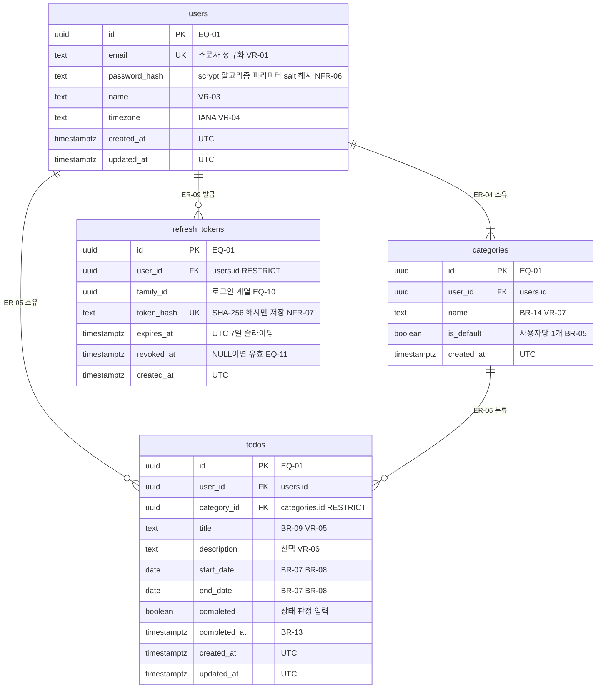

# TodoList ERD (데이터 모델)

## 문서 이력

| 버전 | 일자 | 작성자 | 변경 내용 |
|------|------|--------|-----------|
| 0.1 | 2026-11-04 | MinjeYu | 도메인 정의서 v0.7·PRD v0.6·구조 설계 원칙 v0.2·아키텍처 다이어그램 v0.1 기반 초안. 아키텍처 다이어그램 v0.1의 AD-05(데이터 모델 관계)를 이 문서로 분리 |
| 0.2 | 2026-11-04 | MinjeYu | 위임 결정(2026-11-04) 반영: EQ-01~09 확정(7장 열 이름 '추천'을 '결정'으로), 3·4장 구분과 6장 가정 요약 정리, 카테고리 FK를 복합 FK로 명시(EQ-04), 도메인 정의서 v0.8·PRD v0.7·구조 설계 원칙 v0.3·아키텍처 다이어그램 v0.3과 일치화 |
| 0.3 | 2026-11-04 | MinjeYu | 사용자 결정(2026-11-04: JWT HS384 + Refresh Token 적용) 반영, 도메인 정의서 v0.9·PRD v0.8·구조 설계 원칙 v0.4·아키텍처 다이어그램 v0.4와 일치화: `refresh_tokens` 엔티티(ER-08)와 `users` 1 : N 관계(ER-09) 추가, ER-07의 '로그인 토큰 저장 안 함'을 '액세스·CSRF 토큰은 저장하지 않고 리프레시 토큰은 해시만 저장'으로 수정(사용자 결정으로 대체), 인덱스 3개(4.1), 추적 표·가정 요약, EQ-10·EQ-11 추가. `schema.sql`에 같은 테이블 추가 |
| 0.4 | 2026-11-04 | MinjeYu | 위임 결정(2026-11-04) 반영(EQ-10·EQ-11 확정), 도메인 정의서 v0.10·PRD v0.9·구조 설계 원칙 v0.5·아키텍처 다이어그램 v0.5와 일치화: 3.5의 `refresh_tokens` 컬럼·제약 구분을 가정에서 확정으로 전환, 폐기 후 10초 유예 판단이 `revoked_at`만 쓰므로 컬럼·제약·인덱스 변경이 없음을 3.5에 명시(동시 갱신 오판 방지, PRD NFR-07·OI-20), 계열 폐기는 미폐기 행만 갱신해 회전 시각이 유지됨을 명시, 6장 가정 요약 정리. `schema.sql` 변경 없음. 범위에 `schema.sql`과의 관계 한 줄 추가(8-plan.md XQ-03) |
| 0.5 | 2026-11-04 | MinjeYu | 문서 간 일치화: 단일 출처 링크의 버전을 구조 설계 원칙 v0.6·아키텍처 다이어그램 v0.6에 맞춤 |
| 0.6 | 2026-11-05 | MinjeYu | PRD v0.13(VR-02 KISA 기준 변경)과 일치화: `users.password_hash` 설명의 VR-02 수치를 참조로 변경. 스키마 변경 없음 |

**표기 범례** (도메인 정의서·PRD·구조 설계 원칙·아키텍처 다이어그램과 같음)
- **확정**: 요구사항 원문 또는 사용자 의사결정(2026-11-04)에 근거한 결정
  - 사용자가 위임한 결정 포함: 사용자가 추천 방향으로 정하도록 맡긴 항목은 출처를 '위임 결정(2026-11-04)'으로 밝힌다
- **가정**: 원문에 없는 잠정 결정. 일단 이대로 그리고 이해관계자가 확인하면 확정한다
- **미결정**: 결정하기 전에는 구현을 보류한다
- 이 문서에서 원문에 없는 내용(타입 선택, 기본값, 제약 이름, 인덱스, FK 동작)은 모두 **가정**이다. 단 7장(`EQ-xx`)에서 위임 결정(2026-11-04)으로 확정한 항목은 구분 열에 '확정'으로 표시했다. 문서 사이의 공백·모순은 7장에 모은다

**단일 출처 원칙**: 엔티티·속성의 의미, 상태 판정, BR·UC·AC·OI는 [도메인 정의서 v0.10](./1-domain-definition.md), FR·NFR·ERR·VR은 [PRD v0.9](./2-prd.md), PR·DL·CN·SO·PQ·TQ(명명 규칙 CN-03, CN-04 포함)는 [구조 설계 원칙 v0.6](./5-project-principle.md), 다이어그램 AD·AQ는 [아키텍처 다이어그램 v0.6](./6-arch-diagram.md)에만 둔다. 이 문서는 그 규칙의 **저장 형태**(컬럼, 타입, NULL, 제약, 관계, 인덱스 후보)만 정하며 규칙 원문은 복사하지 않고 ID로 참조한다. 이 문서에서 새로 만든 ID는 `ER-xx`(엔티티·관계 항목)와 `EQ-xx`(확인 필요)뿐이다. 인증 토큰 방식(JWT HS384 + Refresh Token)은 사용자 결정(2026-11-04)이며 이 문서는 리프레시 토큰의 저장 형태(ER-08)만 정한다.

**범위**: 논리·개념 수준의 ERD다. `CREATE TABLE` 같은 DDL과 마이그레이션 SQL은 쓰지 않는다(SO-10: `backend/migrations/`에서 작성). 타입은 PostgreSQL 17 기준 개념 타입이며, 길이는 다이어그램이 아니라 표에 쓴다. 테이블·컬럼·제약 이름은 CN-03을 따른다. [`schema.sql`](./schema.sql)은 이 ERD를 옮긴 DDL 초안이며 `BEGIN;`·`COMMIT;`을 포함하므로, `backend/migrations/001_init.sql`로 옮길 때 이 두 줄만 뺀다(8-plan.md XQ-03).

## 1. 항목 목록

| ER ID | 종류 | 이름 | 도메인 엔티티 | 비고 |
|-------|------|------|---------------|------|
| ER-01 | 엔티티 | `users` | User | 3.1 |
| ER-02 | 엔티티 | `categories` | Category | 3.2 |
| ER-03 | 엔티티 | `todos` | Todo | 3.3 |
| ER-04 | 관계 | `users` 1 : N `categories` | User – Category | 사용자마다 카테고리 1개 이상(기본 1개 포함), 4장 |
| ER-05 | 관계 | `users` 1 : N `todos` | User – Todo | 4장 |
| ER-06 | 관계 | `categories` 1 : N `todos` | Category – Todo | 할일은 항상 카테고리 1개, 4장 |
| ER-07 | 비영속 | 테이블이 아닌 것 | — | 할일 상태, 로그인 실패 카운터, 액세스·CSRF 토큰, 3.4 |
| ER-08 | 엔티티 | `refresh_tokens` | — (기술 테이블, 도메인 엔티티 아님) | 리프레시 토큰의 SHA-256 해시, 3.5 (사용자 결정(2026-11-04)) |
| ER-09 | 관계 | `users` 1 : N `refresh_tokens` | User – (기술 테이블) | 사용자의 로그인 기기·세션마다 계열 1개, 4장 |

도메인 정의서 3장의 영속 엔티티는 User, Category, Todo 셋뿐이며 모두 위에 포함했다. `refresh_tokens`(ER-08)는 로그인 상태 유지를 위한 기술 테이블이라 도메인 엔티티가 아니다(도메인 정의서 3장에 명시). 앱 데이터이므로 `schema_migrations`와 달리 ERD에 넣었다. 테이블 이름은 CN-03이 정한 `users`, `categories`, `todos`다. `user`는 PostgreSQL 예약어라 복수형을 쓰는 CN-03이 이 점에서도 안전하다.

## 2. 전체 ERD

- 카디널리티 `||--|{`(users–categories)의 '1개 이상'은 BR-03(가입 때 기본 카테고리 자동 생성)을 앱이 트랜잭션으로 지켜서 성립한다. DB 제약만으로는 '최소 1개'를 강제할 수 없다(4장).
- 다이어그램의 `UK`는 컬럼 하나짜리 고유만 표시한다. 복합·표현식·부분 고유는 3장 표에 쓴다.
- 상태(시작 전·진행 중·완료·기한 초과) 컬럼은 **없다**(3.4).

## 3. 엔티티별 속성

공통: 컬럼의 도메인 속성·API 필드 이름은 CN-04에 따라 camelCase이며 변환은 `*.queries.js`의 SQL 별칭에서만 한다. `*_date`는 `DATE`, `*_at`은 `TIMESTAMPTZ`(UTC)다(CN-03, CN-06, PRD 6장). 길이 검사는 문자 수 기준이다. 구분 열에서 '컬럼 존재'는 도메인 정의서 3장에 속성이 있다는 뜻이고, 타입·기본값·제약은 따로 표시한다.

### 3.1 users (ER-01)

| 컬럼 | 타입 | NULL | 제약·기본값 | 도메인 속성 / API 필드 | 근거 ID | 구분 |
|------|------|------|-------------|------------------------|---------|------|
| id | uuid | 불가 | PK, 기본값은 DB 생성(`gen_random_uuid()`) | id | 도메인 3장 | 컬럼 확정 / uuid 확정 (위임 결정(2026-11-04), EQ-01) |
| email | text | 불가 | 고유(`uq_users_email`), 최대 254자, 소문자로 저장하므로 일반 고유로 대소문자 무시 중복을 막는다, `email = lower(email)` 검사 | email | VR-01, ERR-04, 도메인 3장 | 확정 (규칙) / 검사 방식 가정 |
| password_hash | text | 불가 | 알고리즘·파라미터(N, r, p, maxmem)·salt·해시를 한 문자열에 함께 저장한다(포맷은 PRD 11장). 평문 저장 금지 | passwordHash (API 응답에 넣지 않는다) | NFR-06, 도메인 3장 | 확정 (저장 내용) / 단일 컬럼 가정 |
| name | text | 불가 | 1~50자, 앞뒤 공백 제거 후 저장 | name | VR-03 | 확정 (컬럼) / 검증 값 가정(VR-03) |
| timezone | text | 불가 | IANA 이름만 허용(검증은 앱에서만, 기준은 Node `Intl` 한 곳, EQ-06), 기본값 없음. DB는 빈 문자열만 거부하는 보강 검사 `ck_users_timezone_not_blank`를 둔다(EQ-03의 보강 원칙과 같음). 가입 때 대체값 `Asia/Seoul`은 앱이 넣는다 | timezone | VR-04, PRD 4.2, OI-02, OI-10 | 확정 (검증 위치·기준은 위임 결정(2026-11-04), EQ-06) |
| created_at | timestamptz | 불가 | 기본값 `now()`, UTC로 저장 | createdAt | PRD 4.2, 6장, CN-06 | 컬럼 확정 / 기본값 가정 |
| updated_at | timestamptz | 불가 | 기본값 `now()`, 수정 때 앱이 쓰기 SQL에서 `updated_at = now()`를 명시해 갱신(트리거 없음, EQ-02) | updatedAt | PRD 4.2, 6장, CN-06 | 컬럼 확정 / 갱신 방식 확정 (위임 결정(2026-11-04), EQ-02) |

- 비밀번호 원문은 trim 등 가공 없이 해시한다(PRD 4.1). 컬럼에 길이 제한(VR-02는 입력 규칙)은 두지 않는다. 해시 문자열 길이와 무관하기 때문이다.
- email 수정은 불가(OI-03)이므로 UK 갱신 경로는 없다.

### 3.2 categories (ER-02)

| 컬럼 | 타입 | NULL | 제약·기본값 | 도메인 속성 / API 필드 | 근거 ID | 구분 |
|------|------|------|-------------|------------------------|---------|------|
| id | uuid | 불가 | PK | id | 도메인 3장 | 컬럼 확정 / uuid 확정 (위임 결정(2026-11-04), EQ-01) |
| user_id | uuid | 불가 | FK → `users.id`, 삭제 동작 RESTRICT(EQ-05) | userId | BR-02, 도메인 3장 | 확정 (컬럼) / 삭제 동작 확정 (위임 결정(2026-11-04), EQ-05) |
| name | text | 불가 | 1~30자, 앞뒤 공백을 제거한 입력 표기 그대로 저장. 같은 사용자 안 고유: `(user_id, lower(name))` 표현식 고유 인덱스(`uq_categories_user_id_lower_name`). 기본 카테고리 이름 '기본'도 대상 | name | BR-14, VR-07, ERR-04, PRD 11장 | 확정 (비교·저장 기준, 위임 결정(2026-11-04)) / DB 제약 방식 확정 (위임 결정(2026-11-04), EQ-03) |
| is_default | boolean | 불가 | 기본값 `false`. 사용자당 `true`는 최대 1개: 부분 고유 인덱스 `uq_categories_user_id_default`(`user_id` where `is_default`) | isDefault | BR-03, BR-05, 도메인 3장, SO-10 | 컬럼 확정 / 부분 고유 가정 |
| created_at | timestamptz | 불가 | 기본값 `now()`, UTC | createdAt | PRD 4.2, 6장 | 컬럼 확정 / 기본값 가정 |
| (복합 고유) | — | — | `(id, user_id)` 고유(`uq_categories_id_user_id`): `todos`의 복합 FK 대상(4장) | — | BR-02 | 확정 (위임 결정(2026-11-04), EQ-04) |

- `updated_at`은 도메인 3장에 없으므로 두지 않았다(이름 수정 시각이 필요하다는 근거가 없어 추가하지 않는다. EQ-02).
- 기본 카테고리 삭제·이름 변경 금지(BR-05)와 가입 때 자동 생성(BR-03)은 앱 규칙이다. DB는 '최대 1개'만 보장한다.

### 3.3 todos (ER-03)

| 컬럼 | 타입 | NULL | 제약·기본값 | 도메인 속성 / API 필드 | 근거 ID | 구분 |
|------|------|------|-------------|------------------------|---------|------|
| id | uuid | 불가 | PK | id | 도메인 3장 | 컬럼 확정 / uuid 확정 (위임 결정(2026-11-04), EQ-01) |
| user_id | uuid | 불가 | FK → `users.id`, RESTRICT(EQ-05). 모든 조회·변경 SQL의 `user_id` 조건 대상 | userId | BR-02, NFR-09, DL-07 | 확정 (컬럼) / 삭제 동작 확정 (위임 결정(2026-11-04), EQ-05) |
| category_id | uuid | 불가 | 복합 FK `(category_id, user_id)` → `categories(id, user_id)`, 삭제 동작 RESTRICT(4장). 미지정 입력은 앱이 기본 카테고리 id로 채운다 | categoryId | BR-04, BR-06, OI-04, AQ-08 | 컬럼 확정 / FK 동작 확정 (위임 결정(2026-11-04), EQ-04) |
| title | text | 불가 | 1~100자, 앞뒤 공백 제거 후 저장, 공백만 불가(`btrim(title) <> ''` 검사, 보강용) | title | BR-09, VR-05 | 확정 (규칙) / DB 검사 보강 확정 (위임 결정(2026-11-04), EQ-03) |
| description | text | 허용 | 최대 1000자. 앞뒤 공백 제거 후 비어 있으면 NULL로 저장하고 API는 null로 응답(EQ-08) | description | VR-06, 도메인 3장 | 확정 (선택 속성) / NULL 표현 확정 (위임 결정(2026-11-04), EQ-08) |
| start_date | date | 불가 | `ck_todos_date_order`: `start_date <= end_date` | startDate | BR-07, BR-08, OI-01, OI-05, PRD 6장 | 확정 (DATE, BR-07) / NOT NULL은 가정 (OI-01) |
| end_date | date | 불가 | 위와 같음 | endDate | BR-07, BR-08, OI-01, OI-05, PRD 6장 | 확정 (DATE, BR-07) / NOT NULL은 가정 (OI-01) |
| completed | boolean | 불가 | 기본값 `false` | completed | 도메인 2·4장, OI-07 | 확정 |
| completed_at | timestamptz | 허용 | 완료로 표시할 때 UTC 시각, 해제하면 NULL. `ck_todos_completed_at`: `completed = (completed_at IS NOT NULL)` | completedAt | BR-13, AC-10 | 컬럼 확정 / 검사 확정 (위임 결정(2026-11-04), EQ-07) |
| created_at | timestamptz | 불가 | 기본값 `now()`, UTC. BR-11 정렬의 마지막 키 | createdAt | BR-11, PRD 4.2 | 컬럼 확정 / 기본값 가정 |
| updated_at | timestamptz | 불가 | 기본값 `now()`, 수정 때 앱이 쓰기 SQL에서 `updated_at = now()`를 명시해 갱신(트리거 없음, EQ-02) | updatedAt | AC-17, PRD 4.2 | 컬럼 확정 / 갱신 방식 확정 (위임 결정(2026-11-04), EQ-02) |

- `start_date`, `end_date`는 시간대 변환 없이 `DATE`로 저장하고 `YYYY-MM-DD` 문자열로 읽는다(PRD 4.2, 6장, PR-07, CN-06). `*_at`은 UTC `TIMESTAMPTZ`이며 표시 변환은 앱이 한다(CN-07).
- 물리 삭제다(BR-10). 삭제 표시 컬럼은 없다.

### 3.4 테이블이 아닌 것 (ER-07)

| 항목 | 저장 방식 | 근거 ID |
|------|-----------|---------|
| 할일 상태(시작 전·진행 중·완료·기한 초과) | **컬럼도 테이블도 없다.** 조회 때 `completed`, `start_date`, `end_date`와 서버가 계산한 오늘(`users.timezone` 기준)로 판정한다. 판정 순서는 도메인 4장 | 도메인 4장, PR-06, DL-09, OI-02 |
| 로그인 실패 카운터(IP별·계정별) | **테이블이 아니다.** 프로세스 메모리(`lib/loginAttempts.js`)로 시작한다. DB에 저장하지 않으므로 ERD에 없다. 공유 저장소 전환은 R-03(프로세스 다중화) 전에 PRD 11장에서 정한다 | NFR-10, PQ-10, CN-10 |
| 액세스 토큰(JWT)·CSRF 토큰 | 저장하지 않는다(액세스 토큰 검증은 서명 확인만, 서버 세션 저장소 없음). 리프레시 토큰만 해시로 저장한다(3.5). 사용자 결정(2026-11-04)으로 이전의 '로그인 토큰 저장 안 함'을 대체했다 | NFR-07, NFR-15 |
| `schema_migrations` | 마이그레이션 러너의 적용 기록용 기술 테이블이다. 도메인 엔티티가 아니므로 다이어그램에서 뺐다 | SO-10 |

### 3.5 refresh_tokens (ER-08)

로그인 상태 유지용 기술 테이블이다 (사용자 결정(2026-11-04)). 모든 컬럼·제약은 사용자가 정하지 않은 세부라 위임 결정(2026-11-04)으로 확정했다(EQ-10, EQ-11).

| 컬럼 | 타입 | NULL | 제약·기본값 | 근거 ID | 구분 |
|------|------|------|-------------|---------|------|
| id | uuid | 불가 | PK, 기본값 `gen_random_uuid()` | EQ-01 | uuid 확정 (EQ-01) / 테이블 확정 (위임 결정(2026-11-04)) |
| user_id | uuid | 불가 | FK → `users.id`, 삭제 동작 RESTRICT(EQ-05와 같음, 탈퇴는 범위 외). 인덱스 `idx_refresh_tokens_user_id`: 사용자의 모든 토큰 폐기(비밀번호 변경)와 만료 행 정리 | NFR-07, PRD 4.4, EQ-05 | 확정 (위임 결정(2026-11-04)) |
| family_id | uuid | 불가 | 로그인(회원가입 포함)마다 새로 만들고 갱신으로 이어지는 토큰은 같은 값을 쓴다. 재사용 감지·로그아웃 때 계열을 한 번에 폐기한다. 별도 계열 테이블은 두지 않는다(EQ-10). 인덱스 `idx_refresh_tokens_family_id` | BR-16, NFR-07 | 확정 (위임 결정(2026-11-04), EQ-10) |
| token_hash | text | 불가 | 고유(`uq_refresh_tokens_token_hash`), 비어 있지 않음. 리프레시 토큰 원문의 SHA-256 해시만 저장하고 원문은 저장하지 않는다. 입력이 32바이트 이상 무작위라 salt·느린 해시는 쓰지 않는다. 갱신은 이 값으로만 조회한다. 해시 표기(hex 등)는 PRD 11장 | NFR-07 | 확정 (위임 결정(2026-11-04)) |
| expires_at | timestamptz | 불가 | UTC. 발급 시각 + 7일(갱신할 때마다 새 행이 새 만료를 가진다, 슬라이딩). `ck_refresh_tokens_expires_after_created`: `expires_at > created_at` | NFR-07, OI-18 | 확정 (위임 결정(2026-11-04)) |
| revoked_at | timestamptz | 허용 | NULL이면 유효. 갱신(회전)·로그아웃·재사용 감지·비밀번호 변경 때 폐기 시각을 쓴다. `ck_refresh_tokens_revoked_after_created`: NULL이거나 `revoked_at >= created_at`. 폐기된 행은 만료 시각이 지나기 전에는 지우지 않는다(EQ-11) | BR-16, NFR-07 | 확정 (위임 결정(2026-11-04), EQ-11) |
| created_at | timestamptz | 불가 | 기본값 `now()`, UTC | PRD 4.2 | 확정 (위임 결정(2026-11-04)) |

- 유효한 토큰: `revoked_at IS NULL AND expires_at > now()`. 한 계열에서 유효한 토큰은 보통 1개다(회전).
- 갱신은 `token_hash`로 행을 `FOR UPDATE`로 잠그고(동시 갱신 직렬화, DL-08) 폐기 → 새 행 INSERT를 한 트랜잭션에서 한다. 이미 폐기된 행이 제출되면 `revoked_at`이 현재 시각에서 유예 시간(10초, `config.js` 설정값) 이내인 경우 아무것도 폐기하지 않고 거부만 하고, 유예를 넘기면 같은 `family_id`의 미폐기 행을 모두 폐기한다 (BR-16, AC-24, PRD NFR-07·OI-20). 유예 판단은 `revoked_at`만 쓰므로 컬럼·제약·인덱스 변경이 없다. 계열 폐기 UPDATE는 `revoked_at IS NULL`인 행만 바꾸므로 회전 때 기록한 폐기 시각이 유지된다. 로그아웃·비밀번호 변경으로 계열이 이미 폐기된 행은 유예 안이든 밖이든 갱신이 거부되므로 회전 폐기와 구분하지 않는다.
- 원문 토큰·해시는 API 응답과 로그에 넣지 않는다(SO-06).

## 4. 관계·무결성 규칙

| 항목 | 규칙 | 근거 ID | 구분 |
|------|------|---------|------|
| ER-04 users–categories | `categories.user_id` NOT NULL FK. 사용자마다 카테고리는 따로이며 기본 카테고리는 정확히 1개다. DB는 최대 1개(부분 고유)를, 앱은 최소 1개(가입 트랜잭션, DL-08)를 보장한다 | BR-03, BR-05, AC-01, SO-10 | 확정 (규칙) / 구현 방식 가정 |
| ER-05 users–todos | `todos.user_id` NOT NULL FK. 모든 `SELECT`·`UPDATE`·`DELETE`는 `user_id = $n` 조건을 넣고, `userId`는 토큰에서만 얻는다 | BR-02, NFR-09, DL-07, KPI-04 | 확정 |
| ER-06 categories–todos | `todos.category_id` NOT NULL FK. 할일은 항상 카테고리 1개를 가진다 | BR-04, FR-02 | 확정 |
| ER-09 users–refresh_tokens | `refresh_tokens.user_id` NOT NULL FK, RESTRICT. 사용자는 로그인마다 계열(`family_id`) 하나를 갖고 계열 안에서 토큰이 회전한다. 로그아웃은 그 계열, 비밀번호 변경은 그 사용자의 모든 행, 재사용 감지는 그 계열을 폐기한다 | BR-01, BR-16, PRD 4.4, NFR-07 | 확정 (리프레시 토큰 저장: 사용자 결정(2026-11-04)) / 구현 방식 가정 |
| 카테고리 삭제 FK 동작 | **RESTRICT**(CASCADE·SET NULL 금지). 앱이 한 트랜잭션에서 할일을 기본 카테고리로 옮긴 뒤 카테고리를 삭제한다. 이동이 실패하면 삭제도 실패한다. 대상 행 `FOR UPDATE` 잠금(DL-08)과 FK 위반의 ERR-05 번역(SO-07)은 AQ-08 결정을 따른다 | BR-06, OI-04, AC-04, DL-08, AQ-08 | 확정 (위임 결정(2026-11-04), EQ-04, AQ-08) |
| 사용자 간 격리의 DB 보강 | `todos(category_id, user_id)`를 `categories(id, user_id)`에 거는 **복합 FK**로 다른 사용자의 카테고리를 가리키는 할일 행을 DB에서 막는다. 단일 FK `category_id → categories.id`는 이 복합 FK가 대신한다 | BR-02, ERR-05 | 확정 (위임 결정(2026-11-04), EQ-04) |
| users 삭제 | 회원 탈퇴는 MVP 범위 외라 `users`를 지우는 경로가 없다. FK는 RESTRICT로 둔다. 탈퇴를 도입할 때 CASCADE 여부를 함께 정한다(R-10) | OI-09, R-10 | 확정 (위임 결정(2026-11-04), EQ-05) |
| 날짜 순서·완료 일관성 | `ck_todos_date_order`, `ck_todos_completed_at`를 DB 검사로 둔다. 앱 검증(BR-15)과 이중이며 최종 판정 메시지는 앱이 ERR-01로 만든다 | BR-07, BR-13, SO-10 | 확정 (날짜 순서 제약 방침) / 완료 검사 확정 (위임 결정(2026-11-04), EQ-07) |
| 이름·제목 공백 규칙 | 앞뒤 공백 제거와 공백만 금지는 앱이 먼저 처리하고 DB 검사는 보강이다 | BR-09, BR-14, PRD 4.1 | 확정 (위임 결정(2026-11-04), EQ-03) |

### 4.1 인덱스 후보 (가정)

NFR-05는 할일 조회가 `user_id`로 시작하는 인덱스를 타라고 한다(확정). 구체적인 인덱스 구성은 가정이며(`refresh_tokens`의 인덱스는 NFR-05 대상이 아니다) `EXPLAIN`으로 확인한 뒤 조정한다(NFR-05).

| 인덱스 | 컬럼 | 대상 쿼리 | 근거 ID |
|--------|------|-----------|---------|
| `idx_todos_user_id_end_date_start_date_created_at` | `todos(user_id, end_date, start_date, created_at)` | 목록 기본 정렬(BR-11), 상태 필터의 `end_date` 조건, 캘린더 기간 겹침(`end_date >= 조회 시작일`을 인덱스에서, `start_date <= 조회 종료일`은 이후 필터) | BR-11, BR-12, FR-05, FR-08, NFR-05 |
| `idx_todos_user_id_category_id` | `todos(user_id, category_id)` | 카테고리 필터, 카테고리별 할일 수, 삭제 때 이동 대상 찾기, FK 검사 | BR-06, BR-11, PRD 11장 |
| `uq_categories_user_id_lower_name` | `categories(user_id, lower(name))` | 이름 중복 검사이자 `user_id` 선두 인덱스 | BR-14, SO-10 |
| `uq_categories_user_id_default` | `categories(user_id)` where `is_default` | 기본 카테고리 조회와 사용자당 1개 보장 | BR-03, SO-10 |
| `uq_users_email` | `users(email)` | 로그인 조회(DL-07의 예외), email 중복 | VR-01, DL-07 |
| `uq_refresh_tokens_token_hash` | `refresh_tokens(token_hash)` | 갱신·로그아웃 때 해시로 조회와 잠금, 해시 중복 방지 | NFR-07 |
| `idx_refresh_tokens_user_id` | `refresh_tokens(user_id)` | 비밀번호 변경 때 사용자의 모든 토큰 폐기, 로그인 때 만료 행 정리, FK 검사 | PRD 4.4, OI-21 |
| `idx_refresh_tokens_family_id` | `refresh_tokens(family_id)` | 재사용 감지·로그아웃 때 계열 폐기 | BR-16, AC-24 |

## 5. 추적 표 (엔티티·컬럼 ↔ BR·VR·NFR·AC)

| 엔티티·컬럼 | BR | VR | NFR / 기타 | AC |
|-------------|----|----|------------|----|
| users.email | — | VR-01 | ERR-04, DL-07 | AC-01, AC-14, AC-19 |
| users.password_hash | — | VR-02 | NFR-06, NFR-10 (카운터는 비영속, ER-07) | AC-14, AC-15, AC-20, AC-21 |
| users.name | — | VR-03 | OI-03 | AC-19 |
| users.timezone | BR-15 | VR-04 | OI-02, OI-10, PRD 4.2 | AC-13 |
| users.created_at, updated_at | — | — | PRD 4.2, 6장, CN-06 | — |
| categories.user_id | BR-02 | — | NFR-09, DL-07 | AC-09 |
| categories.name | BR-14, BR-15 | VR-07 | ERR-01, ERR-04, PRD 11장 | AC-03 |
| categories.is_default | BR-03, BR-05, BR-06 | — | SO-10 | AC-01, AC-03, AC-05 |
| categories.created_at | — | — | PRD 4.2 | — |
| todos.user_id | BR-02 | — | NFR-05, NFR-09, DL-07, KPI-04 | AC-09 |
| todos.category_id | BR-02, BR-04, BR-06 | — | OI-04, AQ-08 | AC-04, AC-05 |
| todos.title | BR-09, BR-15 | VR-05 | — | AC-17 |
| todos.description | — | VR-06 | — | — |
| todos.start_date, end_date | BR-07, BR-08, BR-11, BR-12 | — | OI-01, OI-05, PRD 6장, 도메인 4장 | AC-06, AC-07, AC-08, AC-12, AC-13, AC-17, AC-18 |
| todos.completed | BR-13 | — | 도메인 4장, OI-07 | AC-07, AC-08, AC-10 |
| todos.completed_at | BR-13 | — | PRD 4.2 | AC-10 |
| todos.created_at | BR-11 | — | PRD 4.2 | — |
| todos.updated_at | — | — | PRD 4.2 | AC-17 |
| 상태(저장 안 함) | BR-12 | — | 도메인 4장, PR-06, DL-09 | AC-07, AC-08, AC-13 |
| refresh_tokens.user_id | BR-01, BR-16 | — | NFR-07, PRD 4.4 | AC-16, AC-20, AC-23 |
| refresh_tokens.family_id | BR-16 | — | NFR-07 | AC-16, AC-24 |
| refresh_tokens.token_hash | BR-16 | — | NFR-07 | AC-22, AC-24 |
| refresh_tokens.expires_at | BR-16 | — | NFR-07, OI-18 | AC-23 |
| refresh_tokens.revoked_at | BR-01, BR-16 | — | NFR-07, OI-21 | AC-16, AC-22, AC-23, AC-24 |
| refresh_tokens.created_at | — | — | PRD 4.2 | — |

## 6. 새로 둔 가정 요약

| 위치 | 가정 |
|------|------|
| 3장 공통 | 테이블 이름은 CN-03의 `users`·`categories`·`todos`, `created_at`·`updated_at`의 `now()` 기본값 (PK uuid와 앱의 `updated_at` 갱신은 EQ-01·EQ-02로 확정) |
| 3.1 | email 소문자 저장 + 일반 고유, `password_hash` 단일 문자열 컬럼, timezone 기본값 없음 |
| 3.2 | 기본 카테고리 부분 고유 (`lower(name)` 표현식 고유와 `updated_at` 없음은 EQ-03·EQ-02로 확정) |
| 3.3 | `start_date`·`end_date` NOT NULL(OI-01) (`completed` 일관성 검사와 `description` NULL은 EQ-07·EQ-08로 확정) |
| 3.5 | 새 가정 없음 (`refresh_tokens`의 컬럼·제약은 사용자 결정(2026-11-04)의 후속으로 EQ-10·EQ-11에서 위임 결정(2026-11-04)으로 확정) |
| 4장 | 인덱스 8개 (기존 5개 + `refresh_tokens` 3개) (FK 동작과 복합 FK는 EQ-04·EQ-05로 확정) |

## 7. 확인 필요 사항 (EQ)

문서 1~6을 ERD로 옮기다 발견한 공백·모순이며 EQ-01~11은 위임 결정(2026-11-04)으로 확정했다. EQ-10·EQ-11은 사용자 결정(2026-11-04)(Refresh Token 적용)의 후속으로 생겼다. 결정은 이 문서 3·4장이 단일 출처이고 영향받는 다른 문서에도 반영했다. 반영 위치는 결정 열 끝에 적는다.

| # | 구분 | 원문 ID | 공백·모순 | 결정 |
|---|------|---------|-----------|------|
| EQ-01 | 확정 (위임 결정(2026-11-04)) | 도메인 3장, PRD 11장 | `id`의 타입과 생성 방식이 어느 문서에도 없다. `bigint`를 쓰면 pg가 JS 문자열로 돌려주고(DATE type parser처럼 별도 설정 필요), 순차 값이라 ID 추측이 쉽다. BR-02는 타인 데이터를 '없음'으로 답해 존재를 숨기라고 한다 | `uuid`(DB의 `gen_random_uuid()`)로 정한다. JS에서 문자열 그대로 쓰고 추측이 어렵다. uuid 형식이 아닌 ID는 pg 형식 오류가 ERR-07로 새지 않도록 DB에 보내기 전에 ERR-05로 응답한다 (반영: 3장, 5번 SO-07) |
| EQ-02 | 확정 (위임 결정(2026-11-04)) | 도메인 3장, AC-17, BR-14, UC-04 | (1) `updated_at`을 누가 갱신하는지 문서에 없다(AC-17은 갱신을 요구). (2) Category는 `updatedAt` 없이 `createdAt`만 있어 이름 수정 시각을 알 수 없다 | (1) 쓰기 SQL에서 앱이 `updated_at = now()`를 명시한다(트리거 없이 SO-10의 단순함 유지). (2) 필요성 근거가 없으므로 컬럼을 추가하지 않는다 (반영: 3.1~3.3) |
| EQ-03 | 확정 (위임 결정(2026-11-04)) | BR-14, BR-09, PRD 4.1, 11장 | '앞뒤 공백 제거'와 '대소문자 무시'의 정의가 구현마다 다르다. JS `trim()`은 탭·NBSP 등도 지우고 PostgreSQL `btrim`은 기본으로 공백 문자만 지운다. `lower()`는 데이터베이스 로케일에 영향을 받는다. 입력 표기를 그대로 저장해야 하므로(BR-14) 소문자 저장으로 해결할 수 없다 | 앱이 trim 후 길이·중복을 검증하는 것을 기준으로 삼고, DB는 `(user_id, lower(name))` 고유 인덱스로 경합 중복만 막는다(위반은 ERR-04로 번역). DB 공백 검사는 보강에 그친다. 다국어 정규화는 범위 외(다국어 가정) (반영: 3.2, 4장, PRD 11장, 5번 SO-10) |
| EQ-04 | 확정 (위임 결정(2026-11-04)) | BR-02, BR-06, AQ-08, SO-10 | (1) 카테고리 FK의 삭제 동작이 PRD·도메인에 없다. (2) 단일 FK로는 다른 사용자의 카테고리를 가리키는 할일 행을 DB가 막지 못한다(앱 검증에만 의존). (3) '사용자당 기본 카테고리 최소 1개'는 선언 제약으로 표현할 수 없다 | (1) RESTRICT로 정한다. (2) `(category_id, user_id)` 복합 FK + `categories(id, user_id)` 고유를 둔다(조회 SQL 변경 없음). (3) 가입 트랜잭션(DL-08)과 통합 테스트(AC-01)로 보장한다. AQ-08의 행 잠금·ERR-05 번역도 이 결정과 함께 정했다 (반영: 3.2~3.3, 4장, 5번 DL-08·SO-07) |
| EQ-05 | 확정 (위임 결정(2026-11-04)) | OI-09, R-10, BR-02 | 회원 탈퇴가 범위 외라 `users` 삭제 시 `categories`·`todos`의 FK 동작이 정해진 적이 없다. 운영 출시 전 재검토 예정이다 | 지금은 RESTRICT(삭제 경로 없음). OI-09 재검토 때 CASCADE(개인정보 삭제 요구 대응)로 바꿀지 함께 정한다 (반영: 4장, PRD R-10) |
| EQ-06 | 확정 (위임 결정(2026-11-04)) | VR-04, PRD 4.2, CN-06 | IANA 시간대 유효성은 DB 검사 제약으로 표현하기 어렵다. 프런트 목록은 `Intl`, 서버는 `Intl` 또는 PostgreSQL 시간대 목록이라 지원 이름이 서로 다를 수 있다. 오늘은 Node의 `getToday`가 계산하므로 PostgreSQL이 이 값을 쓰지는 않는다 | 검증은 앱(VR-04)에서만 하고 DB는 `text NOT NULL`로 둔다. 서버 검증 기준은 Node `Intl` 한 곳이다 (반영: 3.1) |
| EQ-07 | 확정 (위임 결정(2026-11-04)) | BR-13, 도메인 4장 | `completed`와 `completed_at`이 같은 사실(완료 여부)을 두 곳에 저장한다. 도메인 4장은 `completed`만 판정에 쓴다. 한쪽만 바뀐 행이 생기면 모순이다 | 두 컬럼을 모두 두되 `ck_todos_completed_at` 검사로 일치를 강제한다. 판정은 `completed`만 쓴다 (반영: 3.3, 4장) |
| EQ-08 | 확정 (위임 결정(2026-11-04)) | VR-06, 도메인 3장, PRD 4.1 | `description`의 '없음'을 NULL로 할지 빈 문자열로 할지, `title`·`description`을 trim한 값으로 저장할지가 문서에 없다(BR-14만 저장 기준을 명시) | trim한 값으로 저장하고 빈 입력은 NULL로 정규화한다. API는 `description`이 없으면 null로 응답한다 (반영: 3.3, PRD VR-06, 도메인 3장 Todo 비고) |
| EQ-09 | 확정 (위임 결정(2026-11-04)) | 도메인 3장, 6번 문서 범위 | 도메인 정의서 3장 다이어그램(대문자 `USER`·`CATEGORY`·`TODO`)과 이 문서의 ERD(테이블 이름)가 이름만 다른 중복 표현이다. 또 아키텍처 다이어그램의 '범위' 문구는 '컬럼 타입과 DDL은 후속 설계서에서 정하므로 쓰지 않는다'라고만 적어 이 문서를 가리키지 않았다 | 도메인 3장 다이어그램은 개념 관계용으로 유지하고 물리 이름·타입은 이 문서만 단일 출처로 한다 (반영: 도메인 3장 한 줄, 6번 범위 문구에 이 문서 참조) |
| EQ-10 | 확정 (위임 결정(2026-11-04)) | NFR-07, BR-16 | 재사용 감지가 '같은 로그인 계열'을 한 번에 폐기해야 하는데 계열을 어떻게 표현할지 없다 | 별도 `families` 테이블 없이 `refresh_tokens.family_id`(uuid) 열과 인덱스만 둔다. 계열 폐기는 `UPDATE ... WHERE family_id = $1 AND revoked_at IS NULL` 한 문장이다. 로그인마다 새 `family_id`, 갱신은 같은 값을 잇는다 (반영: 3.5, 4장) |
| EQ-11 | 확정 (위임 결정(2026-11-04)) | BR-16, OI-21, AC-24 | 폐기된 행을 바로 지우면 재사용(폐기된 토큰의 재제출)을 '모르는 토큰'과 구별할 수 없어 재사용 감지가 깨진다. 반대로 만료 행이 계속 쌓이면 R-12 | 폐기된 행도 `expires_at`이 지나기 전에는 지우지 않고, 만료 뒤에 정리한다(정리 방식은 OI-21, 로그인 때 그 사용자의 만료 행). 정리 전에도 만료·폐기된 행은 갱신에서 거부한다. 폐기 후 10초 유예 판단도 이 행의 `revoked_at`만 쓴다(PRD OI-20) (반영: 3.5, PRD OI-21) |
