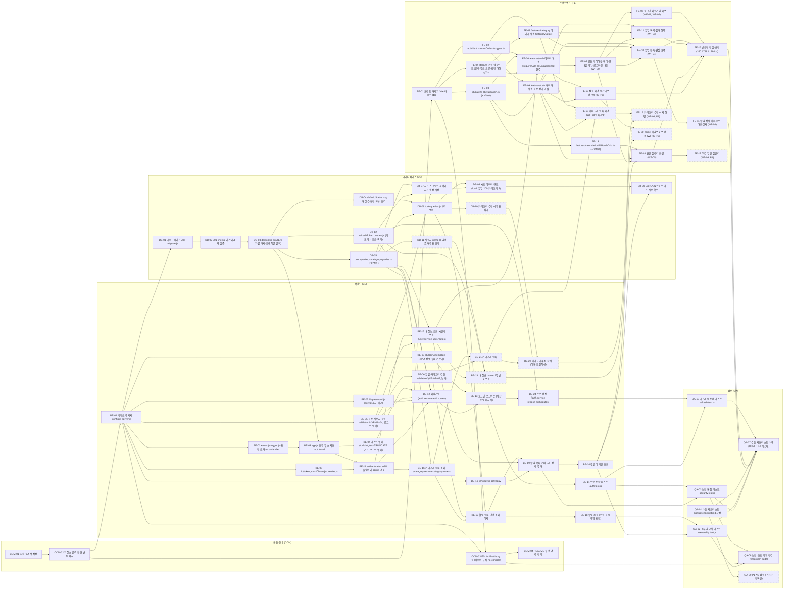

# TodoList 작업 실행 계획 (WBS)

## 문서 이력

| 버전 | 일자 | 작성자 | 변경 내용 |
|------|------|--------|-----------|
| 0.1 | 2026-11-04 | MinjeYu | 도메인 정의서 v0.8·PRD v0.7·사용자 시나리오 v0.4·와이어프레임 v0.3·프로젝트 구조 설계 원칙 v0.3·아키텍처 다이어그램 v0.3·ERD v0.2·`schema.sql` 기반 초안 |
| 0.2 | 2026-11-04 | MinjeYu | 사용자 결정(2026-11-04: JWT HS384 + Refresh Token 적용) 반영, 도메인 정의서 v0.9·PRD v0.8·사용자 시나리오 v0.5·와이어프레임 v0.4·구조 설계 원칙 v0.4·아키텍처 다이어그램 v0.4·ERD v0.3·`schema.sql`과 일치화: 사용자 결정으로 기존 '리프레시 토큰 없음·24시간 만료' 전제를 대체. 신규 Task DB-12(`refreshToken.queries.js`)·BE-24(토큰 갱신)·QA-10(`refresh.test.js`), 수정 Task COM-01·DB-02·DB-07·BE-01·BE-04·BE-08·BE-11·BE-12·BE-13·BE-23·FE-02·FE-06·QA-01·QA-03·QA-05·QA-06·QA-07, 시간·선행·추적표·배치·Mermaid 갱신(Task 67 → 70개, 합계 83.5h → 91.5h), 리스크 R-08 수정과 R-12~R-14 연결, XQ-12~XQ-14 추가 |
| 0.3 | 2026-11-04 | MinjeYu | 위임 결정(2026-11-04) 반영(XQ-01 절차와 XQ-02~XQ-14 확정), 도메인 정의서 v0.10·PRD v0.9·사용자 시나리오 v0.6·와이어프레임 v0.5·구조 설계 원칙 v0.5·아키텍처 다이어그램 v0.5·ERD v0.4와 일치화(`schema.sql` 변경 없음). XQ-01은 'Day 1 종료 시 실제 소요로 배율을 재계산해 재추정하고 그래도 넘치면 일정 연장을 우선 검토' 절차만 확정하고 가용 시간·일정 연장은 사용자 결정 필요로 유지. 동시 갱신 오판 방지(폐기 후 10초 유예, 갱신 실패 시 원 요청 1회 재전송) 반영: BE-01(유예 설정값), BE-24·QA-10(유예 안은 계열 유지·밖은 계열 폐기 테스트), FE-02, QA-07, R-14, XQ-12·XQ-14. 부하 테스트 15분 조건과 무효 실행 재실행을 QA-05·QA-06에 반영(XQ-13). XQ-06은 config.js 가드안, XQ-10은 로그 `time`을 `Date.now()` 숫자로 확정. Task 수·예상 시간·선행 관계는 바꾸지 않음 |
| 0.4 | 2026-11-04 | MinjeYu | 문서 간 일치화: 6.3장 제목을 표의 범위(AC-01~24)에 맞춤, 단일 출처 링크의 버전을 구조 설계 원칙 v0.6·아키텍처 다이어그램 v0.6·ERD v0.5에 맞춤(구조 설계 원칙 6.2장에 `health.service.js`가 추가돼 BE-03·XQ-04와 일치) |
| 0.5 | 2026-11-04 | MinjeYu | COM-01 완료(설계서 `docs/9-design.md` v0.1 작성, 완료 조건 5개 체크), COM-02 진행(`compose.yaml`·`.env.example`·`.gitignore`·`.prettierrc`·`README.md` 작성, 완료 조건 4개 중 2개 체크. `docker compose` 조건 2개는 작업 환경에 Docker가 없어 미확인) |
| 0.6 | 2026-11-04 | MinjeYu | 사용자 결정(2026-11-04: Docker 미사용) 반영: Docker Compose·Dockerfile·컨테이너·healthcheck를 계획에서 제외하고 로컬 PostgreSQL 17(`localhost:5432`)과 `backend/`·`frontend/`의 `npm run dev`로 교체. 수정 Task COM-02(제목 '저장소 골격·환경 변수 예시', `compose.yaml` 삭제, 완료 조건 `docker compose` 2개를 로컬 PostgreSQL 17 접속 확인 1개로 교체)·COM-04·BE-01·BE-03·BE-08·FE-01·QA-07, Mermaid 노드 COM-02·BE-01·FE-01, XQ-07·XQ-09 문구. 단일 출처 링크 버전을 PRD v0.10·구조 설계 원칙 v0.7·아키텍처 다이어그램 v0.7에 맞춤. Task 수·예상 시간·선행 관계는 바꾸지 않음 |
| 0.7 | 2026-11-04 | MinjeYu | 진척 반영: COM-02·DB-01~06·DB-10~12 완료 조건 전부 체크, BE-01은 7개 중 6개(유예 설정값을 BE-24가 쓰는지는 BE-24 이후), FE-01은 4개 중 2개(브라우저 첫 화면 미확인, `/api/health`는 BE-03 이후). 검증은 로컬 PostgreSQL 17의 `todolist` DB |
| 0.8 | 2026-11-04 | MinjeYu | 진척 반영: COM-03·BE-07·DB-07·DB-08 완료 조건 전부 체크(scrypt 1회 174ms는 9-design.md 3장, load 시드 64.6초는 README에 기록) |
| 0.9 | 2026-11-04 | MinjeYu | 진척 반영: COM-04 완료 조건 2개 체크. 사용자 지시(2026-11-04)로 선행 QA-05를 고려하지 않고 진행했으며 k6 실행 명령은 README에 아직 없다(QA-05에서 추가) |
| 0.10 | 2026-11-04 | MinjeYu | 진척 반영: BE-02 완료 조건 4개 체크(`test/unit/errorHandler.test.js`의 임시 라우트로 검증) |
| 0.11 | 2026-11-04 | MinjeYu | 진척 반영: BE-03 완료 조건 4개 체크(`test/health.test.js`, PostgreSQL 서비스 실제 정지 시 500 ERR-07·프로세스 유지 확인) |
| 0.12 | 2026-11-04 | MinjeYu | 진척 반영: BE-04 완료 조건 4개 체크(`test/helpers/`, `test/helpers.test.js`, 개발 DB 행 수 전후 동일 확인). `test` 스크립트는 `--import`·`--test-global-setup`·`--test-concurrency=1`과 `test/**/*.test.js` 패턴을 쓴다 |
| 0.13 | 2026-11-04 | MinjeYu | 진척 반영: BE-05·BE-06·BE-08·BE-09·BE-10 완료 조건 체크(`test/unit/` 단위 테스트 6개 파일, 대상 파일 줄 커버리지 100%). `jsonwebtoken` 설치. 검증 함수는 `errors.js`를 import하지 않고 `{ value, fields }`를 반환한다(DL-01) |
| 0.14 | 2026-11-04 | MinjeYu | 진척 반영: BE-11 완료 조건 6개 체크(`test/auth.middleware.test.js`). `authenticate`·`csrf`는 `/api` 아래에만 적용(액세스 쿠키 `Path=/api`)해 인증 없는 `/api` 미매칭 경로는 ERR-02, 인증 후 미매칭은 ERR-05다. 토큰 갱신 자리는 임시 200 `{status:'ok'}`(본체 BE-24) |
| 0.15 | 2026-11-04 | MinjeYu | 진척 반영: BE-12 완료 조건 7개 체크(`test/signup.test.js`). 자동 로그인 확인은 보호 라우트가 아직 없어 인증 통과(미매칭 404, 요청 로그 userId)로 했고 BE-15 뒤 `GET /api/users/me` 200으로 바꾼다. 트랜잭션 롤백은 테스트 DB 전용 트리거로 기본 카테고리 INSERT를 실패시켜 검증한다 |
| 0.16 | 2026-11-04 | MinjeYu | 진척 반영: BE-13 완료 조건 7개 체크(`test/login.test.js`, 수동 `curl` 로그인·로그아웃 쿠키 확인). 로그아웃 폐기 실패는 테스트 DB 전용 트리거로 재현한다 |
| 0.17 | 2026-11-05 | MinjeYu | 진척 반영: BE-14 완료 조건 3개 체크(`test/auth.test.js` 7케이스, 연속 2회 실행 통과). 보호 라우트가 생기기 전이라 `/api` 아래 경로의 401·404로 인증 여부를 확인한다 |
| 0.18 | 2026-11-05 | MinjeYu | 2장 Task 목록 표에 선행 Task 옆 상태 열(✅ 완료, 🔄 진행 중, ⬜ 미착수)과 범례 추가. 상태는 3장 완료 조건 체크 비율로 판정 |
| 0.19 | 2026-11-05 | MinjeYu | 진척 반영: BE-15 완료 조건 4개 체크(`test/user.test.js` 8케이스). name 변경(P1)은 BE-23 전까지 400으로 거부(swagger 가정 그대로). BE-12·BE-14의 자동 로그인·보호 라우트 확인을 `GET /api/users/me` 200으로 전환 |
| 0.20 | 2026-11-05 | MinjeYu | 진척 반영: BE-16 완료 조건 3개 체크(`test/category.test.js` 4케이스). 할일 생성 API(BE-17) 전이라 테스트 할일은 DB에 직접 넣는다 |
| 0.21 | 2026-11-05 | MinjeYu | 진척 반영: BE-17 완료 조건 5개 체크(`test/todo.test.js` 11케이스). 본문의 형식이 틀린 `categoryId`는 검증 단계(ERR-01 `fields`), 경로의 형식이 틀린 id는 ERR-05로 처리 |
| 0.22 | 2026-11-05 | MinjeYu | 진척 반영: BE-18 완료 조건 4개 체크(`test/todo.test.js` 수정 8케이스 추가). 날짜 순서는 기존 값과 합쳐 service가 검사, `categoryId: null`과 빈 본문은 ERR-01 |
| 0.23 | 2026-11-05 | MinjeYu | 진척 반영: BE-19 완료 조건 5개 체크(`test/todo.list.test.js` 9케이스). AC-13은 `Pacific/Kiritimati`↔`Pacific/Pago_Pago`, 경계는 `getToday` 상대 날짜로 검증(TQ-03) |
| 0.24 | 2026-11-05 | MinjeYu | 진척 반영: BE-20 완료 조건 3개 체크(`test/calendar.test.js` 6케이스). 기간 42일 초과(AQ-07)도 ERR-01로 검증 |
| 0.25 | 2026-11-05 | MinjeYu | 진척 반영: BE-21 완료 조건 3개 체크(`test/category.test.js` 등록 6케이스 추가). 중복은 `uq_categories_user_id_lower_name` 위반을 ERR-04로 번역 |
| 0.26 | 2026-11-05 | MinjeYu | 진척 반영: BE-22 완료 조건 4개 체크(`test/category.test.js` 수정·삭제 7케이스 추가). 롤백과 FK 위반 → ERR-05는 테스트 DB 전용 트리거로 재현 |
| 0.27 | 2026-11-05 | MinjeYu | 진척 반영: BE-23 완료 조건 4개 중 3개 체크(`test/user.test.js` name 3케이스, `test/user.password.test.js` 8케이스). AC-20의 이전 리프레시 값 갱신 401은 BE-24 전이라 미체크(`todo` 테스트로 대기) |
| 0.28 | 2026-11-05 | MinjeYu | 진척 반영: BE-24 완료 조건 7개 체크(`test/refresh.test.js` 8케이스, 시각 조작은 DB의 `created_at`·`expires_at`·`revoked_at` 직접 갱신). 이로써 BE-23 AC-20(이전 리프레시 갱신 401)과 BE-01 유예 설정값 사용 조건도 체크 |
| 0.29 | 2026-11-05 | MinjeYu | 진척 반영: DB-09 완료 조건 2개 체크. 목록·필터·캘린더·카테고리 할일 수 쿼리가 모두 `user_id` 앞 인덱스를 타고 `Seq Scan on todos` 없음, 인덱스 조정 불필요. 요약은 `loadtest/results/2026-11-05-explain.md` |
| 0.30 | 2026-11-05 | MinjeYu | 진척 반영: QA-01 완료 조건 3개 체크. `docs/test/manual-checklist.md`에 P0 수용 기준 18줄(자동 테스트 경로 포함), P1 6줄(`(P1)` 표기), 수동 항목 9줄. `AC-` 포함 줄은 P0 18 + P1 6 = 24 |
| 0.31 | 2026-11-05 | MinjeYu | 진척 반영: FE를 포함하지 않는 QA 수행. QA-02(`test/ownership.test.js` 11케이스, 엔드포인트 10개 점검표는 파일 머리 주석), QA-03(`test/security.test.js` 12케이스, `config.js`에 production의 `LOGIN_LIMIT_EXEMPT_IPS` 거부 가드 추가, XQ-06), QA-08(`docs/test/review-2026-11-05.md`), QA-10(`test/refresh.test.js`에 로그아웃 폐기 케이스 추가) 완료 조건 체크. QA-04~06은 k6 미설치로 보류, QA-07·09는 FE 포함이라 제외 |
| 0.32 | 2026-11-05 | MinjeYu | 사용자 결정(2026-11-05) 반영: 부하 테스트를 하지 않기로 해 QA-04~06을 범위 제외로 표시(3장 각 Task에 `범위 제외` 항목, 2장 상태 열 ➖와 범례 추가). 컷 라인 설명(5.4)과 KPI 판정 문장(6.3)에 제외 사실을 덧붙였다. 완료 조건은 판정하지 않고 남겨 둔다 |
| 0.33 | 2026-11-05 | MinjeYu | 사용자 결정(2026-11-05) 반영: k6 부하 테스트 제거. QA-04~06 삭제(Task 70 → 67개, P0 4.0h 감소: 79.0h → 75.0h, 합계 91.5h → 87.5h), 의존 그래프·Day 배치·16시간 범위·추적 표·리스크에서 참조 제거, XQ-08·XQ-13은 해당 없음 처리, DB-09 요약 위치를 docs/test/로 변경 |
| 0.34 | 2026-11-05 | MinjeYu | 사용자 요청(2026-11-05) 반영: BE-03 수행 작업의 헬스 응답을 SO-14 v0.11(`db` 필드, 실패 503)에 맞춤. 완료 조건 체크 문구는 당시 기록이라 유지 |
| 0.35 | 2026-11-05 | MinjeYu | 사용자 결정(2026-11-05) 반영: 프록시 → CORS. BE-01 수행 작업(`TRUST_PROXY` 개발 비움, `CORS_ORIGINS`·`COOKIE_DOMAIN`), FE-01 수행 작업(Vite 프록시 삭제·`strictPort`)·근거(SO-16 제거)·미체크 완료 조건(CORS 호출), FE-02 수행 작업(`VITE_API_BASE_URL`·`credentials: 'include'`) 수정. 체크된 완료 조건 문구는 당시 기록이라 유지. 단일 출처 링크 버전을 PRD v0.12·구조 설계 원칙 v0.12·아키텍처 다이어그램 v0.9에 맞춤 |
| 0.36 | 2026-11-05 | MinjeYu | 진척 반영: FE-02·FE-03·FE-04 완료 조건 전부 체크(상태 ✅). 검증: Vitest 27개, lint·build 통과, 완료 조건 grep 4종, 브라우저(5173→3000)에서 CSRF 헤더 실린 POST 성공, 액세스 쿠키 삭제 후 갱신 1건·원 요청 1회 재전송, 동시 3건에도 갱신 1건, 리프레시까지 삭제 시 재전송 1회 후 `onUnauthorized` 1회, `ConfirmDialog` 취소·바탕 클릭이 `onConfirm`을 부르지 않음, `components/`의 `api`·`features` import 린트 오류. `todoFilterStore`의 setter는 `rg 'Todo\|Category\|User'` 0건 조건 때문에 `setCatId`로 둠 |
| 0.37 | 2026-11-05 | MinjeYu | 백엔드 코드 대조 반영: BE-01에 CORS·쿠키 Domain·토큰 TTL 설정 수행 작업과 완료 조건(구현·테스트 완료라 체크), BE-03 수행 작업의 `app.js` 순서에 `cors`·개발 전용 `/api/docs`, 완료 조건에 CORS·Swagger UI(체크), 헬스 완료 조건 문구를 현재 응답 `{"status":"ok","db":"up"}`으로 수정. 단일 출처 링크 버전을 구조 설계 원칙 v0.13·아키텍처 다이어그램 v0.10에 맞춤 |
| 0.38 | 2026-11-05 | MinjeYu | 진척 반영: FE-01 남은 완료 조건 2개(브라우저 첫 화면, 5173→3000 `/api/health` CORS 호출)와 FE-06 완료 조건 4개 체크(둘 다 ✅). 검증: Vitest 43개(auth 검증 16개 포함), lint·build 통과, 브라우저에서 로그아웃 상태 `/todos` → `/login`(갱신 1건·재전송 1회 뒤 만료 안내), 쿠키 전부 삭제 후 저장 → 만료 안내와 `/login`, 액세스만 삭제 후 `/todos` → 갱신 뒤 목록 유지(안내 없음). 만료 안내는 로그인하지 않은 접근에도 표시(WF-01 만료 행) |
| 0.39 | 2026-11-05 | MinjeYu | 진척 반영: FE-05 완료 조건 3개 체크(✅). 검증: lint·build·Vitest 43개 통과, 브라우저 1280·768px에서 로그아웃이 헤더 오른쪽 끝(본문 여백 안쪽)이고 메뉴 버튼 없음, 360px에서는 메뉴를 펼쳐야 탭 3개·로그아웃(높이 48px)이 보이고 이동·뒤로 가기 때 메뉴가 닫힘, 가로 스크롤 없음. 로그아웃 → `POST /api/auth/logout` 200, 쿠키 삭제, 로고만 있는 로그인 화면. 뒤로 가기 → 보호 화면 데이터 없이 `/login`(갱신 실패 경로라 만료 안내 표시). `components/`의 `features` import 린트 오류 확인. 공개 화면(로그인·회원가입)도 같은 `Layout`을 로고만으로 써서 상단 알림이 보인다 |
| 0.40 | 2026-11-05 | MinjeYu | 진척 반영: FE-07 완료 조건 5개 체크(✅). 검증: lint·build·Vitest 43개 통과, 브라우저에서 새 email 가입 → 자동 로그인 후 `/todos`(요청에 `timezone: Asia/Seoul` 자동 포함), 14자 비밀번호는 프런트 검증으로 요청 없이 사유 표시·요청 본문을 14자로 바꾼 서버 400 `fields`도 같은 자리에 표시, 중복 email은 email 아래, 틀린 비밀번호·없는 email·짧은 비밀번호의 상단 알림 문구 동일, 같은 email 5회 실패 뒤 6회째와 올바른 비밀번호 모두 제한 안내, `message ===` grep 0건(`api/client.ts`의 `typeof e.message` 검사를 `String(e.message ?? 기본 문구)`로 바꿈). 필드가 아닌 오류(ERR-03·06·07)는 WF 3.2 상단 알림에 서버 문구 그대로 표시 |
| 0.41 | 2026-11-05 | MinjeYu | 진척 반영: FE-08 완료 조건 2개 체크(✅). 검증: lint·build 통과, `useQuery` grep(queries.ts 제외) 0건, 브라우저에서 사용자 A의 `CategorySelect`를 임시 렌더해 선택지가 A의 카테고리(기본·업무)와 같고 첫 선택값·폼 값이 `기본`의 id, 빈 선택지 없음, 다른 사용자 B의 카테고리 미노출. WF-03 필터의 `전체` 선택지는 FE-12에서 필터 바가 직접 그린다 |
| 0.42 | 2026-11-05 | MinjeYu | 사용자 결정(2026-11-05) 반영: VR-02를 KISA 기준으로 변경(PRD v0.13). BE-05 수행 작업·완료 조건, FE-06·FE-07 완료 조건의 비밀번호 경계값을 새 규칙(3종류 7·8자, 2종류 9·10자, 1종류 거부, 128·129자)으로 수정하고 코드 수정 뒤 재확인해 체크 유지. 단일 출처 링크 버전을 PRD v0.13·사용자 시나리오 v0.7·와이어프레임 v0.6·아키텍처 다이어그램 v0.11·ERD v0.6에 맞춤. 구조 설계 원칙 v0.15 |
| 0.43 | 2026-11-05 | MinjeYu | 진척 반영: FE-09 완료 조건 3개 체크(✅). 검증: Vitest 61개(할일 검증 14개: title 0·1·100·101자와 공백·이모지, description 1000·1001자, 없는 날짜·윤년, start>end 거부와 같은 날 통과, 필드 순서 — 백엔드 단위 테스트와 같은 경계값·문구), lint·build 통과, `statusLabel.ts`의 `completed` 0건, 프런트에 상태 값 판정 코드 없음(상태 문자열은 `statusLabel.ts`·`api/types.ts`에만), `setQueryData` 0건. 변경 성공 시 할일(`todoKeys.all`)과 카테고리(`todoCount`) 쿼리를 무효화하고, 삭제는 그 할일의 단건 캐시를 먼저 제거한다(재조회 404 방지) |
| 0.44 | 2026-11-05 | MinjeYu | 진척 반영: FE-10 완료 조건 5개 체크(✅). 검증: lint·build·Vitest 61개 통과, `useForm\|zod` 0건. 브라우저에서 카테고리를 건드리지 않고 등록 → 요청·저장 모두 기본 카테고리 id, 시작일 11-10·종료일 11-05 저장 → 종료일 아래 사유·요청 없음·화면 유지, 편집에서 완료 체크 저장 → 다시 열면 `완료`·해제 저장 → `진행 중`, `마지막 수정`이 `updatedAt` 06:48Z를 Asia/Seoul 15:48·America/New_York 01:48로 표시, 없는 id·형식 오류 id는 `할일을 찾을 수 없습니다`와 목록 링크. 카테고리 드롭다운은 feature 간 컴포넌트 import 금지(DL-11) 때문에 페이지가 폼에 주입한다. 편집 저장은 전체 필드 PATCH |
| 0.45 | 2026-11-05 | MinjeYu | 진척 반영: FE-11~FE-20 완료 조건 31개 체크(모두 ✅). 4개 묶음 병렬 구현(A 삭제·목록, B 캘린더, C 설정, D 카테고리)과 공용 `components/StatusBadge`. 검증: Vitest 93개(월 그리드·주 범위·카테고리 이름 경계 포함), lint·build·prettier 통과, features의 `new Date(`·`setQueryData` 0건. 브라우저: 삭제 취소/확인, 기한 초과·진행 중·카테고리 AND 필터와 편집 후 필터 유지, 3일짜리 할일 3칸 표시·4건 날짜 3건+`+1개 더`·모바일 개수와 그날 목록, 주간 11-02~11-08·전환 시 기준일 유지, UTC 선택 표시·시간대 변경 후 목록 상태와 마지막 수정 갱신, name 헤더 반영·틀린 현재 비밀번호 사유·변경 후 로그인 유지, 카테고리 추가 즉시 드롭다운·필터 반영·중복 사유·기본 행 버튼 없음·삭제 확인창 할일 2개·확인 후 기본으로 이동과 필터 해제. FE-16에서 태블릿 막대 상태 라벨 잘림·모바일 필터 잘림 보정, 결과를 `docs/test/manual-checklist.md` NFR-12 줄에 기록 |
| 0.46 | 2026-11-05 | MinjeYu | 진척 반영: QA-07·QA-09 완료 조건 7개 체크(✅). `docs/test/manual-checklist.md` 결과 칸 기록: 자동 테스트 백엔드 259/259·프런트 93/93, P0 AC 18개·P1 AC 6개 화면 확인 통과(KPI-01 충족), 두 탭 동시 갱신(XQ-12) 재로그인 없음, 백엔드 `TZ=America/Los_Angeles`·브라우저 UTC에서 11-03 할일이 11-03으로 저장·조회·표시, Chromium 데스크톱·모바일 기기 모드 스모크, 두 개발 서버만으로 실행(KPI-03). NFR-11(PostgreSQL 중지)은 공유 DB 영향 때문에 미수행하고 BE-03 기록·자동 테스트로 대체. 확인 중 발견: 갱신 응답이 새로고침으로 끊기면 유예 안 재제출이 ERR-02가 되어 재로그인된다(OI-20 설계대로) |
| 0.47 | 2026-11-05 | MinjeYu | 코드 리뷰 반영(완료 상태 변화 없음): `onUnauthorized`는 현재 사용자 캐시가 있을 때만·한 번만 동작(DL-14 v0.15), 로그인 상태의 로그인·가입 화면은 목록으로(`GuestOnly`, FE-06 수행 작업), 캘린더 보기 전환은 선택한 날짜 기준(WF v0.7), 시드 비밀번호 VR-02 검사(SO-11), 비밀번호 변경 129자 사례를 종류 혼합 값으로 교체. 검증: 백엔드 259/259·프런트 93/93, Playwright로 새 방문자 안내 없음·만료 시 갱신 1회와 안내 1회·로그아웃 뒤 /login 유지·12-17 선택 후 '주' 12.14 - 12.20 확인. 단일 출처 링크를 와이어프레임 v0.7·구조 설계 원칙 v0.15에 맞춤 |

**표기 범례** (도메인 정의서·PRD·사용자 시나리오·와이어프레임·구조 설계 원칙과 같음)
- **확정**: 요구사항 원문 또는 사용자 의사결정(2026-11-04)에 근거한 결정
  - 사용자가 위임한 결정 포함: 사용자가 추천 방향으로 정하도록 맡긴 항목은 출처를 '위임 결정(2026-11-04)'으로 밝힌다
- **가정**: 원문에 없는 잠정 결정. 일단 이대로 진행하고 이해관계자가 확인하면 확정한다
- **미결정**: 결정하기 전에는 구현을 보류한다
- 이 문서에서 원문에 없는 결정은 모두 **가정**이다. 가정과 문서 사이의 공백·모순은 8장(`XQ-xx`)에 모은다

**단일 출처 원칙**: 엔티티 속성·상태 판정·BR·UC·AC는 [도메인 정의서 v0.10](./1-domain-definition.md), FR 우선순위·VR·ERR·NFR·KPI·R·일정·컷 라인은 [PRD v0.13](./2-prd.md), SC는 [사용자 시나리오 v0.7](./3-user-scenario.md), WF는 [와이어프레임 v0.7](./4-wireframe.md), 디렉토리·원칙(PR/DL/CN/TQ/SO)은 [프로젝트 구조 설계 원칙 v0.15](./5-project-principle.md), AD는 [아키텍처 다이어그램 v0.11](./6-arch-diagram.md), 테이블은 [ERD v0.6](./7-erd.md)와 [`schema.sql`](./schema.sql)에만 둔다. 이 문서는 규칙 원문을 복사하지 않고 ID로 참조한다. 이 문서에서 새로 만든 ID는 Task ID(`COM-xx`, `DB-xx`, `BE-xx`, `FE-xx`, `QA-xx`)와 확인 필요 `XQ-xx`뿐이다.

**범위**: 구현 작업의 분해·순서·일정·검증 방법만 정한다. 코드 구현, Git 커밋, 기존 문서 수정은 이 문서의 범위가 아니다. 문서 사이의 모순은 수정하지 않고 8장에 남긴다.

**Task 읽는 법**: 각 Task는 수행 작업(만들 파일은 구조 원칙(5-project-principle.md) 6장 경로 기준, 구현할 규칙은 ID 참조), 완료 조건(`- [ ]` 체크박스, 검증 가능한 문장), 선행 Task, 근거 ID, 우선순위(PRD 4장 기준 P0/P1), 예상 시간을 가진다. 완료 조건을 모두 체크해야 Task가 끝난 것이다. API 경로·응답 필드·상태 값 이름은 COM-01 설계서가 정하며, 이 문서는 정하지 않는다(PR-09).

## 1. 전제와 일정 적합성

### 1.1 전제

| 항목 | 내용 | 구분 |
|------|------|------|
| 인원·기간 | 1인, 2일 (G2, KPI-03) | 확정 |
| 가용 시간 | 하루 8시간 집중 작업, 슬롯(오전·오후)당 4시간, 2일 합계 16시간 | 가정 (사용자 결정 필요, XQ-01) |
| 작업 방식 | 한 명이 한 번에 한 Task만 한다. DB·BE·FE는 병렬로 진행하지 않는다 | 가정 |
| 예상 시간 | 구현·자동 테스트 작성·자체 확인을 포함한 집중 작업 시간. | 가정 |
| 설계서 | `docs/9-design.md`(파일명 가정)를 Day 1 시작 전에 쓴다(PQ-01). 2일 예산 16시간에는 넣지 않는다. 사용자 결정(2026-11-04)으로 인증 토큰 세부가 늘어 2.5시간으로 잡았다 | 확정 (시점, PQ-01) / 확정 (파일명, XQ-02, 위임 결정(2026-11-04)) |
| 우선순위 | PRD 4장의 P0/P1을 그대로 쓴다. 한 FR이 P0·P1로 나뉜 곳(FR-02, FR-03, FR-08)은 Task를 나눠 둔다 | 확정 |
| 새 기능 | 문서에 없는 기능은 넣지 않았다. 문서가 직접 말하지 않지만 P0 화면에 필요한 내부 요소(카테고리 목록 조회, `GET /api/health` 서비스 계층 등)는 가정으로 표시한다 | 가정 |

### 1.2 규모 요약

| 그룹 | Task 수 | P0 시간 | P1 시간 | 합계 |
|------|--------|---------|---------|------|
| 공통·준비 (COM) | 4 | 5.0h | 0.0h | 5.0h |
| 데이터베이스 (DB) | 12 | 11.0h | 1.0h | 12.0h |
| 백엔드 (BE) | 24 | 28.5h | 4.5h | 33.0h |
| 프런트엔드 (FE) | 20 | 21.5h | 6.0h | 27.5h |
| 검증 (QA) | 7 | 9.0h | 1.0h | 10.0h |
| **합계** | **67** | **75.0h** | **12.5h** | **87.5h** |

DB·BE·FE가 본체(P0 61.0h)이고, 공통·검증 그룹은 준비·점검 작업이다.

### 1.3 일정 적합성 판정 (중요)

- **2일 예산 16시간 대비 P0 작업량은 72.5시간(설계서 COM-01 제외, 포함하면 75.0시간)이다.** P1 12.5시간을 전부 자르는 PRD 8장 컷 라인 1~4를 모두 적용해도 P0 72.5시간이 남아 16시간을 약 4.5배 넘는다. PRD 8장에는 P0를 자르는 규칙이 없고(컷하지 않는 것) PR-04도 보안·무결성 검증을 줄이지 못하게 하므로, 이 추정이 맞다면 'P0를 2일에 끝낸다'(G2, KPI-03)는 목표는 이 계획만으로 달성할 수 없다.
- 크리티컬 패스(5장)만 해도 21.0시간이다.
- 사용자 결정(2026-11-04)의 Refresh Token 적용(v0.2)으로 P0가 7.5시간(설계서 COM-01 +0.5, DB-12 1.0, BE-08·BE-12·BE-13 각 +0.5, BE-24 2.0, FE-02 +0.5, QA-03 +0.5, QA-10 1.5), P1이 0.5시간(BE-23) 늘었다. 일정 판정(재합의 필요, XQ-01)은 달라지지 않는다. 1인 순차 작업이므로 실제 하한은 P0 총량이다.
- 따라서 이 문서는 (1) PRD 8장 마일스톤에 맞춘 슬롯 배치와 슬롯별 초과량을 그대로 보여 주고, (2) 16시간 안에 끝나는 범위를 의존 순서대로 잘라 보여 주며, (3) 일정 재합의를 XQ-01로 올린다. 컷 라인을 넘어 P0를 자르는 결정은 이 문서가 하지 않는다.
- 추정이 과대일 수 있다. Day 1 종료 시점에 실제 소요를 이 표와 비교해(R-01) 추정 배율을 다시 계산해 재추정하고, 그래도 넘치면 일정 연장을 우선 검토한다(XQ-01 확정 절차). 가용 시간과 일정 연장 자체는 사용자 결정이다.

## 2. Task 목록

Task ID는 그룹 접두사와 번호다. 완료 조건·근거는 3장 상세에 있다. 슬롯은 4장의 배치 열이다.

상태 열은 그 Task의 3장 완료 조건 체크 상태다: ✅ 모두 체크(완료), 🔄 일부 체크(진행 중), ⬜ 체크 없음(미착수). 완료 조건을 체크할 때 함께 갱신한다.

### 2.1 공통·준비 (COM)

| ID | Task | 우선순위 | 시간 | 슬롯 | 선행 Task | 상태 |
|----|------|----------|------|------|-----------|------|
| COM-01 | 후속 설계서 작성 | P0 | 2.5h | Day 1 시작 전 (준비) | 없음 | ✅ |
| COM-02 | 저장소 골격·환경 변수 예시 | P0 | 1.0h | Day 1 오전 | COM-01 | ✅ |
| COM-03 | ESLint·Prettier 설정 (레이어 규칙·no-console) | P0 | 1.0h | Day 1 오후 | BE-01, FE-01 | ✅ |
| COM-04 | README 실행 명령 정리 | P0 | 0.5h | Day 2 오후 (P0) | COM-03, DB-01, DB-08 | ✅ |

### 2.2 데이터베이스 (DB)

| ID | Task | 우선순위 | 시간 | 슬롯 | 선행 Task | 상태 |
|----|------|----------|------|------|-----------|------|
| DB-01 | 마이그레이션 러너 `migrate.js` | P0 | 1.0h | Day 1 오전 | BE-01, COM-02 | ✅ |
| DB-02 | `001_init.sql` 이관과 제약 검증 | P0 | 1.0h | Day 1 오전 | DB-01 | ✅ |
| DB-03 | `db/pool.js` (DATE 문자열 파서·트랜잭션 헬퍼) | P0 | 1.0h | Day 1 오전 | BE-01, DB-02 | ✅ |
| DB-04 | `db/todoStatus.js` 상태 상수·판정 SQL 조각 | P0 | 1.0h | Day 1 오후 | DB-03 | ✅ |
| DB-05 | `user.queries.js`·`category.queries.js` (P0 범위) | P0 | 1.5h | Day 1 오전 | DB-03 | ✅ |
| DB-06 | `todo.queries.js` (P0 범위) | P0 | 2.0h | Day 1 오후 | DB-04, DB-05 | ✅ |
| DB-07 | 시드 스크립트 골격과 사전 생성 계정 | P0 | 1.0h | Day 1 오전 | DB-05, BE-07, DB-12 | ✅ |
| DB-08 | 시드 데이터 규모 (load: 할일 200·카테고리 5) | P0 | 1.0h | Day 2 오후 (P0) | DB-06, DB-07 | ✅ |
| DB-09 | EXPLAIN으로 인덱스 사용 확인 | P0 | 0.5h | Day 2 오후 (P0) | DB-08, BE-19, BE-20 | ✅ |
| DB-10 | 카테고리 수정·삭제용 쿼리 | P1 | 0.5h | Day 2 오후 남은 시간 (P1) | DB-05, DB-06 | ✅ |
| DB-11 | 사용자 name·비밀번호 변경용 쿼리 | P1 | 0.5h | Day 2 오후 남은 시간 (P1) | DB-05 | ✅ |
| DB-12 | `refreshToken.queries.js` (리프레시 토큰 쿼리) | P0 | 1.0h | Day 1 오전 | DB-03 | ✅ |

### 2.3 백엔드 (BE)

| ID | Task | 우선순위 | 시간 | 슬롯 | 선행 Task | 상태 |
|----|------|----------|------|------|-----------|------|
| BE-01 | 백엔드 패키지·`config.js`·`server.js` | P0 | 1.5h | Day 1 오전 | COM-02 | ✅ |
| BE-02 | `errors.js`·`logger.js`·요청 로거·`errorHandler` | P0 | 1.0h | Day 1 오전 | BE-01 | ✅ |
| BE-03 | `app.js` 조립·헬스 체크·not found | P0 | 1.0h | Day 1 오전 | BE-02, DB-03 | ✅ |
| BE-04 | 테스트 헬퍼 (`todolist_test`·TRUNCATE 가드·로그인 헬퍼) | P0 | 1.0h | Day 1 오전 | BE-03, DB-02 | ✅ |
| BE-05 | 공통·사용자 검증 `validation/` (VR-01~04, 로그인 입력) | P0 | 1.0h | Day 1 오전 | BE-01 | ✅ |
| BE-06 | 할일·카테고리 검증 `validation/` (VR-05~07, 날짜) | P0 | 1.0h | Day 1 오후 | BE-05 | ✅ |
| BE-07 | `lib/password.js` (scrypt 해시·비교) | P0 | 1.5h | Day 1 오전 | BE-01 | ✅ |
| BE-08 | `lib/token.js`·`csrfToken.js`·`cookies.js` | P0 | 2.0h | Day 1 오전 | BE-01 | ✅ |
| BE-09 | `lib/loginAttempts.js` (IP·계정별 실패 카운터) | P0 | 1.5h | Day 1 오전 | BE-01 | ✅ |
| BE-10 | `lib/today.js` `getToday` | P0 | 0.5h | Day 1 오후 | BE-01 | ✅ |
| BE-11 | `authenticate`·`csrf` 미들웨어와 `app.js` 연결 | P0 | 1.5h | Day 1 오전 | BE-03, BE-08 | ✅ |
| BE-12 | 회원가입 (`auth.service`·`auth.routes`) | P0 | 2.0h | Day 1 오전 | BE-04, BE-05, BE-07, BE-08, BE-11, DB-05, DB-12 | ✅ |
| BE-13 | 로그인·로그아웃 (제한·동일 메시지) | P0 | 2.0h | Day 1 오전 | BE-09, BE-12 | ✅ |
| BE-14 | 인증 통합 테스트 `auth.test.js` | P0 | 1.5h | Day 1 오전 | BE-13 | ✅ |
| BE-15 | 내 정보 조회·시간대 변경 (`user.service`·`user.routes`) | P0 | 1.0h | Day 1 오전 | BE-11, BE-05, DB-05 | ✅ |
| BE-16 | 카테고리 목록 조회 (`category.service`·`category.routes`) | P0 | 1.0h | Day 1 오후 | BE-11, DB-05 | ✅ |
| BE-17 | 할일 등록·단건 조회·삭제 | P0 | 1.5h | Day 1 오후 | BE-06, BE-16, DB-06 | ✅ |
| BE-18 | 할일 수정 (완료 표시·해제 포함) | P0 | 1.5h | Day 1 오후 | BE-17 | ✅ |
| BE-19 | 할일 목록·카테고리·상태 필터 | P0 | 1.5h | Day 2 오전 | BE-17, BE-15, BE-10 | ✅ |
| BE-20 | 캘린더 기간 조회 | P0 | 1.0h | Day 2 오전 | BE-19 | ✅ |
| BE-21 | 카테고리 등록 | P1 | 1.0h | Day 2 오후 남은 시간 (P1) | BE-16, BE-06 | ✅ |
| BE-22 | 카테고리 수정·삭제 (이동 트랜잭션) | P1 | 1.5h | Day 2 오후 남은 시간 (P1) | BE-21, DB-10 | ✅ |
| BE-23 | 내 정보 name·비밀번호 변경 | P1 | 2.0h | Day 2 오후 남은 시간 (P1) | BE-15, DB-11, DB-12 | ✅ |
| BE-24 | 토큰 갱신 (`auth.service` refresh·`auth.routes`) | P0 | 2.0h | Day 1 오전 | BE-13, DB-12 | ✅ |

### 2.4 프런트엔드 (FE)

| ID | Task | 우선순위 | 시간 | 슬롯 | 선행 Task | 상태 |
|----|------|----------|------|------|-----------|------|
| FE-01 | 프런트 패키지·Vite·라우트 뼈대 | P0 | 1.5h | Day 1 오전 | COM-02 | ✅ |
| FE-02 | `api/client.ts`·`errorCodes.ts`·`types.ts` | P0 | 2.0h | Day 1 오후 | FE-01 | ✅ |
| FE-03 | `lib/date.ts`·`lib/validation.ts` (+ Vitest) | P0 | 1.0h | Day 1 오후 | FE-01 | ✅ |
| FE-04 | `store/`와 공용 컴포넌트 (알림·필드 오류·확인 대화상자) | P0 | 1.0h | Day 1 오후 | FE-01 | ✅ |
| FE-05 | 공통 레이아웃·헤더·모바일 메뉴·로그아웃 버튼 (WF-00) | P0 | 1.0h | Day 1 오후 | FE-04, FE-06 | ✅ |
| FE-06 | `features/auth` 데이터 계층·`RequireAuth`·`onUnauthorized` 연결 | P0 | 1.5h | Day 1 오후 | FE-02, FE-03, FE-04, BE-15 | ✅ |
| FE-07 | 로그인·회원가입 화면 (WF-01, WF-02) | P0 | 2.0h | Day 1 오후 | FE-06, FE-05 | ✅ |
| FE-08 | `features/category` 데이터 계층·`CategorySelect` | P0 | 0.5h | Day 1 오후 | FE-02, FE-04 | ✅ |
| FE-09 | `features/todo` 데이터 계층·검증·상태 라벨 | P0 | 1.0h | Day 1 오후 | FE-02, FE-03 | ✅ |
| FE-10 | 할일 등록·편집 화면 (WF-04) | P0 | 2.0h | Day 1 오후 | FE-09, FE-08, FE-05 | ✅ |
| FE-11 | 할일 삭제 버튼·확인 대화상자 (WF-04) | P0 | 0.5h | Day 1 오후 | FE-10 | ✅ |
| FE-12 | 할일 목록·필터 화면 (WF-03) | P0 | 2.0h | Day 2 오전 | FE-09, FE-08, FE-05 | ✅ |
| FE-13 | `features/calendar/buildMonthGrid.ts` (+ Vitest) | P0 | 1.0h | Day 2 오전 | FE-03 | ✅ |
| FE-14 | 월간 캘린더 화면 (WF-05) | P0 | 2.0h | Day 2 오전 | FE-13, FE-09, FE-05, BE-20 | ✅ |
| FE-15 | 설정 화면 시간대 변경 (WF-07 P0) | P0 | 1.0h | Day 2 오전 | FE-06, FE-09, BE-15 | ✅ |
| FE-16 | 반응형 점검·보정 (360 / 768 / 1280px) | P0 | 1.5h | Day 2 오전 | FE-07, FE-10, FE-12, FE-14, FE-15 | ✅ |
| FE-17 | 주간·일간 캘린더 (WF-06, P1) | P1 | 2.0h | Day 2 오후 남은 시간 (P1) | FE-14 | ✅ |
| FE-18 | 카테고리 등록 화면 (WF-08 등록, P1) | P1 | 1.0h | Day 2 오후 남은 시간 (P1) | FE-08, FE-09, BE-21 | ✅ |
| FE-19 | 카테고리 수정·삭제 화면 (WF-08, P1) | P1 | 1.5h | Day 2 오후 남은 시간 (P1) | FE-18, BE-22 | ✅ |
| FE-20 | name·비밀번호 변경 폼 (WF-07 P1) | P1 | 1.5h | Day 2 오후 남은 시간 (P1) | FE-15, BE-23 | ✅ |

### 2.5 검증 (QA)

| ID | Task | 우선순위 | 시간 | 슬롯 | 선행 Task | 상태 |
|----|------|----------|------|------|-----------|------|
| QA-01 | 수동 체크리스트 `manual-checklist.md` 작성 | P0 | 1.0h | Day 2 오후 (P0) | 없음 | ✅ |
| QA-02 | 소유권 교차 테스트 `ownership.test.js` | P0 | 1.5h | Day 2 오후 (P0) | BE-17, BE-18, BE-19, BE-20, BE-16 | ✅ |
| QA-03 | 보안 통합 테스트 `security.test.js` | P0 | 2.0h | Day 2 오후 (P0) | BE-14, BE-17, BE-19 | ✅ |
| QA-07 | 수동 체크리스트 수행 (UI·NFR-12·시간대) | P0 | 2.0h | Day 2 오후 (P0) | QA-01, FE-16, FE-11, FE-15, BE-19, QA-02, QA-03, QA-10 | ✅ |
| QA-08 | 보안·코드 리뷰 점검 (grep·npm audit) | P0 | 1.0h | Day 2 오후 (P0) | QA-03, COM-03, QA-02 | ✅ |
| QA-09 | P1 AC 검증 (구현한 항목만) | P1 | 1.0h | Day 2 오후 남은 시간 (P1) | QA-01 | ✅ |
| QA-10 | 리프레시 통합 테스트 `refresh.test.js` | P0 | 1.5h | Day 1 오전 | BE-24, BE-14 | ✅ |

## 3. Task 상세

모든 구현 Task는 COM-01(설계서)에 정해진 값·경로·이름을 따른다. 설계서가 없으면 구현하지 않는다(PR-09). 테스트 이름은 `AC-xx:`·`NFR-xx:`·`BR-xx:`로 시작하고 규칙 구현 위에는 ID 주석 한 줄을 둔다(PR-02).

### 3.1 공통·준비 (COM)

#### COM-01 후속 설계서 작성

- **우선순위 / 예상 시간**: P0 / 2.5h
- **선행 Task**: 없음
- **근거**: PQ-01, PR-09, PRD 11장, AQ-03, AQ-07, AQ-11, AQ-12, CN-09, NFR-06, NFR-07, NFR-10, NFR-15, BR-16, OI-18, OI-19, OI-20, OI-21, R-13
- **수행 작업**
  - `docs/9-design.md`(파일명은 가정, XQ-02)를 쓴다. 규칙 원문은 복사하지 않고 ID로 참조한다(PR-01)
  - PRD 11장 항목을 결정한다: scrypt 값(N, r, p, maxmem)·salt 길이·`passwordHash` 저장 포맷·재해시 방식·libuv 스레드 풀 크기, 없는 email 로그인의 응답 시간 처리(ERR-03), 로그인 카운터 저장 위치·시간 창 방식, CSRF 토큰 구조(HMAC 입력, JWT 식별자는 `jti`)·쿠키/헤더 이름·서명 키 관리(SO-03)
  - 인증 토큰 세부를 결정한다(사용자 결정(2026-11-04), PRD 11장): 액세스·리프레시·CSRF 쿠키 이름과 `Max-Age`, 리프레시 쿠키 `Path`(갱신·로그아웃 경로를 모두 포함하는 공통 접두사, OI-19), 토큰 갱신 경로, JWT 클레임 이름·`jti` 생성, JWT 서명 키 환경 변수 이름·생성 방법·분리 여부·교체 절차(R-13), 리프레시 토큰 저장·정리 방식(OI-21), 갱신 트랜잭션과 재사용 감지의 커밋 처리(AQ-11), 재사용 감지 유예 시간(10초)의 설정값 이름과 `revoked_at` 기반 유예 판단(AQ-13), 프런트 갱신 처리(갱신 실패 시 원 요청 1회 재전송 포함, DL-14, OI-20)
  - API 명세를 쓴다: 경로(`/api` 접두사, PQ-05)·메서드·요청/응답 JSON·상태 코드·`fields` 형태, 상태 값 이름(CN-09), 현재 사용자 조회 응답(AQ-03), 캘린더 기간 조회 계약(AQ-07), 카테고리 목록의 할일 수 필드(PRD 11장), 토큰 갱신 요청·응답
  - 로그아웃·비밀번호 변경 후 액세스 토큰 재사용 잔여 위험(최대 15분)을 명시한다(NFR-07, R-08)
- **완료 조건**
  - [x] PRD 11장의 불릿 항목 전부에 대응하는 결정이 `docs/9-design.md`에 있다(항목별 확인)
  - [x] 이 계획의 모든 엔드포인트(회원가입·로그인·토큰 갱신·로그아웃·내 정보·시간대·카테고리 목록·등록·수정·삭제·할일 CRUD·목록·캘린더·health)가 경로·메서드·상태 코드와 함께 표에 있다
  - [x] 쿠키 3종의 이름·`Max-Age`, 리프레시 쿠키 `Path`(인증 API 공통 접두사 하나임과 그 아래 다른 요청에도 전송되는 부작용), JWT 클레임, 서명 키 길이 검사·교체 절차, 리프레시 만료 행 정리 방식(로그인 때), 재사용 감지 유예 시간 설정값 이름이 설계서에 있다
  - [x] 잔여 위험(R-08, 액세스 토큰 최대 15분) 문장이 설계서에 있다
  - [x] 설계서에 PRD·도메인 정의서의 규칙 원문 복사가 없고 ID 참조만 있다(PR-01)

#### COM-02 저장소 골격·환경 변수 예시

- **우선순위 / 예상 시간**: P0 / 1.0h
- **선행 Task**: COM-01
- **근거**: SO-02, SO-03, SO-08, SO-09, PRD 6장 개발 환경, 구조 원칙 6.1장
- **수행 작업**
  - `.env.example`(키 이름과 `change-me` 자리표시자, SO-02, SO-03), `.gitignore`(`.env`, `node_modules`), `.prettierrc`, `README.md` 뼈대
  - `docs/test/` 디렉토리는 해당 Task에서 만든다
- **완료 조건**
  - [x] `.env.example`을 복사한 `.env`의 `DATABASE_URL`로 로컬 PostgreSQL 17에 접속된다(`select version()`이 17.x)
  - [x] `git ls-files`에 `.env.example` 외의 `.env*`가 없다(SO-02)
  - [x] `.env.example`에 실제 비밀 값이 없고 자리표시자만 있다(SO-03)

#### COM-03 ESLint·Prettier 설정 (레이어 규칙·no-console)

- **우선순위 / 예상 시간**: P0 / 1.0h
- **선행 Task**: BE-01, FE-01
- **근거**: TQ-10, DL-01, DL-11, SO-06, PR-03
- **수행 작업**
  - `backend/eslint.config.js`: 디렉토리별 override의 `no-restricted-imports`(DL-01 표), `lib/logger.js` 밖 `no-console`(SO-06)
  - `frontend/eslint.config.js`: `typescript-eslint`, `eslint-plugin-react-hooks`, `no-restricted-imports`(DL-11 표)
  - 양쪽 `package.json`에 `lint`, `format:check` 스크립트를 둔다(루트 `.prettierrc` 하나 사용)
- **완료 조건**
  - [x] `npm run lint`와 `npm run format:check`가 `backend/`, `frontend/` 양쪽에서 오류 0건이다
  - [x] 일부러 `routes/`에 `import ... from '../db/pool.js'`를 넣으면 린트가 실패한다(확인 후 되돌림)
  - [x] 일부러 `components/`에서 `features/`를 import하면 린트가 실패한다(확인 후 되돌림)
  - [x] 일부러 `console.log`를 `src/lib/logger.js` 밖에 넣으면 린트가 실패한다(확인 후 되돌림)

#### COM-04 README 실행 명령 정리

- **우선순위 / 예상 시간**: P0 / 0.5h
- **선행 Task**: COM-03, DB-01, DB-08
- **근거**: TQ-12, PQ-11
- **수행 작업**
  - `README.md`에 한 곳으로 모은다: `backend/`·`frontend/`의 `npm run dev`, `npm test`, `npm run lint`, `npm run format:check`, 마이그레이션, 시드(`dev`·`load`)(TQ-12)
  - 규칙 문장은 복사하지 않고 문서 1~8 링크와 ID만 둔다(PR-01)
- **완료 조건**
  - [x] README의 명령을 새 셸에서 순서대로 실행해 모두 성공한다(마이그레이션, 시드, 테스트, 린트)
  - [x] README에 비밀 값이 없다(`.env.example` 참조만)

### 3.2 데이터베이스 (DB)

#### DB-01 마이그레이션 러너 `migrate.js`

- **우선순위 / 예상 시간**: P0 / 1.0h
- **선행 Task**: BE-01, COM-02
- **근거**: SO-10, NFR-05, PR-03
- **수행 작업**
  - `backend/scripts/migrate.js`: `migrations/NNN_*.sql`을 번호 순서로 적용하고 `schema_migrations`에 기록, 파일마다 트랜잭션, 적용된 파일은 건너뜀(forward-only)
  - `backend/package.json`에 `migrate` 스크립트를 둔다. 연결 정보는 `config.js`(SO-01)
- **완료 조건**
  - [x] 빈 DB에서 `npm run migrate`가 성공하고 `schema_migrations`에 적용 기록이 남는다
  - [x] 두 번째 실행은 아무것도 적용하지 않고 성공한다
  - [x] 일부러 오류가 있는 임시 마이그레이션 파일은 해당 파일 전체가 롤백된다(확인 후 임시 파일 삭제)

#### DB-02 `001_init.sql` 이관과 제약 검증

- **우선순위 / 예상 시간**: P0 / 1.0h
- **선행 Task**: DB-01
- **근거**: SO-10, NFR-05, BR-03, BR-05, BR-07, BR-13, BR-14, ER-08, 7-erd.md, schema.sql
- **수행 작업**
  - `docs/schema.sql`을 `backend/migrations/001_init.sql`로 옮긴다. 러너가 파일마다 트랜잭션을 열므로 파일 안의 `BEGIN;`·`COMMIT;`만 뺀다(XQ-03). 나머지 DDL은 바꾸지 않는다
  - psql로 제약 위반을 일부러 일으켜 확인한다: 날짜 순서(BR-07), 완료 일관성(BR-13), 카테고리 이름 중복(BR-14), 사용자당 기본 카테고리 1개, 다른 사용자 카테고리 참조, `refresh_tokens`의 해시 중복·없는 사용자·`expires_at <= created_at`(ER-08)
- **완료 조건**
  - [x] `001_init.sql`과 `docs/schema.sql`의 차이가 `BEGIN;`·`COMMIT;` 두 줄뿐이다(`diff` 결과)
  - [x] `npm run migrate` 후 `\d todos`에 `ck_todos_date_order`, `ck_todos_completed_at`, 복합 FK `fk_todos_category_id_user_id`와 인덱스 2개가 있다
  - [x] `start_date > end_date` INSERT, `completed=true`이면서 `completed_at IS NULL`인 INSERT, 같은 사용자의 `lower(name)` 중복 카테고리 INSERT, 두 번째 기본 카테고리 INSERT, 다른 사용자 카테고리를 가리키는 할일 INSERT가 각각 제약 위반으로 거부된다
  - [x] `\d refresh_tokens`에 `uq_refresh_tokens_token_hash`, `ck_refresh_tokens_expires_after_created`, 인덱스 `idx_refresh_tokens_user_id`·`idx_refresh_tokens_family_id`가 있다
  - [x] 같은 `token_hash`의 두 번째 INSERT, 없는 `user_id`의 INSERT, `expires_at <= created_at` INSERT가 각각 제약 위반으로 거부된다(ER-08)

#### DB-03 `db/pool.js` (DATE 문자열 파서·트랜잭션 헬퍼)

- **우선순위 / 예상 시간**: P0 / 1.0h
- **선행 Task**: BE-01, DB-02
- **근거**: PR-07, CN-06, DL-08, SO-01, NFR-05, PRD 11장(pg 설정)
- **수행 작업**
  - `backend/src/db/pool.js`: pg `Pool`(크기는 `config.js` 설정값, NFR-05), DATE(OID 1082)를 `YYYY-MM-DD` 문자열로 돌려주는 type parser(PR-07), `withTransaction(fn)`(DL-08)
  - `ping` 같은 보조 함수는 두지 않는다. 헬스 체크는 BE-03
- **완료 조건**
  - [x] 통합 테스트 또는 스크립트로 `start_date = '2026-11-03'`인 행을 읽으면 JS 값이 문자열 `'2026-11-03'`이다(`typeof` 확인)
  - [x] `TZ=America/Los_Angeles`와 `TZ=Pacific/Kiritimati`로 같은 조회를 해도 값이 같다(PRD 4.2 날짜 검증)
  - [x] `withTransaction` 안에서 예외를 던지면 INSERT가 롤백된다
  - [x] 풀 크기를 환경 변수로 바꾸면 반영된다(`config.js` 경유)

#### DB-04 `db/todoStatus.js` 상태 상수·판정 SQL 조각

- **우선순위 / 예상 시간**: P0 / 1.0h
- **선행 Task**: DB-03
- **근거**: DL-09, CN-09, PR-06, 도메인 4장, R-05, AC-08
- **수행 작업**
  - `backend/src/db/todoStatus.js`: 상태 상수(`NOT_STARTED`, `IN_PROGRESS`, `COMPLETED`, `OVERDUE`)와 도메인 4장 순서의 판정 SQL 조각. `today`는 바인딩 값으로 받는다(DL-09). 상수 이름은 설계서(COM-01)를 따른다
  - 목록의 `status` 컬럼과 상태 필터가 같은 조각을 쓰게 한다. 조각 위에 `// 4장` 같은 ID 주석(PR-02)
- **완료 조건**
  - [x] AC-08의 세 경우를 임시 INSERT와 `today` 바인딩으로 조회해 ①② 진행 중, ③ 시작 전이 나온다
  - [x] 종료일 당일은 진행 중, 다음 날은 기한 초과이고, `completed=true`는 날짜와 무관하게 완료다(경계 4개 확인)
  - [x] `src/db/` 밖에 판정 SQL이 없다(`rg 'completed' backend/src --glob '!db/**'`로 SQL 문자열 확인)

#### DB-05 `user.queries.js`·`category.queries.js` (P0 범위)

- **우선순위 / 예상 시간**: P0 / 1.5h
- **선행 Task**: DB-03
- **근거**: DL-04, DL-07, CN-02, CN-04, BR-02, BR-03, BR-04, NFR-08, NFR-09
- **수행 작업**
  - `backend/src/db/user.queries.js`: `findByEmail`, `findById`, `insert`, `updateTimezone`(`updated_at = now()`, EQ-02). email 조회만 `user_id` 조건 예외(DL-07)
  - `backend/src/db/category.queries.js`: `listByUser`(카테고리별 할일 수 포함, PRD 11장), `findById(db, userId, id)`, `findDefault(db, userId)`, `insert`
  - 첫 인자는 `db`(pool 또는 client), 컬럼 별칭은 `TODO_COLUMNS` 같은 상수로 snake_case→camelCase(CN-04), 모든 SQL은 `$n` 바인딩(NFR-08)
- **완료 조건**
  - [x] 두 사용자를 만든 뒤 `category.queries.findById(db, userA, userB의 카테고리 id)`가 `null`이다
  - [x] `listByUser`가 카테고리별 할일 수를 포함하고 다른 사용자 카테고리를 돌려주지 않는다
  - [x] 반환 객체의 키가 camelCase다(`startDate`, `userId` 등)
  - [x] `rg "\$\{" backend/src/db`에 요청 값이 들어가는 템플릿 리터럴이 없다(DL-10)
  - [x] `rg 'user_id' backend/src/db/category.queries.js`로 모든 SELECT·UPDATE·DELETE 문에 `user_id = $n` 조건이 있음을 리뷰했다(DL-07)

#### DB-06 `todo.queries.js` (P0 범위)

- **우선순위 / 예상 시간**: P0 / 2.0h
- **선행 Task**: DB-04, DB-05
- **근거**: DL-07, DL-09, DL-10, BR-02, BR-04, BR-11, BR-12, BR-13, NFR-05, NFR-08, AQ-07
- **수행 작업**
  - `backend/src/db/todo.queries.js`: `insert`, `findById(db, userId, id)`, `update`(`updated_at = now()`, `completed`와 `completed_at` 함께, BR-13), `remove`, `listByUser`(카테고리·상태 필터 AND, BR-11 고정 정렬, `today` 바인딩, `status` 컬럼 포함), `listByRange`(`start_date <= to AND end_date >= from`, AQ-07 계약)
  - 정렬은 코드 상수만 사용하고 요청 값을 SQL 조각에 넣지 않는다(DL-10). 모든 문에 `user_id = $n`
- **완료 조건**
  - [x] 사용자 2명 데이터에서 `listByUser(db, userA, ...)`가 B의 할일을 돌려주지 않는다
  - [x] 정렬이 `end_date`, `start_date`, `created_at` 오름차순임을 3건 데이터로 확인한다(BR-11)
  - [x] 상태 필터와 카테고리 필터를 함께 걸면 AND로 좁혀진다
  - [x] `listByRange`가 start=11-03, end=11-05 할일을 `from=11-04,to=11-04` 조회에서 돌려준다(BR-12 겹침)
  - [x] `rg "\$\{" backend/src/db`에 요청 값 템플릿 리터럴이 없다

#### DB-07 시드 스크립트 골격과 사전 생성 계정

- **우선순위 / 예상 시간**: P0 / 1.0h
- **선행 Task**: DB-05, BE-07, DB-12
- **근거**: SO-11, NFR-04, NFR-06, BR-03, ER-08, PRD 8장 Day 1 오전
- **수행 작업**
  - `backend/scripts/seed.js`: `dev`·`load` 모드 인자, `NODE_ENV=production`이면 거부, 사용자 생성은 `lib/password.js`로 사용자마다 해시하고 기본 카테고리를 같은 트랜잭션에서 만든다(BR-03, DL-08)
  - 시드 email은 `@example.test`, 재실행 시 그 도메인 계정만 지우고 재생성. 로그인으로 생긴 `refresh_tokens` 행이 FK(RESTRICT) 때문에 사용자 삭제를 막으므로 사용자 삭제 전에 그 사용자의 리프레시 행을 먼저 지운다(DB-12). `dev`는 데모 사용자 2명, `load`는 계정 1000개(비밀번호는 환경 변수, SO-11)
  - `package.json`에 `seed` 스크립트. 할일·추가 카테고리 데이터는 DB-08
- **완료 조건**
  - [x] `npm run seed -- dev` 실행 후 `@example.test` 사용자 2명과 각자 기본 카테고리 1개가 있다
  - [x] 재실행해도 `@example.test` 사용자 수가 늘지 않는다. 해당 사용자로 로그인해 `refresh_tokens` 행이 있는 상태에서 재실행해도 FK 오류 없이 끝난다
  - [x] `NODE_ENV=production npm run seed -- dev`가 비정상 종료한다
  - [x] `rg 'bcrypt' backend` 결과가 없고 해시는 `lib/password.js`를 거친다(NFR-06)

#### DB-08 시드 데이터 규모 (load: 할일 200·카테고리 5)

- **우선순위 / 예상 시간**: P0 / 1.0h
- **선행 Task**: DB-06, DB-07
- **근거**: SO-11, NFR-04, NFR-01
- **수행 작업**
  - `seed.js`의 `load` 모드에 사용자당 카테고리 5개(기본 포함)·할일 200개를 추가한다. 날짜는 '오늘' 기준 상대 날짜(SQL 날짜 산술 또는 `getToday`)로 분산해 네 상태가 섞이게 한다. `dev` 모드에는 소량 할일을 추가한다
  - 대량 INSERT는 배치로 하되 규칙(BR-04, BR-07)을 우회하지 않는다
- **완료 조건**
  - [x] `load` 시드 후 `SELECT count(*) FROM users WHERE email LIKE '%@example.test'`가 1000이다
  - [x] 같은 조건의 사용자별 할일 수가 200, 카테고리 수가 5다(`GROUP BY` 쿼리로 확인, NFR-04)
  - [x] 모든 사용자의 기본 카테고리가 정확히 1개다
  - [x] 소요 시간을 README 후보 메모에 기록했다(재실행 비용 파악)

#### DB-09 EXPLAIN으로 인덱스 사용 확인

- **우선순위 / 예상 시간**: P0 / 0.5h
- **선행 Task**: DB-08, BE-19, BE-20
- **근거**: NFR-05, R-03, SO-10
- **수행 작업**
  - `load` 시드 DB에서 목록 조회·상태 필터·캘린더 기간 조회·카테고리별 할일 수 쿼리를 `EXPLAIN (ANALYZE)`로 확인한다
  - `user_id` 앞 인덱스를 안 타면 인덱스를 새 마이그레이션 파일로 조정한다(`001`은 고치지 않는다, SO-10)
- **완료 조건**
  - [x] 목록·캘린더 기간 조회 `EXPLAIN` 결과에 `idx_todos_user_id_*` 인덱스 스캔이 있고 `Seq Scan on todos`가 없다
  - [x] `EXPLAIN` 결과 요약(쿼리, 사용 인덱스, 실행 시간)을 `docs/test/2026-11-05-explain.md`에 기록했다

#### DB-10 카테고리 수정·삭제용 쿼리

- **우선순위 / 예상 시간**: P1 / 0.5h
- **선행 Task**: DB-05, DB-06
- **근거**: BR-05, BR-06, BR-14, DL-08, AQ-08, EQ-03
- **수행 작업**
  - `category.queries.js`에 `update`(이름), `remove`, `lockForUpdate(db, userId, id)`(`FOR UPDATE`) 추가. `todo.queries.js`에 `moveToCategory(db, userId, fromId, toId)` 추가
- **완료 조건**
  - [x] `moveToCategory` 후 이전 카테고리 할일 수가 0이고 기본 카테고리가 그만큼 늘었다
  - [x] 다른 사용자 ID로 호출하면 0행이 갱신된다

#### DB-11 사용자 name·비밀번호 변경용 쿼리

- **우선순위 / 예상 시간**: P1 / 0.5h
- **선행 Task**: DB-05
- **근거**: FR-03, DL-07, EQ-02
- **수행 작업**
  - `user.queries.js`에 `updateName`, `updatePasswordHash`(둘 다 `updated_at = now()`) 추가
- **완료 조건**
  - [x] 두 함수 호출 뒤 `updated_at`이 바뀌고 `email`은 그대로다
  - [x] 다른 사용자 ID로 호출하면 0행이 갱신되고 `password_hash`가 바뀌지 않는다(DL-07)

#### DB-12 `refreshToken.queries.js` (리프레시 토큰 쿼리)

- **우선순위 / 예상 시간**: P0 / 1.0h
- **선행 Task**: DB-03
- **근거**: NFR-07, BR-16, DL-04, DL-08, SO-17, ER-08, EQ-10, EQ-11, OI-21, 사용자 결정(2026-11-04)
- **수행 작업**
  - `backend/src/db/refreshToken.queries.js`: 첫 인자는 `db`(DL-04). 함수: 새 행 저장, 해시로 조회와 `FOR UPDATE`, 행 하나 폐기, 계열(`family_id`) 폐기, 사용자의 모든 행 폐기(비밀번호 변경용), 사용자의 만료 행 삭제(`// LIMIT:` 주석, OI-21), 사용자의 모든 행 삭제(시드 재실행용). 모든 SQL은 `$n` 바인딩이고 비즈니스 판단과 `AppError`는 없다
  - 만료 행 삭제는 `expires_at`이 지난 행만 지우고 만료 전에 폐기된 행은 남긴다(재사용 감지가 폐기된 행에 의존, EQ-11)
- **완료 조건**
  - [x] 저장한 행을 같은 해시로 조회하면 `family_id`·`expires_at`이 보이고 `revoked_at`이 NULL이다
  - [x] 두 연결에서 같은 해시를 `FOR UPDATE`로 조회하면 두 번째 연결은 첫 연결이 커밋할 때까지 기다린다(동시 갱신 직렬화)
  - [x] 계열 폐기는 같은 `family_id`의 미폐기 행만 폐기하고 다른 계열은 그대로이며, 사용자 전체 폐기는 그 사용자의 미폐기 행만 폐기한다
  - [x] 만료 행 삭제는 만료된 행만 지우고 만료 전에 폐기된 행은 남긴다(EQ-11)
  - [x] 쿼리 함수의 인자와 반환에 리프레시 토큰 원문이 없고 해시만 오간다(SO-17)

### 3.3 백엔드 (BE)

#### BE-01 백엔드 패키지·`config.js`·`server.js`

- **우선순위 / 예상 시간**: P0 / 1.5h
- **선행 Task**: COM-02
- **근거**: PQ-05, SO-01, SO-03, SO-04, SO-05, SO-09, SO-16, DL-16, CN-11
- **수행 작업**
  - `backend/package.json`(`"type": "module"`, `engines` Node 22, scripts: `dev`, `test`, `lint`, `format:check`, `migrate`, `seed`), 의존성은 구조 원칙 2.3장 초기 허용 목록만(`express`, `pg`, `cookie-parser`, `jsonwebtoken`, 개발용 `eslint`, `prettier`)
  - `backend/src/config.js`(`process.env`를 읽는 유일한 곳, 필수 값 검증과 실패 시 종료, `NODE_ENV` 3값만 허용, `production`에서 자리표시자 거부와 JWT 서명 키 48바이트 미만 거부(모든 환경), `trust proxy` 설정값(`TRUST_PROXY`, 개발은 비움)과 `true` 거부, CORS 허용 출처(`CORS_ORIGINS`, 정확한 출처 형식 검증, production 필수)·CSRF 쿠키 `Domain`(`COOKIE_DOMAIN`, production 필수, SO-08·SO-12), 쿠키 `Secure` 플래그, 리프레시 재사용 감지 유예 시간(기본 10초, AQ-13))
  - `config.js`에 `CORS_ORIGINS`(SO-08)·`COOKIE_DOMAIN`(CSRF 쿠키 Domain, SO-12)·`ACCESS_TOKEN_TTL_MINUTES`·`REFRESH_TOKEN_TTL_DAYS`(분·일 단위, 내부는 초, NFR-07) 검증 추가(사용자 결정·요청(2026-11-05))
  - `backend/src/server.js`는 `listen`만 한다. `dev`는 `node --watch --env-file-if-exists=../.env`(포트 3000, 루트 `.env`, SO-09). DB는 로컬에 설치된 PostgreSQL 17(`localhost:5432`)을 쓴다(사용자 결정(2026-11-04): Docker 미사용)
- **완료 조건**
  - [x] `backend/`에서 `npm run dev`로 서버가 뜨고 계속 실행된다
  - [x] `NODE_ENV=staging`이면 프로세스가 종료한다. `NODE_ENV=production`에 `JWT` 키가 `change-me` 자리표시자면 종료한다(SO-03, SO-04)
  - [x] `JWT` 서명 키가 디코딩 후 48바이트(384비트) 미만이면 어느 `NODE_ENV`에서도 종료한다(SO-03, NFR-07)
  - [x] `trust proxy`를 `true`로 주면 종료한다(SO-16)
  - [x] 리프레시 재사용 감지 유예 시간이 `config.js`의 설정값(기본 10초)으로 있고 BE-24가 그 값을 쓴다(SO-17)
  - [x] `rg 'process\.env' backend/src`가 `config.js`에서만 나온다(SO-01)
  - [x] `backend/package.json`의 의존성이 구조 원칙 2.3장 초기 허용 목록 안이다(DL-16)
  - [x] `CORS_ORIGINS`에 정확한 출처가 아닌 값이 있거나 production에 없으면, production에 `COOKIE_DOMAIN`이 없으면 종료한다(SO-08, `security.test.js`)
  - [x] `ACCESS_TOKEN_TTL_MINUTES`·`REFRESH_TOKEN_TTL_DAYS`가 양의 정수가 아니거나 리프레시가 액세스보다 길지 않으면 종료한다(NFR-07, `security.test.js`)

#### BE-02 `errors.js`·`logger.js`·요청 로거·`errorHandler`

- **우선순위 / 예상 시간**: P0 / 1.0h
- **선행 Task**: BE-01
- **근거**: CN-05, PR-08, SO-06, SO-07, ERR-01~ERR-08, NFR-11
- **수행 작업**
  - `backend/src/errors.js`: `AppError`, `ERR` 상수(code 문자열·HTTP 상태, 상수마다 `// ERR-0x` 주석, CN-05)
  - `backend/src/lib/logger.js`(한 줄 JSON stdout, `time`은 `Date.now()`의 epoch 밀리초 숫자라 `new Date(` 없이 CN-06을 지킨다, XQ-10),`middleware/requestLogger.js`(`time`, `level`, `method`, `path`, `status`, `userId`, `durationMs`만), `middleware/errorHandler.js`(공통 오류 형식, 알 수 없는 예외는 ERR-07 고정 문구, 스택·SQL 미노출)
- **완료 조건**
  - [x] 임시 라우트에서 `AppError(ERR.VALIDATION_ERROR, ...)`를 던지면 400과 `{ error: { code, message, fields? } }` 형식이다
  - [x] 임시 라우트에서 일반 `Error`를 던지면 500 `INTERNAL_ERROR`이고 응답 본문에 스택·SQL·파일 경로가 없다. 서버 로그에는 `err.message`·`err.stack`이 있다(NFR-11)
  - [x] `rg "'VALIDATION_ERROR'|'NOT_FOUND'|'UNAUTHORIZED'" backend/src --glob '!errors.js'`가 0건이다(CN-05)
  - [x] 요청 로그 한 줄에 `Authorization`, 쿠키, body가 없다(SO-06)

#### BE-03 `app.js` 조립·헬스 체크·not found

- **우선순위 / 예상 시간**: P0 / 1.0h
- **선행 Task**: BE-02, DB-03
- **근거**: DL-05, SO-14, AD-02, AQ-06, XQ-04
- **수행 작업**
  - `backend/src/app.js`: 요청 로거 → `cors`(`middleware/cors.js`, SO-08) → 쿠키·JSON 파서 → 공개 라우트(개발 전용 `/api/docs` Swagger UI 포함) → (authenticate·csrf는 BE-11) → 보호 라우트 → not found(ERR-05 형식) → `errorHandler` 순서의 뼈대(DL-05). Express 앱을 export(TQ-01)
  - `routes/health.routes.js` + `services/health.service.js`(`select 1`, 가정 XQ-04)로 `GET /api/health`가 `{ "status": "ok", "db": "up" }`을 반환(DB 실패는 503 `db: down`, SO-14 v0.11). 기동 확인은 `curl http://localhost:3000/api/health`로 한다
- **완료 조건**
  - [x] `curl localhost:<port>/api/health`가 200 `{"status":"ok","db":"up"}`이고 다른 필드가 없다(v0.37: 헬스 응답의 `db` 필드 추가에 맞춰 문구 수정)
  - [x] 존재하지 않는 경로가 404 ERR-05 형식이다
  - [x] 로컬 PostgreSQL 서비스를 멈추면 헬스 체크가 5xx이고 응답 본문에 pg 오류 메시지가 없다(SO-07)
  - [x] `curl http://localhost:3000/api/health`가 200이다
  - [x] 허용 출처 요청에만 CORS 헤더가 붙고 사전 요청은 인증·CSRF 전에 204다(SO-08, `cors.test.js`)
  - [x] `/api/docs`는 `NODE_ENV=development`가 아니면 공개 라우트로 열리지 않는다(`docs.test.js`). development에서 열리는 것은 브라우저로 확인

#### BE-04 테스트 헬퍼 (`todolist_test`·TRUNCATE 가드·로그인 헬퍼)

- **우선순위 / 예상 시간**: P0 / 1.0h
- **선행 Task**: BE-03, DB-02
- **근거**: TQ-01, TQ-02, TQ-08, XQ-09
- **수행 작업**
  - `backend/test/helpers/`: `todolist_test` database 보장(없으면 생성, XQ-09)·`migrations/` 적용, 연결 대상 이름이 `_test`로 끝나지 않으면 `TRUNCATE` 전에 중단(대상에 `refresh_tokens` 포함), 앱을 `listen(0)`으로 기동하는 함수, 내장 `fetch` 래퍼, 상대 날짜 계산(`today±n`) 테스트 전용 함수(TQ-03), 회원가입·로그인·CSRF 헤더 부착 헬퍼
  - `package.json`의 `test` 스크립트: `node --test`
- **완료 조건**
  - [x] `npm test`가 `todolist_test`에 붙어 마이그레이션을 적용하고 헬스 체크 테스트 1건이 통과한다
  - [x] 연결 database 이름을 `todolist`로 바꿔 헬퍼를 실행하면 `TRUNCATE` 없이 중단된다(TQ-08)
  - [x] 개발용 `todolist` database의 데이터가 테스트 실행 후에도 그대로다
  - [x] 테스트 사이 초기화가 `refresh_tokens`를 포함한 모든 테이블을 비운다(FK RESTRICT, 테스트 독립)

#### BE-05 공통·사용자 검증 `validation/` (VR-01~04, 로그인 입력)

- **우선순위 / 예상 시간**: P0 / 1.0h
- **선행 Task**: BE-01
- **근거**: PR-05, PQ-06, TQ-06, VR-01, VR-02, VR-03, VR-04, AQ-04, BR-15, CN-08
- **수행 작업**
  - `backend/src/validation/common.js`(trim, 길이, `YYYY-MM-DD` 형식), `user.validation.js`(email 정규화·형식·254자, 비밀번호 VR-02(KISA 기준 길이·문자 종류 조합, 최대 128자)와 공백 미제거, name 1~50자, timezone IANA 검증, 로그인 입력 검증 AQ-04)
  - 순수 함수. 검증 실패는 `fields` 키를 API 필드 이름(camelCase)으로 돌려준다(CN-08). 상수 위에 `// VR-02` 형식 ID 주석(PR-02)
  - `backend/test/unit/`에 경계값 단위 테스트(`VR-xx:` 이름)
- **완료 조건**
  - [x] 단위 테스트가 비밀번호 3종류 7자 거부·8자 통과, 2종류 9자 거부·10자 통과, 1종류 거부, 128자 통과·129자 거부, 앞뒤 공백이 있는 비밀번호가 그대로 유지됨을 확인한다(VR-02, PRD 4.1)
  - [x] timezone `+09:00` 거부, `UTC`·`Asia/Seoul` 통과(PQ-06), email `A@Example.com`이 소문자로 정규화된다(VR-01)
  - [x] 로그인 입력: 비밀번호 10자는 통과하고 129자는 거부된다(AQ-04)
  - [x] `node --test backend/test/unit` 전체 통과

#### BE-06 할일·카테고리 검증 `validation/` (VR-05~07, 날짜)

- **우선순위 / 예상 시간**: P0 / 1.0h
- **선행 Task**: BE-05
- **근거**: PR-05, TQ-06, VR-05, VR-06, VR-07, BR-07, BR-08, BR-09, BR-14, BR-15, EQ-03, EQ-08
- **수행 작업**
  - `todo.validation.js`: title 필수·1~100자·공백만 불가(BR-09), description 최대 1000자·trim 후 빈 값은 `null`(VR-06, EQ-08), startDate·endDate 필수(BR-08)·형식·`startDate ≤ endDate`(BR-07, 문자열 비교, CN-06)
  - `category.validation.js`: name 필수·1~30자·공백만 불가(VR-07, BR-14의 필수·공백 부분). 같은 규칙으로 단위 테스트 작성
- **완료 조건**
  - [x] 단위 테스트가 title 0자·1자·100자·101자·공백만을 확인한다
  - [x] description `'   '`이 `null`로 정규화되고 1001자는 거부된다
  - [x] start=2026-11-05, end=2026-11-04가 거부되고 start=end는 통과한다(AC-06, BR-07)
  - [x] `2026-02-30` 같은 존재하지 않는 날짜가 거부된다
  - [x] `rg 'new Date\(' backend/src/validation`이 0건이다(CN-06)

#### BE-07 `lib/password.js` (scrypt 해시·비교)

- **우선순위 / 예상 시간**: P0 / 1.5h
- **선행 Task**: BE-01
- **근거**: NFR-06, R-04, SO-12, TQ-05, PRD 11장(scrypt)
- **수행 작업**
  - `backend/src/lib/password.js`: `node:crypto` 비동기 `scrypt`, 사용자별 랜덤 salt 16바이트 이상, 설계서(COM-01)의 파라미터·저장 포맷(알고리즘·파라미터·salt·해시 한 문자열), `timingSafeEqual` 비교, 입력값 그대로 해시(공백 미제거), 없는 사용자용 더미 검증 함수(ERR-03 응답 시간 대책)
  - `backend/test/unit/password.test.js`(`NFR-06:` 이름)
- **완료 조건**
  - [x] 단위 테스트: 같은 비밀번호를 두 번 해시하면 결과가 다르고(salt) 둘 다 검증을 통과한다
  - [x] 단위 테스트: 73자 이상 비밀번호의 끝 글자만 다른 값은 검증에 실패한다(NFR-06)
  - [x] 단위 테스트: 앞뒤 공백이 있는 비밀번호로 해시한 뒤 공백을 뺀 값은 검증에 실패한다
  - [x] 저장 문자열에 알고리즘·파라미터·salt가 파싱 가능하게 들어 있다
  - [x] `rg 'scryptSync|bcrypt' backend/src`가 0건이고 `rg 'timingSafeEqual' backend/src/lib`가 1건 이상이다
  - [x] 해시 1회 소요 시간을 측정해 기록했다(NFR-16 대비)

#### BE-08 `lib/token.js`·`csrfToken.js`·`cookies.js`

- **우선순위 / 예상 시간**: P0 / 2.0h
- **선행 Task**: BE-01
- **근거**: NFR-07, NFR-15, SO-03, SO-04, SO-12, SO-17, DL-02, BR-16, R-13, PRD 11장(CSRF, 인증 토큰 세부), 사용자 결정(2026-11-04)
- **수행 작업**
  - `backend/src/lib/token.js`: JWT(HS384) 발급·검증(만료 15분, 클레임 `sub`·`iat`·`exp`·`jti`만, 검증은 `algorithms: ['HS384']`만 허용), 리프레시 토큰 생성(`crypto.randomBytes` 32바이트 이상)과 SHA-256 해시, 세션 토큰 묶음(액세스 JWT와 `jti`, 리프레시 값·해시·만료, CSRF 토큰) 발급 순수 함수(DB를 모름, PQ-13). `jsonwebtoken`·`node:crypto`만 쓴다(DL-16)
  - `csrfToken.js`(JWT 식별자 `jti`에 묶은 HMAC 서명 토큰 생성·검증, `timingSafeEqual`), `cookies.js`(액세스 `HttpOnly`·`SameSite=Lax`, 리프레시 `HttpOnly`·`SameSite=Strict`·`Path` 한정, CSRF 쿠키는 `HttpOnly`가 아님, `Secure` 조건과 `Max-Age` 한 곳, 쿠키 3종 설정·삭제 함수. 파싱은 `cookie-parser`가 한다)
  - 단위 테스트: 만료 토큰·변조 서명·다른 JWT 식별자 거부, HS384가 아닌 알고리즘 거부, 리프레시 값·해시 성질
  - JWT 서명 키 길이 검사는 `config.js`(BE-01)가 하며 이 Task는 키를 `config.js`로만 받는다
- **완료 조건**
  - [x] 단위 테스트: 만료된 JWT와 서명이 변조된 JWT 검증이 실패한다(NFR-07)
  - [x] 단위 테스트: HS256으로 서명한 토큰과 `alg: none` 토큰 검증이 실패하고 HS384 토큰만 통과한다(NFR-07, SO-17)
  - [x] 단위 테스트: 발급한 액세스 JWT의 클레임이 `sub`·`iat`·`exp`·`jti`뿐이고 `exp - iat`가 15분이다
  - [x] 단위 테스트: 리프레시 토큰이 32바이트 이상이고 해시가 SHA-256이며 원문과 다르고 같은 입력은 같은 해시다(SO-17)
  - [x] 단위 테스트: 서명이 변조된 CSRF 토큰, 다른 JWT 식별자로 만든 CSRF 토큰 검증이 실패한다(NFR-15)
  - [x] 단위 테스트: 액세스 쿠키는 `HttpOnly`·`Lax`, 리프레시 쿠키는 `HttpOnly`·`Strict`·`Path` 한정, CSRF 쿠키는 `HttpOnly`가 아니며 `production` 설정에서만 `Secure`다(SO-04)
  - [x] 비밀 키가 코드에 없고 `config.js`를 통해서만 읽힌다(`rg` 확인, SO-03)
  - [x] `rg "jsonwebtoken|algorithms|HS384" backend/src`에서 `jsonwebtoken` import가 `lib/token.js`에서만 나오고 HS384 외 알고리즘 문자열이 없다(SO-17)

#### BE-09 `lib/loginAttempts.js` (IP·계정별 실패 카운터)

- **우선순위 / 예상 시간**: P0 / 1.5h
- **선행 Task**: BE-01
- **근거**: NFR-10, PQ-10, AQ-10, CN-10, R-09, XQ-05
- **수행 작업**
  - `backend/src/lib/loginAttempts.js`: IP별·계정(정규화 email)별 실패 횟수를 15분 시간 창으로 집계(IP 10회, 계정 5회, 수치는 가정), 제한 확인 함수와 실패 기록 함수 분리, 제한 중 거부한 시도는 집계하지 않음, 성공은 집계하지 않음, 시간 창이 지난 항목은 접근 시 삭제하고 주기 정리, 키 수 상한 각 10,000개(오래된 것부터 삭제)
  - `now`와 `windowMs`를 인자로 받아 시계 mock 없이 시간 창을 테스트한다(XQ-05). `// LIMIT:` 주석으로 메모리 방식의 한계를 남긴다(CN-10)
- **완료 조건**
  - [x] 단위 테스트: 같은 계정 5회 실패 뒤 제한 확인이 거부 상태이고, 시간 창이 지난 `now`를 주면 해제된다(AC-15의 해제 부분)
  - [x] 단위 테스트: 같은 IP에서 서로 다른 계정 10회 실패 뒤 그 IP가 제한된다. 제한 중 시도는 횟수를 늘리지 않는다
  - [x] 단위 테스트: 키 상한을 넘기면 가장 오래된 항목이 지워지고 메모리 키 수가 상한을 넘지 않는다(AQ-10)
  - [x] `rg 'LIMIT:' backend/src/lib/loginAttempts.js`가 1건 이상이다

#### BE-10 `lib/today.js` `getToday`

- **우선순위 / 예상 시간**: P0 / 0.5h
- **선행 Task**: BE-01
- **근거**: DL-09, PR-06, PR-07, CN-06, TQ-03, R-05, OI-02
- **수행 작업**
  - `backend/src/lib/today.js`: `getToday(timezone, now = new Date())`가 `YYYY-MM-DD` 문자열을 돌려준다(`Intl.DateTimeFormat`). `new Date(` 호출은 이 파일에만 둔다(CN-06). 단위 테스트(`R-05:`)
- **완료 조건**
  - [x] 고정 `now = 2026-11-03T20:00:00Z`에서 `Asia/Seoul`은 `2026-11-04`, `UTC`는 `2026-11-03`이다(AC-13 전제)
  - [x] `Pacific/Kiritimati`와 `Pacific/Pago_Pago`가 같은 `now`에서 서로 다른 날짜를 돌려준다(TQ-03)
  - [x] `rg 'new Date\(' backend/src`가 `lib/today.js`에서만 나온다(로그 `time`은 `Date.now()` 숫자라 예외가 없다, XQ-10)

#### BE-11 `authenticate`·`csrf` 미들웨어와 `app.js` 연결

- **우선순위 / 예상 시간**: P0 / 1.5h
- **선행 Task**: BE-03, BE-08
- **근거**: DL-05, DL-06, DL-07, NFR-07, NFR-15, ERR-02, ERR-08, BR-01, AD-02, AD-08
- **수행 작업**
  - `middleware/authenticate.js`: 인증 쿠키의 JWT를 `lib/token.js`로 검증(HS384만)하고 `req.user = { id }`만 채운다(DL-06). 실패는 ERR-02. `middleware/csrf.js`: POST·PUT·PATCH·DELETE에서 쿠키·헤더 일치·서명·JWT 식별자 연계를 확인하고 실패는 ERR-08. GET은 제외
  - `app.js`에 `cookie-parser`와 순서를 연결: 공개 라우트(회원가입·로그인·토큰 갱신·로그아웃·헬스) → `authenticate` → `csrf` → 보호 라우트(DL-05). 인증이 CSRF보다 먼저
- **완료 조건**
  - [x] 임시 보호 라우트에 토큰 없이 GET하면 401 ERR-02다(AC-02의 서버 부분)
  - [x] 만료 토큰으로 POST하면 CSRF 헤더 유무와 상관없이 ERR-02다(검사 순서, PRD 11장)
  - [x] 유효 JWT에 CSRF 헤더가 없는 POST는 403 ERR-08이다
  - [x] 공개 라우트(헬스)는 인증 없이 통과한다
  - [x] 토큰 갱신용 공개 라우트 자리(임시 응답)는 액세스 토큰·CSRF 헤더 없이 `authenticate`·`csrf`를 거치지 않고 도달한다(DL-05, 갱신 본체는 BE-24)
  - [x] `rg 'req\.(body|query|params)\.userId' backend/src`가 0건이다(DL-07)

#### BE-12 회원가입 (`auth.service`·`auth.routes`)

- **우선순위 / 예상 시간**: P0 / 2.0h
- **선행 Task**: BE-04, BE-05, BE-07, BE-08, BE-11, DB-05, DB-12
- **근거**: UC-01, FR-01, BR-03, BR-16, VR-01~04, NFR-06, NFR-07, NFR-15, OI-10, ERR-01, ERR-04, AD-06, DL-08, SO-17, AQ-12, AC-01
- **수행 작업**
  - `backend/src/services/auth.service.js`의 `signup`: 입력 검증(BE-05) → scrypt 해시와 리프레시 토큰 값·해시를 트랜잭션 밖에서 계산 → `withTransaction`으로 User + 기본 카테고리 + 리프레시 토큰 행 생성(BR-03, 새 `family_id`, AQ-12) → email 중복(유니크 위반)은 ERR-04로 번역(SO-07) → timezone 없음·무효면 `Asia/Seoul`(PRD 4.2) → 액세스·리프레시·CSRF 쿠키 발급(자동 로그인, NFR-07)
  - `backend/src/routes/auth.routes.js`: HTTP 입출력과 `lib/cookies.js` 호출만(DL-02)
- **완료 조건**
  - [x] 통합 테스트 `AC-01:` 회원가입 후 그 사용자의 `is_default` 카테고리가 정확히 1개다
  - [x] 같은 email(대소문자만 다름)로 다시 가입하면 409 ERR-04다(VR-01)
  - [x] 가입 응답에 액세스·리프레시·CSRF 쿠키 3개가 있고, 곧바로 보호 라우트 GET이 성공한다(NFR-07 자동 로그인)
  - [x] 가입 직후 `refresh_tokens`에 그 사용자의 행이 1개 있고 `token_hash`가 쿠키의 리프레시 값과 다르다(원문 미저장, SO-17)
  - [x] timezone 미전송·`+09:00` 전송 시 저장 값이 `Asia/Seoul`이다
  - [x] 일부러 기본 카테고리 INSERT를 실패시키면 users 행도 리프레시 행도 남지 않는다(트랜잭션, BR-03)
  - [x] 비밀번호와 리프레시 토큰 원문이 응답 본문·로그에 없다(SO-06)

#### BE-13 로그인·로그아웃 (제한·동일 메시지)

- **우선순위 / 예상 시간**: P0 / 2.0h
- **선행 Task**: BE-09, BE-12
- **근거**: UC-02, BR-01, BR-16, AC-14, AC-15, AC-16, NFR-06, NFR-10, NFR-15, NFR-16, ERR-01, ERR-03, ERR-06, AD-07, AD-13, AQ-04, AQ-05, SO-17
- **수행 작업**
  - `auth.service`의 `login`: 입력 형식 검사(AQ-04, 실패 횟수에 넣지 않음) → 제한 확인(IP·계정, ERR-06, 제한 중 비밀번호 미검증) → email 조회 → 없으면 더미 검증 → 실패 시 실패 기록과 ERR-03(같은 문구) → 성공 시 새 계열로 리프레시 행 저장(그 사용자의 만료 행 정리 포함, OI-21)과 액세스·리프레시·CSRF 쿠키 발급(성공은 집계하지 않음). 클라이언트 IP는 `req.ip`를 routes가 인자로 전달(SO-16)
  - `logout`: 토큰이 없거나 만료여도 액세스·리프레시·CSRF 쿠키를 지우고 성공, 리프레시 쿠키가 있으면 그 계열을 폐기하되 폐기가 실패해도 쿠키 삭제·성공(BR-01, NFR-15). CSRF 대상 제외, 공개 라우트에 위치
- **완료 조건**
  - [x] 수동 `curl`로 로그인 성공 시 `Set-Cookie` 3개(액세스, 리프레시, CSRF)가 내려온다
  - [x] 로그인 직후 `refresh_tokens`에 새 `family_id`의 행이 생기고 같은 사용자로 다시 로그인하면 다른 `family_id`의 행이 하나 더 생긴다
  - [x] 틀린 비밀번호와 없는 email의 응답 본문(`code`, `message`)이 같다(AC-14)
  - [x] 같은 계정으로 5회 실패 뒤 올바른 비밀번호가 429 ERR-06이다(AC-15)
  - [x] 쿠키 없이 로그아웃해도 200이고 `Set-Cookie`로 쿠키를 삭제한다(AC-16)
  - [x] 로그인한 뒤 로그아웃하면 그 리프레시 쿠키 계열의 모든 행이 `revoked_at`을 가지고, 폐기 쿼리를 일부러 실패시켜도 로그아웃은 200이며 쿠키를 삭제한다(AC-16, BR-01)
  - [x] 비밀번호 129자 입력은 400 ERR-01이고 실패 횟수가 늘지 않는다(AQ-04)

#### BE-14 인증 통합 테스트 `auth.test.js`

- **우선순위 / 예상 시간**: P0 / 1.5h
- **선행 Task**: BE-13
- **근거**: TQ-05, TQ-07, AC-01, AC-02, AC-14, AC-15, AC-16, KPI-01
- **수행 작업**
  - `backend/test/auth.test.js`: 테스트 이름은 `AC-01:`, `AC-02:`, `AC-14:`, `AC-15:`, `AC-16:` 형식(TQ-07). BE-12·BE-13에서 확인한 시나리오를 자동화한다
  - AC-15는 한도 초과 후 올바른 비밀번호가 429임을 통합 테스트로, 시간 창 해제는 BE-09 단위 테스트로 확인한다(XQ-05)
- **완료 조건**
  - [x] `node --test backend/test/auth.test.js`가 통과하고 위 AC 5개의 테스트 이름이 모두 있다(`rg '^.*AC-(01|02|14|15|16):'`)
  - [x] AC-16: 쿠키 없는 로그아웃과 만료 토큰 로그아웃이 모두 200이고 이후 보호 라우트 GET이 401이다
  - [x] 테스트를 두 번 연속 실행해도 통과한다(TRUNCATE로 독립)

#### BE-15 내 정보 조회·시간대 변경 (`user.service`·`user.routes`)

- **우선순위 / 예상 시간**: P0 / 1.0h
- **선행 Task**: BE-11, BE-05, DB-05
- **근거**: FR-03, UC-03, AQ-03, DL-06, VR-04, PQ-06, PRD 4.2, ERR-01
- **수행 작업**
  - `user.routes.js`·`user.service.js`: 현재 사용자 조회(email, name, timezone, AQ-03)와 시간대 변경(설정 화면의 무효 값은 대체하지 않고 ERR-01, PRD 4.2). 시간대는 토큰에 넣지 않고 DB에서 읽는다(DL-06)
  - 테스트 이름 `VR-04:`(오프셋 형식 거부, `UTC` 허용, PQ-06). AC-13의 상태 재판정 테스트는 BE-19
- **완료 조건**
  - [x] 통합 테스트: `Asia/Seoul` 사용자가 `UTC`로 바꾸면 200이고 조회 응답의 timezone이 `UTC`다
  - [x] 통합 테스트: `+09:00`, 빈 문자열, `Mars/Olympus`는 400 ERR-01이고 저장 값이 바뀌지 않는다
  - [x] 응답에 `passwordHash`가 없다
  - [x] 인증 없이 호출하면 401이다

#### BE-16 카테고리 목록 조회 (`category.service`·`category.routes`)

- **우선순위 / 예상 시간**: P0 / 1.0h
- **선행 Task**: BE-11, DB-05
- **근거**: FR-02, BR-02, BR-04, UC-04, PRD 11장(카테고리별 할일 수), ERR-05
- **수행 작업**
  - `category.routes.js`·`category.service.js`: 내 카테고리 목록(기본 카테고리 포함, 카테고리별 할일 수 포함) 조회. 할일 폼 드롭다운·목록 필터·삭제 확인 개수가 쓴다
- **완료 조건**
  - [x] 통합 테스트: 가입 직후 목록이 기본 카테고리 1개이고 할일 수가 0이다
  - [x] 통합 테스트: 사용자 B의 카테고리가 사용자 A의 목록에 나오지 않는다
  - [x] 할일 2개를 만든 뒤 그 카테고리의 할일 수가 2다

#### BE-17 할일 등록·단건 조회·삭제

- **우선순위 / 예상 시간**: P0 / 1.5h
- **선행 Task**: BE-06, BE-16, DB-06
- **근거**: FR-02, FR-04, FR-06, UC-05, UC-08, BR-02, BR-04, BR-07~BR-10, BR-15, VR-05, VR-06, SO-07, AC-05, AC-06, ERR-01, ERR-05
- **수행 작업**
  - `todo.routes.js`·`todo.service.js`: 등록(categoryId 미지정 시 기본 카테고리 BR-04, 다른 사용자·없는 categoryId는 ERR-05, 완료는 false로 시작), 단건 조회, 삭제(물리 삭제 BR-10). uuid 형식이 아닌 ID는 DB 전에 ERR-05(SO-07). `userId`는 `req.user.id`에서만
  - 테스트 이름 `AC-05:`, `AC-06:`
- **완료 조건**
  - [x] 통합 테스트 `AC-05:` categoryId 없이 등록하면 기본 카테고리에 들어간다
  - [x] 통합 테스트 `AC-06:` start=11-05, end=11-04 등록이 400이고 `fields`에 날짜 필드가 있으며 행이 생기지 않는다
  - [x] 다른 사용자의 categoryId로 등록하면 404 ERR-05다(BR-02)
  - [x] 형식이 틀린 id(`/api/.../abc`) 요청이 500이 아니라 404 ERR-05다(SO-07)
  - [x] 삭제 후 단건 조회가 404다

#### BE-18 할일 수정 (완료 표시·해제 포함)

- **우선순위 / 예상 시간**: P0 / 1.5h
- **선행 Task**: BE-17
- **근거**: FR-07, UC-07, BR-04, BR-07~BR-09, BR-13, BR-15, EQ-02, EQ-07, AC-10, AC-17
- **수행 작업**
  - `todo.service`의 수정: 검증 후 `completed` 변경 시 `completed_at`을 같은 문장에서 설정·해제(BR-13), `updated_at = now()`, categoryId 소유 확인(ERR-05). 서버가 최종 판정(PR-05)
  - 테스트 이름 `AC-10:`, `AC-17:`
- **완료 조건**
  - [x] 통합 테스트 `AC-10:` 완료한 할일의 완료를 해제하면 `completedAt`이 null이고 `status`가 날짜로 다시 판정된다
  - [x] 통합 테스트 `AC-17:` 제목과 startDate를 바꿔 저장하면 값이 반영되고 `updatedAt`이 이전 값보다 크며 '시작 전'으로 판정된다
  - [x] 완료로 표시하면 `completedAt`이 채워진다(BR-13)
  - [x] 수정으로 end < start가 되면 400이고 기존 값이 유지된다

#### BE-19 할일 목록·카테고리·상태 필터

- **우선순위 / 예상 시간**: P0 / 1.5h
- **선행 Task**: BE-17, BE-15, BE-10
- **근거**: FR-05, UC-06, BR-02, BR-11, 도메인 4장, DL-09, DL-10, AC-07, AC-08, AC-09, AC-13, TQ-03, AD-09, OI-15
- **수행 작업**
  - `todo.routes.js`·`todo.service.js`의 목록: service가 사용자 timezone으로 `getToday`를 계산해 쿼리에 바인딩(DL-09), `status` 포함, 카테고리·상태 필터 AND, 허용되지 않은 상태 값은 ERR-01(AD-09), 다른 사용자·없는 categoryId 필터는 ERR-05, 페이지네이션 없음(OI-15)
  - 테스트 이름 `AC-07:`, `AC-08:`, `AC-09:`, `AC-13:`. AC-13은 `Pacific/Kiritimati`↔`Pacific/Pago_Pago`로 검증(TQ-03)
- **완료 조건**
  - [x] 통합 테스트 `AC-07:` 기한 초과 할일이 `OVERDUE` 필터에 나오고 `IN_PROGRESS` 필터에는 나오지 않는다(상대 날짜 today-1)
  - [x] 통합 테스트 `AC-08:` 경계 3건이 ①② 진행 중 ③ 시작 전이다
  - [x] 통합 테스트 `AC-09:` 사용자 B의 할일이 A의 목록에 없다
  - [x] 통합 테스트 `AC-13:` 시간대를 두 값 사이에서 바꾸면 같은 할일의 `status`가 달라지고 `startDate`·`endDate`는 그대로다
  - [x] `status=INVALID` 요청이 400 ERR-01이다

#### BE-20 캘린더 기간 조회

- **우선순위 / 예상 시간**: P0 / 1.0h
- **선행 Task**: BE-19
- **근거**: FR-08, UC-09, BR-12, AQ-07, NFR-05, AC-12, AD-11
- **수행 작업**
  - `todo.routes.js`·`todo.service.js`: 기간(`from`, `to`, `YYYY-MM-DD`) 겹침 조회(AQ-07). 형식 위반·`from > to`는 ERR-01. 응답에 `status` 포함(상태 시각 구분용). 월간은 프런트가 그리드 첫날~마지막날로 한 번에 요청한다
  - 테스트 이름 `AC-12:`
- **완료 조건**
  - [x] 통합 테스트 `AC-12:` start=11-03, end=11-05 할일이 기간 11-03~11-05의 조회에 나오고 11-06~11-30 조회에는 나오지 않는다
  - [x] 기간 조회에도 다른 사용자의 할일이 나오지 않는다
  - [x] `from=2026-13-01` 요청이 400 ERR-01이다

#### BE-21 카테고리 등록

- **우선순위 / 예상 시간**: P1 / 1.0h
- **선행 Task**: BE-16, BE-06
- **근거**: FR-02, UC-04, BR-14, BR-15, VR-07, ERR-01, ERR-04, AC-03
- **수행 작업**
  - `category.service`의 등록: 이름 trim·검증(BR-14 필수·공백 ERR-01), 중복은 유니크 인덱스 위반을 ERR-04로 번역(기본 '기본'과도 대소문자 무시 비교, EQ-03)
- **완료 조건**
  - [x] 통합 테스트: 이름 `'  '` 등록이 400 ERR-01이고 `fields`에 `name`이 있다
  - [x] 통합 테스트: `업무` 등록 후 `업무 `(공백)와 대소문자만 다른 이름 등록이 409 ERR-04다
  - [x] 통합 테스트: `기본` 이름 등록이 409 ERR-04다

#### BE-22 카테고리 수정·삭제 (이동 트랜잭션)

- **우선순위 / 예상 시간**: P1 / 1.5h
- **선행 Task**: BE-21, DB-10
- **근거**: FR-02, UC-04, BR-05, BR-06, DL-08, AQ-08, SO-07, AC-03, AC-04, AD-10
- **수행 작업**
  - `category.service`의 수정·삭제: 존재·소유 확인(ERR-05) → 기본 카테고리면 ERR-01(BR-05) → `withTransaction`에서 대상 행 `FOR UPDATE` 잠금 → 할일을 기본 카테고리로 이동 → 카테고리 삭제(BR-06). FK 위반은 ERR-05로 번역(SO-07)
  - 테스트 이름 `AC-03:`, `AC-04:`
- **완료 조건**
  - [x] 통합 테스트 `AC-03:` 기본 카테고리 삭제와 이름 변경이 모두 400 ERR-01이다
  - [x] 통합 테스트 `AC-04:` '업무'의 할일 2개가 삭제 후 기본 카테고리에 있다
  - [x] 삭제 중간에 예외를 일으키면 할일과 카테고리가 모두 원래대로다(롤백)
  - [x] 다른 사용자의 카테고리 삭제 요청이 404 ERR-05다

#### BE-23 내 정보 name·비밀번호 변경

- **우선순위 / 예상 시간**: P1 / 2.0h
- **선행 Task**: BE-15, DB-11, DB-12
- **근거**: FR-03, UC-03, OI-03, PRD 4.4, NFR-06, NFR-07, VR-02, VR-03, BR-16, ERR-01, AC-19, AC-20, AC-21, SO-17
- **수행 작업**
  - `user.service`: name 변경(VR-03), 비밀번호 변경(현재 비밀번호 확인 — 불일치는 ERR-01의 `fields.currentPassword`, 로그인 실패 횟수에 넣지 않음, 새 비밀번호 VR-02, scrypt는 트랜잭션 없이 계산)
  - 비밀번호 변경 성공 시 그 사용자의 모든 리프레시 토큰을 폐기하고(`refreshToken.queries`, PRD 4.4) 현재 세션에 새 계열의 액세스·리프레시·CSRF 쿠키를 발급해 현재 기기 로그인을 유지한다(`lib/token.js` 순수 함수, PQ-13)
  - 테스트 이름 `AC-19:`, `AC-20:`, `AC-21:`
- **완료 조건**
  - [x] 통합 테스트 `AC-19:` name이 바뀌고 email은 그대로다
  - [x] 통합 테스트 `AC-20:` 변경 응답의 새 쿠키로 보호 라우트가 성공하고 새 비밀번호로만 로그인되며, 변경 전에 받아 둔 다른 기기의 리프레시 값으로 갱신하면 401 ERR-02다(BR-16)
  - [x] 비밀번호 변경 뒤 그 사용자의 이전 `refresh_tokens` 행이 모두 폐기돼 있고 현재 세션의 새 계열 행만 유효하다
  - [x] 통합 테스트 `AC-21:` 틀린 현재 비밀번호로 6회 시도해도 모두 400이고 이후 올바른 비밀번호 로그인이 429가 아니다. 이 실패로 리프레시 토큰은 폐기되지 않는다

#### BE-24 토큰 갱신 (`auth.service` refresh·`auth.routes`)

- **우선순위 / 예상 시간**: P0 / 2.0h
- **선행 Task**: BE-13, DB-12
- **근거**: UC-02, BR-16, NFR-07, NFR-15, ERR-02, AC-22, AC-23, AC-24, AD-14, DL-05, DL-08, SO-17, AQ-11, AQ-13, OI-18, OI-20, 사용자 결정(2026-11-04)
- **수행 작업**
  - `auth.service`의 `refresh`: 쿠키의 리프레시 값 해시와 새 리프레시 값·해시를 트랜잭션 밖에서 만든다 → `withTransaction` 안에서 그 해시의 행을 `FOR UPDATE`로 조회 → 결과 분기(AD-14): 없음·만료는 ERR-02, 이미 폐기됨은 `revoked_at`이 설정값 유예(10초) 이내이면 아무것도 폐기하지 않고 ERR-02(동시 갱신의 패자·응답 유실 뒤 재시도), 유예를 넘기면 재사용으로 보고 같은 계열의 미폐기 행을 모두 폐기, 유효하면 이전 행 폐기 + 같은 `family_id`의 새 행 저장(만료 지금부터 7일)과 새 액세스 JWT·새 CSRF 토큰 발급. 재사용의 계열 폐기는 커밋해야 하므로 트랜잭션 함수가 결과 코드(성공·모름·만료·유예·재사용)를 돌려주고 커밋 뒤 트랜잭션 밖에서 ERR-02를 던진다(AQ-11)
  - `auth.routes`에 토큰 갱신을 공개 라우트로 연결한다(`authenticate`·`csrf` 앞, DL-05). 성공 시 세 쿠키를 `lib/cookies.js`로 재발급(DL-02). 로그인 실패 제한(NFR-10)에 세지 않는다
- **완료 조건**
  - [x] 만료된 액세스 토큰(테스트가 `exp`를 과거로 직접 서명)과 유효한 리프레시 쿠키로 갱신하면 200이고 세 쿠키가 새 값으로 내려오며, 새 CSRF 값으로 상태 변경 요청이 성공한다(AC-22)
  - [x] 갱신 뒤 `refresh_tokens`에서 이전 행은 `revoked_at`이 있고 같은 `family_id`의 새 행이 `expires_at` 약 7일 뒤로 있다. 이전 리프레시 값으로 다시 갱신하면 401이다
  - [x] 쿠키 없음·모르는 값·`expires_at`이 지난 행은 401 ERR-02다(AC-23)
  - [x] 폐기 후 10초를 넘긴 리프레시 값(테스트가 DB에서 `revoked_at`을 과거로 직접 갱신)으로 갱신하면 401 ERR-02이고 그 계열의 최신 리프레시 값으로도 이후 갱신이 401이다. 다른 로그인(다른 계열)의 토큰은 계속 유효하다(AC-24)
  - [x] 폐기 직후(10초 이내)의 이전 리프레시 값으로 갱신하면 401 ERR-02이지만 계열은 폐기되지 않아 그 계열의 최신 리프레시 값으로는 갱신이 성공한다(OI-20)
  - [x] 같은 리프레시 값으로 갱신 2건을 동시에 보내면 성공은 1건뿐이고 나머지는 401 ERR-02이며, 성공한 쪽의 새 리프레시 값으로 이후 갱신이 성공한다(행 잠금과 유예, OI-20)
  - [x] 갱신 요청은 액세스 토큰·CSRF 헤더 없이도 처리되고, 갱신 실패를 여러 번 해도 로그인 실패 횟수(NFR-10)에 들어가지 않는다

### 3.4 프런트엔드 (FE)

#### FE-01 프런트 패키지·Vite·라우트 뼈대

- **우선순위 / 예상 시간**: P0 / 1.5h
- **선행 Task**: COM-02
- **근거**: PQ-05, SO-08, SO-09, DL-16, DL-15, 구조 원칙 6.3장
- **수행 작업**
  - `frontend/package.json`(React 19, TypeScript, Zustand, TanStack Query, `react-router`, 개발용 `vite`·`@vitejs/plugin-react`·`vitest`·`eslint` 계열·`prettier`만, DL-16), `vite.config.ts`(포트 5173 `strictPort: true`로 출처 고정, `/api` 프록시 없음, SO-08), `tsconfig.json`, `index.html`
  - `src/main.tsx`(QueryClientProvider, Router), `src/App.tsx`(WF↔경로 표 뼈대), `src/pages/`에 WF 1개당 빈 페이지 파일(DL-15). 스크립트: `dev`, `build`, `test`
- **완료 조건**
  - [x] `frontend/`에서 `npm run dev` 후 브라우저 `http://localhost:5173`에서 앱 첫 화면이 열린다
  - [x] 브라우저(`http://localhost:5173`)에서 `http://localhost:3000/api/health`를 CORS로 호출하면 응답이 온다(SO-08)
  - [x] `npm run build`가 오류 없이 끝난다
  - [x] `frontend/package.json`의 의존성이 구조 원칙 2.3장 초기 허용 목록 안이다(DL-16)

#### FE-02 `api/client.ts`·`errorCodes.ts`·`types.ts`

- **우선순위 / 예상 시간**: P0 / 2.0h
- **선행 Task**: FE-01
- **근거**: DL-14, CN-05, CN-06, PR-08, NFR-07, NFR-15, ERR-02, BR-16, PQ-09, PQ-14, AQ-02, SC-16, R-14
- **수행 작업**
  - `src/api/client.ts`: `fetch`의 유일한 호출 지점. API 기준 주소는 `VITE_API_BASE_URL`(개발 기본 `http://localhost:3000/api`), `credentials: 'include'`로 쿠키 전송, 상태 변경 요청에 CSRF 쿠키 값(`document.cookie`)을 헤더로 부착(이름은 설계서), 응답 파싱, `ApiError` 변환. 보호 API가 ERR-02를 받으면 토큰 갱신을 한 번만 시도하고(동시에 ERR-02를 받은 요청은 진행 중인 갱신 Promise 하나를 공유, single-flight) 성공하면 원 요청을 새 CSRF 값으로 한 번만 재전송하고, 갱신이 ERR-02로 실패해도 원 요청을 한 번만 재전송한다(쿠키는 탭 간에 공유되어 다른 탭이 받은 새 쿠키가 있을 수 있음, DL-14, OI-20). 갱신 요청 자체와 재전송한 요청이 ERR-02여도 다시 갱신하지 않고 `onUnauthorized` 콜백을 호출한다. 콜백 등록 함수만 노출하고 `store`·router는 import하지 않는다
  - `src/api/errorCodes.ts`(ERR 코드 문자열 상수), `src/api/types.ts`(`DateString`, `IsoTimestamp`, 응답 타입을 설계서 API 명세와 대조해 손으로 작성, PQ-09)
  - single-flight 갱신은 TQ-06(프런트는 순수 함수만 자동 테스트) 때문에 자동 테스트하지 않고 수동으로 확인한다(XQ-14)
- **완료 조건**
  - [x] `rg 'fetch\(' frontend/src`가 `api/client.ts`에서만 나온다(DL-14)
  - [x] `rg "'VALIDATION_ERROR'|'UNAUTHORIZED'" frontend/src --glob '!api/errorCodes.ts'`가 0건이다(CN-05)
  - [x] 로그인 후 `POST` 호출 요청에 CSRF 헤더가 실려 나간다(개발자 도구 네트워크 탭)
  - [x] 액세스 쿠키를 지운 상태(리프레시 쿠키는 유지)에서 보호 API를 호출하면 갱신 요청 1건 뒤 원 요청이 한 번 다시 나가 성공한다(네트워크 탭, SC-16, 수동)
  - [x] 같은 상태에서 보호 API 3개를 동시에 호출해도 갱신 요청은 1건뿐이다(single-flight, DL-14, 수동)
  - [x] 갱신이 401이면 원 요청이 한 번만 재전송되고 그것도 401이면 등록한 `onUnauthorized` 콜백이 호출되며 갱신·원 요청이 더 이상 재시도되지 않는다(임시 호출과 네트워크 탭으로 확인)

#### FE-03 `lib/date.ts`·`lib/validation.ts` (+ Vitest)

- **우선순위 / 예상 시간**: P0 / 1.0h
- **선행 Task**: FE-01
- **근거**: CN-06, CN-07, PR-07, TQ-06, PRD 4.1
- **수행 작업**
  - `src/lib/date.ts`: `YYYY-MM-DD` 문자열 비교·계산(UTC 기준, `new Date(` 호출은 이 파일만), 시각 표시 변환 함수 1개(`Intl.DateTimeFormat`, 사용자 timezone, CN-07). `src/lib/validation.ts`: 공백 제거·길이 도구
  - `lib/date.test.ts` 등 Vitest 순수 함수 테스트(백엔드와 같은 경계값, TQ-06)
- **완료 조건**
  - [x] `npm test`(Vitest)가 통과한다
  - [x] 테스트: 같은 ISO 시각이 `Asia/Seoul`과 `UTC`에서 다른 표시 문자열로 변환된다(CN-07)
  - [x] `rg 'new Date\(' frontend/src`가 `lib/date.ts`에서만 나온다(CN-06)
  - [x] `lib/`가 `react`와 다른 앱 디렉토리를 import하지 않는다(린트 통과)

#### FE-04 `store/`와 공용 컴포넌트 (알림·필드 오류·확인 대화상자)

- **우선순위 / 예상 시간**: P0 / 1.0h
- **선행 Task**: FE-01
- **근거**: DL-13, WF-00, BR-06, BR-10, CN-08, PR-05, DL-12
- **수행 작업**
  - `src/store/alertStore.ts`, `menuStore.ts`, `todoFilterStore.ts`, `calendarStore.ts`(UI 상태만, 서버 데이터 타입 없음, DL-12)
  - `src/components/TopAlert.tsx`, `FieldError.tsx`, `ConfirmDialog.tsx`(도메인을 모르는 공용 UI, WF-00)
- **완료 조건**
  - [x] `rg 'Todo|Category|User' frontend/src/store`에 서버 엔티티 타입이 없다(DL-12)
  - [x] `ConfirmDialog`의 취소가 `onConfirm`을 호출하지 않는다(임시 화면에서 확인)
  - [x] 린트가 `components/`의 `features/`·`api/` import를 막는다(COM-03 이후 통과)

#### FE-05 공통 레이아웃·헤더·모바일 메뉴·로그아웃 버튼 (WF-00)

- **우선순위 / 예상 시간**: P0 / 1.0h
- **선행 Task**: FE-04, FE-06
- **근거**: WF-00, NFR-12, PRD 7장, UC-02, AC-16
- **수행 작업**
  - `src/components/Layout.tsx`, `Header.tsx`: 헤더 내비게이션(목록·캘린더·설정, '+ 새 할일'), 로그아웃은 헤더 오른쪽, 모바일(< 768px)에서는 펼침 메뉴 안(`menuStore`). 로그아웃 동작은 `features/auth`의 훅 사용(`components/`는 features를 import하지 않으므로 훅은 `pages/`나 `App.tsx`에서 주입)
  - 로그아웃 성공 시 쿼리 캐시를 비우고 로그인 화면으로 이동(AD-13)
- **완료 조건**
  - [x] 1280px에서 로그아웃 버튼이 헤더 오른쪽에 있고, 360px에서는 메뉴를 펼쳐야 보인다
  - [x] 로그아웃을 누르면 로그인 화면으로 이동하고 뒤로 가기로 보호 화면이 데이터 없이 로그인으로 돌아간다
  - [x] 린트가 `components/` → `features/` import를 막는다(오류 0건)

#### FE-06 `features/auth` 데이터 계층·`RequireAuth`·`onUnauthorized` 연결

- **우선순위 / 예상 시간**: P0 / 1.5h
- **선행 Task**: FE-02, FE-03, FE-04, BE-15
- **근거**: DL-12, DL-14, AQ-02, AQ-03, FR-01, SC-03, SC-16, AC-02, AC-22, PR-05
- **수행 작업**
  - `src/features/auth/api.ts`, `queries.ts`(회원가입·로그인·로그아웃·현재 사용자 조회 훅, 쿼리 키 한 곳, DL-12), `validation.ts`(VR-01·02·03 프런트 반영, 로그인 입력은 AQ-04 범위), `RequireAuth.tsx`(현재 사용자 조회로 인증 판정, 로그인 상태의 로그인·가입 화면 접근은 `GuestOnly`로 목록 이동, WF 2장)
  - `main.tsx`에서 `onUnauthorized` 콜백에 만료 안내(`alertStore`)와 로그인 화면 이동을 연결(DL-14). `features/auth/validation.test.ts`
- **완료 조건**
  - [x] 로그아웃 상태에서 `/todos` 접근 시 로그인 화면으로 이동한다(AC-02, 수동)
  - [x] 액세스·리프레시 쿠키를 모두 지우고 저장 동작을 하면 갱신도 실패해 만료 안내와 함께 로그인 화면으로 이동한다(SC-03, 수동)
  - [x] 리프레시 쿠키만 남기고 액세스 쿠키를 지운 뒤 `/todos`에 접근하면 로그인 화면 이동 없이 목록이 열린다(AC-22, 수동)
  - [x] Vitest: 비밀번호 VR-02 경계값(3종류 7·8자, 2종류 9·10자, 1종류, 128·129자), 앞뒤 공백 유지가 백엔드 단위 테스트와 같은 결과다(TQ-06)

#### FE-07 로그인·회원가입 화면 (WF-01, WF-02)

- **우선순위 / 예상 시간**: P0 / 2.0h
- **선행 Task**: FE-06, FE-05
- **근거**: WF-01, WF-02, FR-01, UC-01, UC-02, OI-10, PRD 4.2, PR-05, CN-08, ERR-01, ERR-03, ERR-04, ERR-06, AC-01, AC-14, AC-15
- **수행 작업**
  - `src/features/auth/LoginForm.tsx`, `SignupForm.tsx`, `src/pages/LoginPage.tsx`, `SignupPage.tsx`: 입력란 아래 `FieldError`로 서버 ERR-01 `fields` 표시, 가입 시 `Intl.DateTimeFormat().resolvedOptions().timeZone` 자동 감지 전송(입력란 없음, PRD 4.2), 가입·로그인 성공 시 목록 화면 이동, ERR-03·ERR-04·ERR-06은 `error.code`로 분기해 안내 문구 표시(PR-08)
- **완료 조건**
  - [x] 새 email로 가입하면 자동 로그인되어 할일 목록 화면으로 간다(수동, SC-01)
  - [x] VR-02에 맞지 않는 비밀번호(예: 2종류 9자)로 가입 시 비밀번호 입력란 아래에 사유가 표시된다(프런트 검증과 서버 `fields` 둘 다 경로 확인, PR-05)
  - [x] 틀린 비밀번호와 없는 email의 안내 문구가 같다(AC-14, 수동)
  - [x] 5회 실패 후 제한 안내가 표시된다(AC-15, 수동)
  - [x] `rg 'message ===|message ==' frontend/src`가 0건이다(PR-08)

#### FE-08 `features/category` 데이터 계층·`CategorySelect`

- **우선순위 / 예상 시간**: P0 / 0.5h
- **선행 Task**: FE-02, FE-04
- **근거**: FR-02, PRD 7장, WF-03, WF-04, DL-12, BR-04
- **수행 작업**
  - `src/features/category/api.ts`, `queries.ts`(목록 훅), `CategorySelect.tsx`(빈 선택지 없는 드롭다운, 기본값 '기본')
- **완료 조건**
  - [x] 드롭다운에 내 카테고리만 나오고 첫 선택값이 '기본'이다(수동, BE-16 연동)
  - [x] 쿼리 키·훅이 `queries.ts`에만 있다(DL-12 grep: `rg 'useQuery' frontend/src --glob '!**/queries.ts'` 0건)

#### FE-09 `features/todo` 데이터 계층·검증·상태 라벨

- **우선순위 / 예상 시간**: P0 / 1.0h
- **선행 Task**: FE-02, FE-03
- **근거**: FR-05, FR-07, DL-12, CN-09, PR-06, TQ-06, VR-05, VR-06, BR-07~BR-09, PQ-09
- **수행 작업**
  - `src/features/todo/api.ts`, `queries.ts`(목록·단건·등록·수정·삭제·캘린더 기간 훅, 변경 성공 시 관련 쿼리 `invalidateQueries`), `validation.ts`(VR-05·06, BR-07~09 프런트 반영), `statusLabel.ts`(서버 `status` 값→한국어 표시, 상태 판정 함수 없음)
  - `validation.test.ts`: 백엔드 BE-06과 같은 경계값
- **완료 조건**
  - [x] Vitest: title 0·1·100·101자와 start>end 거부가 백엔드 단위 테스트와 같은 결과다(TQ-06)
  - [x] `rg 'completed' frontend/src/features/todo/statusLabel.ts`가 0건이고 프런트에 상태 판정 함수가 없다(PR-06)
  - [x] 변경 훅이 `setQueryData` 없이 `invalidateQueries`만 쓴다(`rg setQueryData frontend/src` 0건)

#### FE-10 할일 등록·편집 화면 (WF-04)

- **우선순위 / 예상 시간**: P0 / 2.0h
- **선행 Task**: FE-09, FE-08, FE-05
- **근거**: WF-04, FR-02, FR-04, FR-07, UC-05, UC-07, OI-07, PRD 4.2, CN-07, PR-05, AC-05, AC-06, AC-10, AC-17
- **수행 작업**
  - `src/features/todo/TodoForm.tsx`, `src/pages/TodoFormPage.tsx`(등록·편집 공용): 제목·설명·`input type="date"` 시작일·종료일·카테고리 드롭다운, 편집 화면의 완료 체크(OI-07), 편집 화면의 '마지막 수정'(`updatedAt`을 `lib/date.ts`로 사용자 시간대 표시, CN-07), 서버 `fields` 표시, 저장 성공 시 목록으로 이동
  - 폼 입력값은 컴포넌트 로컬 `useState`(DL-13)
- **완료 조건**
  - [x] 카테고리를 건드리지 않고 등록하면 기본 카테고리로 목록에 나온다(AC-05, 수동)
  - [x] 시작일을 종료일보다 늦게 입력하고 저장하면 날짜 입력란 아래에 사유가 표시되고 저장되지 않는다(AC-06, 수동)
  - [x] 편집에서 완료 체크 후 저장→해제 후 저장 시 상태 표시가 바뀐다(AC-10, 수동)
  - [x] 편집 화면에 '마지막 수정'이 사용자 시간대 기준으로 표시된다(SC-12 전제)
  - [x] `rg 'useForm|zod' frontend/package.json`이 0건이다(DL-16)

#### FE-11 할일 삭제 버튼·확인 대화상자 (WF-04)

- **우선순위 / 예상 시간**: P0 / 0.5h
- **선행 Task**: FE-10
- **근거**: FR-06, UC-08, BR-10, AC-11, WF-04, DL-12
- **수행 작업**
  - `TodoForm`(편집 모드)에 삭제 버튼과 `ConfirmDialog` 연결. 취소하면 아무것도 하지 않고, 확인하면 삭제 후 목록으로 이동(관련 쿼리 무효화)
- **완료 조건**
  - [x] 삭제 확인 대화상자에서 취소하면 할일이 목록에 남아 있다(AC-11, 수동)
  - [x] 확인하면 목록에서 사라진다(수동)

#### FE-12 할일 목록·필터 화면 (WF-03)

- **우선순위 / 예상 시간**: P0 / 2.0h
- **선행 Task**: FE-09, FE-08, FE-05
- **근거**: WF-03, FR-05, UC-06, BR-11, DL-13, PQ-04, AC-07, AC-08, AC-09, NFR-12
- **수행 작업**
  - `src/features/todo/TodoTable.tsx`, `TodoFilterBar.tsx`, `src/pages/TodoListPage.tsx`: 카테고리·상태 필터(`todoFilterStore`, DL-13), 서버 `status` 표시(`statusLabel.ts`), 빈 결과 안내(SC-09 3a), 행 클릭 시 편집 화면, 모바일 360px에서 가로 스크롤 없는 표시
- **완료 조건**
  - [x] 기한 초과 필터를 고르면 기한 초과 할일만, 진행 중 필터에는 나오지 않는다(AC-07, 수동)
  - [x] 카테고리와 상태를 함께 고르면 AND로 좁혀진다(수동)
  - [x] 편집 화면에 갔다 돌아와도 필터가 유지된다(PQ-04, 수동)
  - [x] 360px에서 가로 스크롤이 없다(수동)

#### FE-13 `features/calendar/buildMonthGrid.ts` (+ Vitest)

- **우선순위 / 예상 시간**: P0 / 1.0h
- **선행 Task**: FE-03
- **근거**: FR-08, OI-06, CN-06, TQ-06, WF-05
- **수행 작업**
  - `src/features/calendar/buildMonthGrid.ts`: 월요일 시작 월간 그리드(`YYYY-MM-DD` 문자열 배열, `lib/date.ts` 사용, UTC 기준 계산). 기간 조회용 첫날·마지막날 반환
  - `buildMonthGrid.test.ts`: 월 경계·윤년·월요일 시작
- **완료 조건**
  - [x] Vitest: 2026-11 그리드가 10-26(월)에서 시작해 12-06(일)에서 끝난다
  - [x] Vitest: 2024-02의 29일이 포함되고 모든 행이 7칸이다
  - [x] `rg 'new Date\(' frontend/src/features`가 0건이다(CN-06)

#### FE-14 월간 캘린더 화면 (WF-05)

- **우선순위 / 예상 시간**: P0 / 2.0h
- **선행 Task**: FE-13, FE-09, FE-05, BE-20
- **근거**: WF-05, FR-08, UC-09, BR-12, NFR-12, OI-06, PQ-02, DL-13, AC-12
- **수행 작업**
  - `src/features/calendar/MonthGrid.tsx`, `DayTodoList.tsx`, `src/pages/CalendarPage.tsx`(월간만): 그리드 기간으로 한 번에 조회, 데스크톱은 칸당 최대 3건과 '+N개 더'(누르면 그날 할일 목록), 모바일(< 768px)은 개수 표시와 날짜 탭 시 그날 할일 목록, 상태별 색과 텍스트 라벨 병행, 이전·다음·오늘 이동(`calendarStore`), 할일 클릭 시 편집 화면
  - '오늘' 강조는 `lib/date.ts`로 시간대 기준 계산한 표시 전용 값(PQ-02)
- **완료 조건**
  - [x] start=11-03, end=11-05 할일이 3·4·5일 칸에 모두 표시된다(AC-12, 수동)
  - [x] 한 날짜에 할일 4개를 만들면 3건과 '+1개 더'가 표시되고 누르면 4건 목록이 열린다
  - [x] 360px에서 칸에 개수가 표시되고 날짜를 누르면 목록이 열린다
  - [x] 완료·기한 초과 할일이 색과 텍스트 라벨로 구분된다

#### FE-15 설정 화면 시간대 변경 (WF-07 P0)

- **우선순위 / 예상 시간**: P0 / 1.0h
- **선행 Task**: FE-06, FE-09, BE-15
- **근거**: WF-07, FR-03, UC-03, PRD 4.2, PQ-06, DL-12, AQ-03, AC-13, SC-12
- **수행 작업**
  - `src/features/user/TimezoneForm.tsx`, `src/pages/SettingsPage.tsx`: `Intl.supportedValuesOf('timeZone')` 드롭다운(현재 값이 목록에 없으면 추가, PQ-06), 변경 성공 시 사용자·할일(목록·캘린더) 쿼리 함께 무효화(DL-12)
- **완료 조건**
  - [x] 시간대를 바꾸고 저장하면 안내가 뜨고 목록의 상태 표시가 새 기준으로 갱신된다(AC-13, 수동)
  - [x] 편집 화면의 '마지막 수정' 표시가 새 시간대로 바뀐다(SC-12, 수동)
  - [x] 현재 값이 `UTC`여도 드롭다운에 선택된 항목으로 보인다(PQ-06)

#### FE-16 반응형 점검·보정 (360 / 768 / 1280px)

- **우선순위 / 예상 시간**: P0 / 1.5h
- **선행 Task**: FE-07, FE-10, FE-12, FE-14, FE-15
- **근거**: NFR-12, WF-00, PRD 7장
- **수행 작업**
  - 개발자 도구 기기 모드로 360 / 768 / 1280px에서 P0 화면 전부(WF-01~05, WF-07)를 확인하고 CSS Modules로 보정한다. 가로 스크롤·잘림·헤더 메뉴를 점검한다
- **완료 조건**
  - [x] 360px에서 P0 화면 전부에 가로 스크롤이 없고 P0 기능을 모두 쓸 수 있다
  - [x] 768px, 1280px에서 레이아웃이 깨지지 않는다
  - [x] 위 확인 결과를 수동 체크리스트(QA-01)의 NFR-12 줄에 기록했다

#### FE-17 주간·일간 캘린더 (WF-06, P1)

- **우선순위 / 예상 시간**: P1 / 2.0h
- **선행 Task**: FE-14
- **근거**: FR-08, UC-09, OI-06, NFR-12, AC-18, WF-06
- **수행 작업**
  - `src/features/calendar/WeekView.tsx`, `DayView.tsx`, `CalendarPage.tsx`의 월/주/일 전환: 월요일 시작 주간(`lib/date.ts`), 모바일은 날짜별 세로 목록, 일간은 그날 할일 목록. 기간 조회는 BE-20 재사용. 주 계산에 Vitest 추가
- **완료 조건**
  - [x] 오늘이 속한 주간이 월요일~일요일 7일로 표시되고 할일이 해당 날짜에 나온다(AC-18, 수동)
  - [x] Vitest: 2026-11-03이 속한 주의 시작이 11-02, 끝이 11-08이다
  - [x] 월/주/일 전환 시 기준일이 유지된다

#### FE-18 카테고리 등록 화면 (WF-08 등록, P1)

- **우선순위 / 예상 시간**: P1 / 1.0h
- **선행 Task**: FE-08, FE-09, BE-21
- **근거**: FR-02, UC-04, WF-08, BR-14, PR-05, CN-08, AC-03
- **수행 작업**
  - `src/features/category/CategoryManager.tsx`(등록 부분), `src/features/category/validation.ts`, `src/pages/CategoryManagePage.tsx`, 설정 화면의 링크, 이름 중복·공백 오류를 입력란 아래 표시
- **완료 조건**
  - [x] 카테고리를 등록하면 목록 드롭다운과 필터에 즉시 나타난다(수동)
  - [x] 중복 이름 등록 시 입력란 아래에 사유가 표시된다(수동)
  - [x] Vitest: 이름 0·1·30·31자 경계가 백엔드와 같다(TQ-06)

#### FE-19 카테고리 수정·삭제 화면 (WF-08, P1)

- **우선순위 / 예상 시간**: P1 / 1.5h
- **선행 Task**: FE-18, BE-22
- **근거**: FR-02, UC-04, BR-05, BR-06, WF-08, DL-12, AC-03, AC-04
- **수행 작업**
  - `CategoryManager.tsx`에 수정·삭제 추가: 기본 카테고리의 수정·삭제 버튼은 감춤(SC-13), 삭제 전 `ConfirmDialog`에 옮겨질 할일 개수 표시(카테고리 목록의 할일 수 사용, BR-06), 삭제 뒤 카테고리·할일 쿼리 함께 무효화(DL-12)
- **완료 조건**
  - [x] '업무'(할일 2개) 삭제 확인창에 2개가 표시되고 취소하면 그대로다(수동)
  - [x] 확인하면 할일 2개가 기본 카테고리로 보인다(AC-04, 수동)
  - [x] 기본 카테고리 행에 수정·삭제 버튼이 없다

#### FE-20 name·비밀번호 변경 폼 (WF-07 P1)

- **우선순위 / 예상 시간**: P1 / 1.5h
- **선행 Task**: FE-15, BE-23
- **근거**: FR-03, UC-03, WF-07, PRD 4.4, VR-02, VR-03, CN-08, AC-19, AC-20, AC-21
- **수행 작업**
  - `src/features/user/ProfileForm.tsx`, `PasswordForm.tsx`: name 변경, 비밀번호 변경(현재 비밀번호 불일치는 `currentPassword` 입력란 아래 표시, 비밀번호는 trim하지 않음). 성공 시 사용자 쿼리 무효화
- **완료 조건**
  - [x] name 변경 후 헤더·설정에 새 name이 보인다(AC-19, 수동)
  - [x] 틀린 현재 비밀번호로 저장하면 '현재 비밀번호' 입력란 아래에 사유가 표시된다(AC-21, 수동)
  - [x] 비밀번호 변경 후에도 현재 화면의 로그인이 유지된다(AC-20, 수동)

### 3.5 검증 (QA)

#### QA-01 수동 체크리스트 `manual-checklist.md` 작성

- **우선순위 / 예상 시간**: P0 / 1.0h
- **선행 Task**: 없음
- **근거**: KPI-01, TQ-07, PQ-11, TQ-05
- **수행 작업**
  - `docs/test/manual-checklist.md`: P0 AC 전부(AC-01, 02, 05~17, 22~24)를 한 줄씩. 자동 테스트가 있는 AC는 테스트 파일 위치를 적고, 수동 항목(AC-11, AC-12 화면, AC-22 프런트 갱신(15분 경과 뒤 저장·동시 요청), NFR-12 360/768/1280, NFR-13 스모크, PRD 4.2 서버·브라우저 시간대 변경 검증, NFR-11 수동 확인)을 추가. P1 AC(AC-03, 04, 18~21)는 구분해 둔다(KPI-01)
- **완료 조건**
  - [x] P0 AC 18개(AC-01, 02, 05~17, 22~24)가 모두 한 줄씩 있다(`rg -c 'AC-' docs/test/manual-checklist.md`로 개수 확인)
  - [x] 자동 테스트가 있는 AC의 줄에 `backend/test/...` 파일 경로가 있다
  - [x] P1 AC는 '(P1)'로 구분돼 있다

#### QA-02 소유권 교차 테스트 `ownership.test.js`

- **우선순위 / 예상 시간**: P0 / 1.5h
- **선행 Task**: BE-17, BE-18, BE-19, BE-20, BE-16
- **근거**: TQ-04, BR-02, KPI-04, NFR-09, AC-09, SC-15, R-06
- **수행 작업**
  - `backend/test/ownership.test.js`: 사용자 2명으로 할일·카테고리의 모든 ID 기반 엔드포인트(조회·수정·삭제)와 목록·캘린더 조회, categoryId 지정(등록·수정·필터)을 교차 호출. 다른 사용자 ID는 없는 ID와 같은 ERR-05(404, 같은 본문)여야 한다. 카테고리 수정·삭제(P1)는 구현했을 때 케이스 추가(TQ-04)
- **완료 조건**
  - [x] `node --test backend/test/ownership.test.js`가 통과하고 케이스 이름이 `AC-09:` 또는 `BR-02:`로 시작한다
  - [x] 다른 사용자 ID의 응답 본문이 존재하지 않는 uuid의 응답 본문과 동일하다(상태 코드·`code`·`message`)
  - [x] 목록·캘린더 결과에 다른 사용자 할일이 0건이다(KPI-04)
  - [x] 구현된 할일·카테고리 엔드포인트 수와 테스트의 교차 케이스 수가 일치하는지 표로 점검했다

#### QA-03 보안 통합 테스트 `security.test.js`

- **우선순위 / 예상 시간**: P0 / 2.0h
- **선행 Task**: BE-14, BE-17, BE-19
- **근거**: TQ-05, NFR-06, NFR-07, NFR-08, NFR-10, NFR-15, SO-03, SO-05, SO-17, BR-16, ERR-02, ERR-08, XQ-06, R-13
- **수행 작업**
  - `backend/test/security.test.js`: NFR-06(73자 이상 끝 글자 구분, 앞뒤 공백 비제거), NFR-07(만료·위조 토큰 ERR-02, HS256·`alg: none` 토큰 거부, 48바이트 미만 JWT 키로 기동 거부, DB에 리프레시 토큰 원문 없음), NFR-08(인젝션 문자열을 제목·필터·로그인 email·path 파라미터에 넣어도 데이터 손상·5xx 없음), NFR-10(IP별 10회·계정별 5회 제한, 성공 로그인은 미집계, 토큰 갱신은 미집계, 운영 설정에서 IP 예외 거부: `config.js`에 알 수 없는 설정 키 거부 가드 한 줄과 그 테스트, XQ-06), NFR-15(CSRF 헤더 없음·서명 변조·다른 JWT의 토큰은 ERR-08, 로그아웃과 토큰 갱신은 CSRF 없이 성공, 갱신 직후 새 CSRF 토큰으로 성공하고 갱신 전 CSRF 토큰은 ERR-08)
- **완료 조건**
  - [x] `node --test backend/test/security.test.js`가 통과하고 케이스 이름이 `NFR-06:`, `NFR-07:`, `NFR-08:`, `NFR-10:`, `NFR-15:`로 시작한다
  - [x] 같은 사용자 `sub`와 `jti`로 HS256·`none`으로 서명한 토큰은 401 ERR-02이고 HS384 토큰만 통과한다(SO-17)
  - [x] JWT 키를 47바이트로 주고 앱을 기동하면 거부된다(SO-03)
  - [x] 로그인 뒤 `refresh_tokens.token_hash`가 쿠키의 리프레시 값과 다르고 어느 컬럼에도 원문이 없다(SO-17)
  - [x] 인젝션 문자열(`'; DROP TABLE todos;--`) 요청 뒤 `todos` 테이블과 행이 그대로고 응답이 5xx가 아니다
  - [x] 성공 로그인 20회 연속이 429로 막히지 않는다(NFR-10 성공 미집계)
  - [x] `NODE_ENV=production` 설정으로 IP 예외 설정이 있으면 기동이 거부됨을 확인한다(XQ-06)

#### QA-07 수동 체크리스트 수행 (UI·NFR-12·시간대)

- **우선순위 / 예상 시간**: P0 / 2.0h
- **선행 Task**: QA-01, FE-16, FE-11, FE-15, BE-19, QA-02, QA-03, QA-10
- **근거**: KPI-01, KPI-03, TQ-05, TQ-07, NFR-12, NFR-13, NFR-11, PRD 4.2, AC-02, AC-11, AC-12, AC-13, AC-22
- **수행 작업**
  - `docs/test/manual-checklist.md`의 수동 항목을 직접 수행하고 결과(통과/실패, 날짜)를 적는다: AC-11 삭제 확인 취소, AC-12 월간 표시, 360 / 768 / 1280px(NFR-12), Chrome + 모바일 기기 모드 스모크(NFR-13), PRD 4.2 시간대 변경 검증(서버 `TZ`·브라우저 시간대를 UTC·`America/Los_Angeles`로 바꿔 저장한 날짜가 그대로), 시간대 변경 후 '마지막 수정' 변환(SC-12), NFR-11 서버 오류 시 클라이언트가 ERR-07만 받는지, AC-22 프런트 갱신(액세스 쿠키를 지운 뒤 저장해도 끊기지 않음, 동시 요청의 갱신 1건, 갱신 실패 시 만료 안내와 로그인 이동)
  - 자동 테스트 항목은 `npm test` 결과로 체크한다. KPI-01을 P0 AC 기준으로 판정한다
  - 두 탭 동시 갱신(XQ-12): 같은 로그인으로 탭 2개를 열고 액세스 쿠키를 지운 뒤 두 탭에서 거의 동시에 보호 API를 호출해 결과(재로그인 요구 없이 둘 다 성공)를 체크리스트에 기록한다
- **완료 조건**
  - [x] P0 AC 18개(AC-01, 02, 05~17, 22~24) 전부 통과로 체크돼 있고 실패 항목이 있으면 원인과 처리가 적혀 있다(KPI-01)
  - [x] 360 / 768 / 1280px 확인이 기록돼 있다(NFR-12)
  - [x] 두 탭 동시 갱신 결과가 기록돼 있고 재로그인 요구가 없다(XQ-12, OI-20)
  - [x] 서버 `TZ=America/Los_Angeles` + 브라우저 시간대 UTC에서 start=end=11-03 할일이 11-03으로 저장·조회·표시된다(PRD 4.2)
  - [x] `backend/`·`frontend/`의 `npm run dev` 두 개만으로 전 기능이 실행됨을 확인했다(KPI-03)

#### QA-08 보안·코드 리뷰 점검 (grep·npm audit)

- **우선순위 / 예상 시간**: P0 / 1.0h
- **선행 Task**: QA-03, COM-03, QA-02
- **근거**: TQ-12, SO-15, PR-02, DL-01, DL-04, DL-07, DL-10, CN-04, CN-05, SO-06, SO-02, KPI-04, R-06
- **수행 작업**
  - TQ-12 체크리스트를 실행한다: DL-04 `src/db/` 밖 SQL grep, DL-10 `${` 리뷰, DL-07 `req.body.userId` grep·`user_id` 조건 누락 리뷰, CN-04 snake_case grep, CN-05 code 리터럴 grep, SO-06 로그 금지 값 리뷰, PR-02 P0 BR·NFR이 코드·테스트에서 grep으로 1회 이상 찾히는지, SO-02 `git ls-files`, SO-15 `npm audit`(백엔드·프런트) 결과 기록
- **완료 조건**
  - [x] `rg -n '(SELECT|INSERT|UPDATE|DELETE) ' backend/src --glob '!db/**'`가 SQL 문자열 0건이다(DL-04)
  - [x] `rg 'req\.(body|query)\.userId' backend/src`가 0건이고 `rg "'VALIDATION_ERROR'" backend/src --glob '!errors.js'`가 0건이다
  - [x] P0 BR-01~04, 07~13, 15와 NFR-06~10, 15 각각이 `rg 'BR-xx|NFR-xx' backend`로 코드 또는 테스트에서 1회 이상 찾힌다(PR-02, 목록을 결과에 기록)
  - [x] `npm audit` 결과(백엔드·프런트)의 high 이상 건수를 기록하고 high 이상이 있으면 조치 또는 사유를 적었다(SO-15)
  - [x] `git ls-files`에 `.env.example` 외 `.env*`가 없다(SO-02)

#### QA-09 P1 AC 검증 (구현한 항목만)

- **우선순위 / 예상 시간**: P1 / 1.0h
- **선행 Task**: QA-01
- **근거**: KPI-01, TQ-05, AC-03, AC-04, AC-18, AC-19, AC-20, AC-21
- **수행 작업**
  - 구현한 P1 기능의 AC를 자동 테스트(AC-03, 04, 19~21)와 수동(AC-18, 화면)으로 확인하고 체크리스트의 P1 줄을 갱신한다. 구현하지 않은 P1 AC는 '다음 버전'으로 적는다(PRD 8장 컷 라인)
- **완료 조건**
  - [x] 구현한 P1 AC(AC-03, 04, 18~21 중)의 테스트가 모두 통과하고 체크리스트에 기록됐다
  - [x] 구현하지 않은 P1 AC는 '다음 버전'으로 명시돼 있고 KPI-01 판정에서 제외됐다

#### QA-10 리프레시 통합 테스트 `refresh.test.js`

- **우선순위 / 예상 시간**: P0 / 1.5h
- **선행 Task**: BE-24, BE-14
- **근거**: TQ-05, TQ-07, TQ-03, AC-22, AC-23, AC-24, BR-16, NFR-07, OI-20, SO-17, KPI-01, 사용자 결정(2026-11-04)
- **수행 작업**
  - `backend/test/refresh.test.js`: 테스트 이름은 `AC-22:`, `AC-23:`, `AC-24:` 형식(TQ-07). 시계를 mock하지 않으므로(TQ-03) 만료는 테스트 헬퍼가 `exp`를 과거로 직접 서명한 액세스 토큰과, DB에서 `expires_at`·`created_at`을 과거로 직접 갱신한 리프레시 행으로 만든다
  - 시나리오: 만료 액세스 + 유효 리프레시의 갱신과 회전(AC-22), 만료·폐기·로그아웃 뒤 거부(AC-23, AC-16의 리프레시 부분), 폐기된 값의 재사용과 계열 폐기(AC-24), 폐기 후 10초 이내(계열 유지)와 10초 초과(테스트가 `revoked_at`을 과거로 직접 갱신, 계열 폐기)의 폐기 값 재사용(AC-24, OI-20), 같은 값의 동시 갱신 2건(OI-20), 갱신 뒤 새 CSRF 토큰, 서로 다른 로그인(계열)의 독립
- **완료 조건**
  - [x] `node --test backend/test/refresh.test.js`가 통과하고 `AC-22:`, `AC-23:`, `AC-24:` 이름이 모두 있다(`rg '^.*AC-(22|23|24):'`)
  - [x] AC-22: 갱신 뒤 이전 리프레시 행은 폐기, 같은 `family_id`의 새 행은 유효이고 새 쿠키로 보호 라우트 요청이 성공한다
  - [x] AC-23: 만료된 행, 로그아웃으로 폐기된 행, 쿠키 없음의 갱신이 모두 401 ERR-02다
  - [x] AC-24: 폐기 후 10초를 넘긴 값(`revoked_at`을 과거로 직접 갱신) 제출이 401이고 그 계열의 최신 값도 이후 401이며 다른 계열은 영향이 없다. 10초 이내의 폐기 값 제출은 401이지만 최신 값으로는 갱신이 성공한다
  - [x] 같은 값의 동시 갱신 2건에서 성공은 1건뿐이고 패자 뒤에도 승자의 새 값으로 갱신이 성공한다(계열 유지). 테스트를 두 번 연속 실행해도 통과한다(TRUNCATE로 독립)

## 4. 의존 관계

화살표는 '선행 → 후행'이다. 이미 다른 선행을 통해 간접적으로 만족되는 화살표는 읽기 쉽게 뺐다(전체 선행 목록은 2장·3장). 점선 테두리는 P1이다.



## 5. 일정 배치와 크리티컬 패스

### 5.1 Day 배치표

PRD 8장 마일스톤의 범위를 따라 Task를 슬롯에 배치했다. 용량은 슬롯당 4시간(가정)이고, 초과 시간은 다음 슬롯으로 밀린다. 같은 슬롯 안의 Task는 선행 관계 순서로 진행한다.

| 슬롯 | 배치 Task (선행 순서) | P0 시간 | 용량 | 초과 | PRD 8장 완료 기준 |
|------|------------------------|---------|------|------|-------------------|
| Day 1 시작 전 (준비) | COM-01 | 2.5h | — | — | PRD 11장 항목·API 명세 확정 (PQ-01) |
| Day 1 오전 | COM-02, BE-01, DB-01, DB-02, DB-03, DB-05, DB-12, BE-02, BE-03, BE-04, BE-05, BE-07, DB-07, BE-08, BE-09, BE-11, BE-12, BE-13, BE-24, BE-14, QA-10, BE-15, FE-01 | 31.0h | 4.0h | 27.0h | AC-01, 02, 14, 15, 16, 22, 23, 24 통과 |
| Day 1 오후 | COM-03, DB-04, DB-06, BE-06, BE-10, BE-16, BE-17, BE-18, FE-02, FE-03, FE-04, FE-06, FE-05, FE-07, FE-08, FE-09, FE-10, FE-11 | 22.0h | 4.0h | 18.0h | AC-05, 06, 10, 11, 17 통과 (FR-02 P0 부분, FR-04, FR-06, FR-07) |
| Day 2 오전 | BE-19, BE-20, FE-12, FE-13, FE-14, FE-15, FE-16 | 10.0h | 4.0h | 6.0h | AC-07, 08, 09, 12, 13 통과, NFR-12 확인 |
| Day 2 오후 (P0) | DB-08, DB-09, QA-01, QA-02, QA-03, COM-04, QA-07, QA-08 | 9.5h | 4.0h | 5.5h | KPI-01, 03, 04 확인 (시드·보안 점검·수동 체크리스트) |
| Day 2 오후 남은 시간 (P1) | DB-10, DB-11, BE-21, BE-22, BE-23, FE-17, FE-18, FE-19, FE-20, QA-09 | 12.5h | 남는 시간 | — | 구현한 P1의 AC(AC-03, 04, 18~21) 확인 |

읽는 법: Day 1 오전·오후와 Day 2 오전·오후는 PRD 8장이 한 슬롯에 담으려 한 범위이고, 위 표가 보여 주듯 P0만으로도 슬롯 용량을 크게 넘는다(XQ-01, XQ-07). Day 1 오전에는 PRD 8장 범위 그대로 설계서 이후의 골격·DB·인증을 담았고, 프런트 로그인·회원가입 화면(FE-02~07)은 PRD 8장에 명시가 없어 Day 1 오후로 두었다(가정, XQ-07). 'Day 2 오후 남은 시간(P1)'은 컷 라인 역순으로 하며 P0가 끝나기 전에는 시작하지 않는다.

### 5.2 16시간 안에 끝나는 범위 (선행 순서 기준)

P0 Task를 위의 배치 순서로 앞에서부터 16시간까지 채우면 14.5시간, 13개 Task가 끝난다. 마지막으로 끝나는 Task는 DB-07(시드 스크립트 골격)이고, 다음 BE-08(`lib/token.js`·`csrfToken.js`·`cookies.js`, 2.0h)은 16시간을 넘긴다.

| 구분 | Task |
|------|------|
| 16시간 안에 끝나는 P0 (13개) | COM-02, BE-01, DB-01, DB-02, DB-03, DB-05, DB-12, BE-02, BE-03, BE-04, BE-05, BE-07, DB-07 |
| 16시간을 넘기는 P0 (43개, 58.0h) | BE-08, BE-09, BE-11, BE-12, BE-13, BE-24, BE-14, QA-10, BE-15, FE-01, COM-03, DB-04, DB-06, BE-06, BE-10, BE-16, BE-17, BE-18, FE-02, FE-03, FE-04, FE-06, FE-05, FE-07, FE-08, FE-09, FE-10, FE-11, BE-19, BE-20, FE-12, FE-13, FE-14, FE-15, FE-16, DB-08, DB-09, QA-01, QA-02, QA-03, COM-04, QA-07, QA-08 |

이 표는 '2일이 지났을 때 어디까지 와 있는가'의 추정이다. 이 범위는 DB 기반·scrypt·리프레시 토큰 쿼리 같은 부품까지이고 토큰 발급(BE-08)과 FR-01 자체(회원가입·로그인·토큰 갱신 API와 테스트)도 끝나지 않는다. 화면·캘린더·수동 검증이 모두 남으므로 KPI-01·03은 달성하지 못한다.

### 5.3 크리티컬 패스

P0 Task 사이 가장 긴 선행 경로(시간 가중)는 21.0시간이다(COM-01이 2.0h에서 2.5h로 늘어난 만큼만 달라졌고 경로는 같다).

```text
COM-01(2.5h) -> COM-02(1.0h) -> BE-01(1.5h) -> DB-01(1.0h) -> DB-02(1.0h) -> DB-03(1.0h) -> BE-03(1.0h) -> BE-11(1.5h) -> BE-16(1.0h) -> BE-17(1.5h) -> BE-19(1.5h) -> BE-20(1.0h) -> FE-14(2.0h) -> FE-16(1.5h) -> QA-07(2.0h)
```

- 경로가 인프라 → DB → 미들웨어 → 할일 API → 캘린더 → 반응형 → 수동 검증을 지난다. 이 가운데 하나라도 밀리면 KPI-01 판정이 밀린다
- 경로 밖에서 밀리면 안 되는 것: BE-07(scrypt)·BE-08(토큰)·BE-09(로그인 제한)·BE-24(토큰 갱신)·DB-12(리프레시 토큰 쿼리)는 P0 인증·보안(NFR-06, 07, 10, 15)이라 어떤 컷에서도 빼지 않는다(PR-04). 새 Task의 가장 긴 선행 경로는 BE-24가 16.5시간, QA-10이 18.0시간에 끝나 크리티컬 패스(QA-07 21.0시간)를 늘리지 않는다

### 5.4 컷 라인 연결

PRD 8장의 컷 라인 순서(위에 있을수록 먼저 뺀다)를 Task에 연결했다. P1 구현은 반대로 4 → 3 → 2 → 1 순서로 남는 시간에 한다(3은 4의 등록 API에 의존한다).

| 컷 순서 | 자르는 범위 | 자르는 Task | 절약 시간 | 다음 버전으로 넘기는 AC |
|---------|-------------|-------------|-----------|-------------------------|
| 1 | FR-03의 name·비밀번호 변경 (AC-19~21) | DB-11, BE-23, FE-20 | 4.0h | AC-19~21 |
| 2 | FR-08 주간·일간 캘린더 (AC-18) | FE-17 | 2.0h | AC-18 |
| 3 | FR-02 카테고리 수정·삭제 (AC-03, AC-04) | DB-10, BE-22, FE-19 | 3.5h | AC-03, AC-04 |
| 4 | FR-02 카테고리 등록 화면 (카테고리 필터는 유지) | BE-21, FE-18 | 2.0h | (AC 없음, 등록 후 AC-03·04 전제) |
| 합계 | | | 11.5h (+ QA-09 1.0h) | |

- 컷 1을 적용하면 비밀번호 변경 때의 리프레시 토큰 폐기(BE-23)도 빠지지만, 로그아웃의 폐기(BE-13)·토큰 갱신·재사용 감지(BE-24)는 P0라 남는다.
- 시간대 변경(FE-15, BE-15)은 P0이므로 컷 1에서 빼지 않는다(PRD 8장). 설정 화면(WF-07)은 시간대만 있는 최소 화면으로 둔다
- 컷 4까지 적용하면 모든 할일이 기본 카테고리로만 등록되고 카테고리 필터는 유지된다. 이때도 BE-16(목록 조회)과 FE-08(`CategorySelect`)은 남는다
- **컷 라인 1~4를 전부 적용한 뒤에도 P0 72.5시간이 남는다.** 컷 라인에 더 자를 것이 없다. 아래는 PRD가 정하지 않은 추가 조정 후보이며 모두 사용자 승인이 필요하다(XQ-01).

| 후보 | 절약 | 위험 | 비고 |
|------|------|------|------|
| 프런트 Vitest(TQ-06) 중 `lib/date.ts` 외 일부 생략: FE-06·FE-09·FE-13의 테스트 부분 | 약 1.5h | 프런트·서버 검증 규칙 불일치(PQ-03) 탐지 약화 | TQ-06은 가정이라 줄일 수 있으나 PR-05 불일치 위험이 커진다 |
| 자동 테스트를 TQ-05 필수 범위로만 한정(P1 자동화 생략) | P1 구현 시에만 해당 | 없음 | 이미 계획에 반영 |
| 일정 연장 | 부족분 전부 | 일정 목표(G2) 변경 | 가용 시간이 하루 8시간이면 P0 기준 약 9일(72.5h ÷ 8h) + 설계서 0.3일 |

보안·무결성 검증(QA-02, QA-03, 각 BE Task의 통합 테스트)은 PRD가 컷하지 않는 것으로 확정했으므로(PR-04) 조정 후보에 넣지 않았다.

## 6. 추적 표

### 6.1 FR → Task

| FR | 우선순위 | 구현 Task | 검증 Task |
|----|----------|-----------|-----------|
| FR-01 회원가입·로그인 | P0 | DB-05, DB-07, DB-12, BE-05, BE-07, BE-08, BE-09, BE-11, BE-12, BE-13, BE-24, FE-02, FE-06, FE-07 | BE-14, QA-03, QA-07, QA-10 |
| FR-02 카테고리별 할일 (기본 카테고리·배정) | P0 | DB-02, DB-05, BE-06, BE-12, BE-16, BE-17, FE-08, FE-10 | BE-17, QA-02, QA-07 |
| FR-02 카테고리 등록·수정·삭제 | P1 | DB-10, BE-21, BE-22, FE-18, FE-19 | BE-22, QA-09 |
| FR-03 시간대 변경 | P0 | BE-10, BE-15, FE-15 | BE-15, BE-19, QA-07 |
| FR-03 name·비밀번호 변경 | P1 | DB-11, DB-12, BE-23, FE-20 | BE-23, QA-09 |
| FR-04 날짜 선택 | P0 | BE-06, BE-17, FE-10 | BE-17, QA-07 |
| FR-05 필터 | P0 | DB-04, DB-06, BE-10, BE-19, FE-09, FE-12 | BE-19, QA-02, QA-07 |
| FR-06 삭제 | P0 | BE-17, FE-11 | BE-17, QA-07 |
| FR-07 수정·완료 표시 | P0 | BE-18, FE-10 | BE-18, QA-07 |
| FR-08 월간 캘린더 | P0 | DB-06, BE-20, FE-13, FE-14, FE-16 | BE-20, QA-07 |
| FR-08 주간·일간 캘린더 | P1 | FE-17 | QA-09 |

### 6.2 주요 NFR → Task

| NFR | 구현 Task | 검증 Task |
|-----|-----------|-----------|
| NFR-01 부하 모델, NFR-04 데이터 | DB-07, DB-08 | — |
| NFR-02 응답 시간, NFR-03 오류율 | DB-09, BE-07 | — |
| NFR-16 로그인 p95 | BE-07, BE-13, DB-12 | — |
| NFR-05 인덱스·풀 설정 | DB-02, DB-03 | DB-09 (EXPLAIN) |
| NFR-06 scrypt | BE-07, BE-12 | BE-07 (단위), QA-03 |
| NFR-07 JWT HS384·리프레시 토큰·자동 로그인 | BE-01, BE-08, BE-11, BE-12, BE-13, BE-24, DB-12, FE-02 | BE-08 (단위), QA-03, QA-10 |
| NFR-08 SQL 인젝션 | DB-05, DB-06 | QA-03, QA-08 |
| NFR-09 소유권·HTTPS 설정 | BE-01, DB-05, DB-06 | QA-02, QA-08 |
| NFR-10 로그인 실패 제한 | BE-09, BE-13 | BE-14, QA-03 |
| NFR-11 서버 오류 처리 | BE-02 | QA-07, QA-08 |
| NFR-12 반응형 | FE-05, FE-12, FE-14, FE-16 | QA-07 |
| NFR-13 지원 브라우저 | FE-16 | QA-07 |
| NFR-15 CSRF | BE-08, BE-11, BE-24, FE-02 | QA-03 |
| NFR-14 접근성 | 범위 외 (Task 없음) | — |

### 6.3 AC-01~24 → 검증 Task

KPI-01 판정 대상은 P0 AC 18개(AC-01, 02, 05~17, 22~24)다(AC-03의 우선순위 표기는 XQ-11). 검증 Task의 방식이 '자동'이면 `backend/test/*.test.js`의 테스트 이름이 `AC-xx:`로 시작한다(TQ-07).

| AC | 우선순위 | 구현 Task | 검증 Task | 방식 |
|----|----------|-----------|-----------|------|
| AC-01 | P0 | BE-12 | BE-14 | 자동 (통합) |
| AC-02 | P0 | BE-11, FE-06 | BE-14, QA-07 | 자동 (서버) + 수동 (로그인 이동) |
| AC-03 | P1 | BE-22, FE-18, FE-19 | BE-22, QA-09 | 자동 (통합) |
| AC-04 | P1 | BE-22, FE-19 | BE-22, QA-09 | 자동 (통합) + 수동 (확인 대화상자) |
| AC-05 | P0 | BE-17, FE-10 | BE-17 | 자동 (통합) |
| AC-06 | P0 | BE-06, BE-17, FE-10 | BE-17, BE-06 | 자동 (통합 + 단위) |
| AC-07 | P0 | DB-04, BE-19 | BE-19 | 자동 (통합) |
| AC-08 | P0 | DB-04, BE-19 | BE-19 | 자동 (통합) |
| AC-09 | P0 | DB-06, BE-19 | BE-19, QA-02 | 자동 (통합, 사용자 2명) |
| AC-10 | P0 | BE-18, FE-10 | BE-18 | 자동 (통합) |
| AC-11 | P0 | FE-11 | QA-07 | 수동 |
| AC-12 | P0 | BE-20, FE-14 | BE-20, QA-07 | 자동 (API) + 수동 (화면) |
| AC-13 | P0 | BE-10, BE-15, BE-19, FE-15 | BE-19, QA-07 | 자동 (두 시간대) + 수동 (서버·브라우저 시간대) |
| AC-14 | P0 | BE-13 | BE-14 | 자동 (통합) |
| AC-15 | P0 | BE-09, BE-13 | BE-14, BE-09, QA-03 | 자동 (통합 + 시간 창은 단위, XQ-05) |
| AC-16 | P0 | BE-13, DB-12 | BE-14, QA-03, QA-10 | 자동 (통합, 리프레시 계열 폐기 포함) |
| AC-17 | P0 | BE-18 | BE-18 | 자동 (통합) |
| AC-18 | P1 | FE-17, BE-20 | FE-17, QA-09 | 자동 (프런트 주 계산 단위) + 수동 |
| AC-19 | P1 | BE-23, FE-20 | BE-23, QA-09 | 자동 (통합) |
| AC-20 | P1 | BE-23, DB-12, FE-20 | BE-23, QA-09 | 자동 (통합, 다른 기기 리프레시 폐기 포함) |
| AC-21 | P1 | BE-23, FE-20 | BE-23, QA-09 | 자동 (통합) |
| AC-22 | P0 | BE-24, FE-02, FE-06 | QA-10, QA-07 | 자동 (통합) + 수동 (프런트 single-flight 갱신) |
| AC-23 | P0 | BE-24, DB-12 | QA-10 | 자동 (통합, 만료는 DB 직접 갱신, TQ-03) |
| AC-24 | P0 | BE-24, DB-12 | QA-10 | 자동 (통합) |

종합 판정은 QA-07(KPI-01, KPI-03), QA-02(KPI-04)에서 한다. KPI-02는 부하 테스트를 제거해 이 계획에서 판정하지 않는다.

## 7. 리스크

PRD 9장의 R-xx를 이 계획의 Task와 연결한다. 이 장은 새 리스크 ID를 만들지 않는다.

| 연결 R | 이 계획에서의 모습 | 대응 Task·조치 |
|--------|---------------------|----------------|
| R-01 일정 초과 | 1.3장: P0 총량이 16시간을 크게 넘는다. 컷 라인으로 P1만 줄여서는 해소되지 않는다 | Day 1 종료 시점에 실제 소요와 5.1 배치표를 비교해 배율을 재계산·재추정하고(XQ-01 확정 절차) 그래도 넘치면 일정 연장을 우선 검토한다. 컷 라인(5.4)은 즉시 적용 |
| R-02 캘린더 구현 부담 | FE-13·FE-14가 크리티컬 패스에 있다 | 월간만 P0. 라이브러리 도입 여부는 Day 2 오전 시작 시 FE-13 진행 속도로 판단하고 도입하면 구조 원칙 2.3장 허용 의존성 표에 이유를 적는다(DL-16). 도입해도 `buildMonthGrid`의 날짜 문자열 규칙(CN-06)은 유지 |
| R-03 1000명 목표 미달 | 부하 테스트를 하지 않아 미달 여부를 확인하지 않는다 | DB-09(EXPLAIN·인덱스), DB-03(풀 크기 설정값). 그래도 부족하면 Node 다중화는 PQ-10에 따라 로그인 카운터 저장소를 먼저 바꾼 뒤(BE-09) 진행 |
| R-04 scrypt CPU 부하 | BE-07 파라미터가 NFR-16에 영향 | BE-07에서 1회 해시 시간 측정 후 COM-01의 값 조정 |
| R-05 시간대 오류 | 상태 판정 규칙이 두 곳에 갈 위험 | BE-10(한 곳), DB-04(한 곳), BE-19 AC-13 테스트(두 시간대), FE에는 상태 판정 함수 없음(FE-09 완료 조건) |
| R-06 SQL·소유권 실수 | 쿼리 파일이 많다 | DB-05·DB-06의 `user_id` 조건, QA-02(사용자 2명 교차), QA-08(TQ-12 체크리스트) |
| R-07 부하 환경 | 로컬에서 발생기와 서버가 같은 장비 | 부하 테스트를 하지 않으므로 해당 없음(XQ-08) |
| R-08 액세스 토큰 재사용 | 서버 측 즉시 무효화 없음(액세스 토큰 최대 15분), 리프레시 토큰은 서버에서 즉시 폐기 | COM-01에 잔여 위험을 명시(완료 조건에 포함), 리프레시 폐기는 BE-13·BE-23·BE-24 |
| R-09 계정 제한 악용 | 영구 잠금 없음 | BE-09 시간 창 해제 단위 테스트 |
| R-10 회원 탈퇴 없음 | 범위 외 | Task 없음. 운영 출시 전 재검토 |
| R-11 회원가입 횟수 제한 없음 | 가입 반복 호출이 scrypt CPU를 쓴다 | BE-12에서 해시를 트랜잭션 밖에서 계산 |
| R-12 리프레시 토큰 DB 부하 | 로그인·갱신·로그아웃이 DB를 읽고 쓴다 | DB-12(인덱스·만료 행 정리), BE-24(갱신 트랜잭션은 해시 계산 없이 짧게) |
| R-13 서명 키 유출 | HS384 대칭 키 유출 시 액세스 토큰 위조 가능 | BE-01(48바이트 미만 기동 거부), BE-08(HS384만 허용), QA-03(HS256·`none` 거부, 키 길이), COM-01(키 교체 절차) |
| R-14 갱신 경합의 재사용 오탐 | 동시 갱신·재시도의 재제출이 재사용으로 오판돼 정상 사용자의 계열이 폐기될 수 있다 | BE-24(폐기 후 10초 유예, `revoked_at`), FE-02(single-flight, 갱신 실패 시 원 요청 1회 재전송, 수동 확인), QA-10(유예 안은 계열 유지·밖은 폐기, 동시 갱신 1건만 성공), QA-07(두 탭), XQ-12 |

## 8. 확인 필요 사항

XQ-01은 절차만 확정했고 가용 시간·일정 연장은 사용자 결정이 필요하다. XQ-02~XQ-14는 위임 결정(2026-11-04)으로 확정했다. 결정은 이 표가 단일 출처이고 영향받는 Task에 반영했다.

| # | 구분 | 내용 | 결정 |
|---|------|------|-----------|
| XQ-01 | 확정 (절차, 위임 결정(2026-11-04)) / 사용자 결정 필요 (가용 시간, 일정 연장) | 1.3장: P0 작업량(72.5h)이 가용 16h(가정)를 크게 넘는다. 컷 라인 1~4를 모두 적용해도 해소되지 않고, PRD·구조 원칙은 P0나 보안·무결성 검증을 줄이는 것을 금한다. 가용 시간(하루 8h 가정)과 예상 시간의 기준도 확인되지 않았다 | 확정 절차: Day 1 종료 시 실제 소요로 배율을 재계산해 재추정하고, 그래도 넘치면 일정 연장을 우선 검토한다(프런트 Vitest 일부 생략 약 1.5h는 보조 수단으로만. P0 기능·보안 검증은 자르지 않는다). 사용자 결정 필요: 실제 가용 시간(하루 8h는 가정)과 코딩 보조 도구 사용 여부, 일정 연장 여부와 기간(P0 기준 약 9일 + 설계서) |
| XQ-02 | 확정 (위임 결정(2026-11-04)) | PQ-01은 설계서를 Day 1 전에 쓰라고 했지만 파일명·번호·2일 예산 포함 여부가 없다. 이 문서가 8번이므로 `docs/9-design.md`로 가정했고 2일 예산 밖(Day 1 시작 전)에 두었다 | `docs/9-design.md`로 확정하고 PRD 8장 일정에는 포함하지 않되, 설계서에 2.5시간 넘게 걸리면 Day 1 오전 용량이 줄어든다는 점을 일정 점검에 반영한다 |
| XQ-03 | 확정 (위임 결정(2026-11-04)) | SO-10은 마이그레이션 러너가 파일마다 트랜잭션으로 실행한다고 하는데 `docs/schema.sql`에는 `BEGIN;`·`COMMIT;`이 있다. 그대로 옮기면 파일 중간에서 커밋돼 파일 단위 원자성이 깨진다 | `001_init.sql`로 옮길 때 `BEGIN;`·`COMMIT;` 두 줄만 뺀다(DB-02). `schema.sql`은 수정하지 않고, 이후 ERD 갱신 때 두 문서의 관계를 한 줄로 적는다 |
| XQ-04 | 확정 (위임 결정(2026-11-04)) | SO-14의 `GET /api/health`는 `select 1`을 실행해야 하는데 DL-01은 `routes/`의 `db/` import를 금지하고 6.2장 트리에는 health service가 없다 | `services/health.service.js`를 추가한다(BE-03). services는 `db/pool.js`를 import할 수 있다. 구조 원칙 6.2장 트리에 한 줄을 추가한다 |
| XQ-05 | 확정 (위임 결정(2026-11-04)) | AC-15는 시간 창이 지난 뒤 로그인이 된다고 요구하지만 시간 창은 15분이고 TQ-03은 시계 mock을 금한다 | `loginAttempts`가 `now`·`windowMs`를 인자로 받게 해 시간 창 해제는 단위 테스트(BE-09)로, 한도 초과 429와 비밀번호 미검증은 통합 테스트(BE-14)로 나눠 검증한다. TQ-03의 취지(전역 시계 mock 금지)와 충돌하지 않는다 |
| XQ-06 | 확정 (위임 결정(2026-11-04)) | SO-05는 NFR-10의 테스트 IP 예외를 기본 구현하지 않는다고 하면서 TQ-05는 '운영 설정에서 IP 예외 거부'를 자동 테스트하라고 한다. 예외를 구현하지 않으면 거부할 대상이 없다 | 예외를 구현하지 않는다. QA-03에서 `production`에 예외 설정 키가 주어지면 기동이 거부되는 `config.js` 가드(알 수 없는 설정 키 거부 한 줄)와 그 테스트를 둔다. 가드까지 두기 부담스러우면 '설정 키 자체가 없음' 확인으로 대체한다 |
| XQ-07 | 확정 (위임 결정(2026-11-04)) | PRD 8장 Day 1 오전 범위에 환경 설정·DB·인증·미들웨어·CSRF·로그인 제한·시드가 모두 들어 있고, 프런트 로그인·회원가입 화면은 어느 마일스톤에도 명시가 없다. 시드 골격은 scrypt(BE-07)에 의존한다 | 5.1장 배치(프런트 인증 화면은 Day 1 오후, 시드 골격은 BE-07 뒤)를 이 계획의 배치로 쓰고, PRD v0.10 8장 Day 1 오후에 프런트 로그인·회원가입 화면을 반영했다 |
| XQ-08 | 확정 (위임 결정(2026-11-04)) | 부하 테스트의 요청 비율은 가정이고, 쓰기 20%가 데이터를 계속 늘린다. 부하 발생기와 서버를 같은 장비에서 돌리면 R-07대로 결과가 낮게 나온다. 로컬 장비 사양은 문서에 없다 | 부하 테스트 제거(사용자 결정(2026-11-05))로 해당 없음 |
| XQ-09 | 확정 (위임 결정(2026-11-04)) | TQ-08은 `todolist_test` database를 개발 DB와 같은 PostgreSQL 서버 안에 두라고 하지만 만드는 방법이 없다. SO-10은 앱 코드의 `CREATE`를 금지한다 | 테스트 헬퍼(앱 코드가 아님)가 `postgres` database에 접속해 `todolist_test`가 없으면 만든다(BE-04). 그 외 DDL은 마이그레이션만 쓴다 |
| XQ-10 | 확정 (위임 결정(2026-11-04)) | CN-06은 `new Date(` 호출을 백엔드에서 `lib/today.js`에만 허용하지만 SO-06의 로그 `time` 필드는 시각이 필요하다. 테스트 날짜 계산(TQ-03의 `today±1`)도 `src/` 밖이라 규칙 범위 밖이다 | `lib/logger.js`가 `Date.now()`와 `lib/today.js`가 export하는 시각 문자열 보조 함수를 쓰게 하거나, `logger.js`를 CN-06의 예외로 문서화한다. 전자를 추천했으나 BE-10이 BE-02보다 뒤 슬롯(Day 1 오후)이라 선행 순서가 어긋나므로, 보조 함수 없이 로그 `time`을 `Date.now()`의 epoch 밀리초 숫자로 하는 것으로 확정한다(`new Date(` 없음, CN-06 예외 없음, 5번 SO-06) |
| XQ-11 | 확정 (위임 결정(2026-11-04)) | PRD 4장 FR-02 행은 'AC-03, AC-04 (P1), AC-05'로 AC-04만 P1로 표시했지만 8장 컷 라인 3과 Day 2 오후는 AC-03도 P1로 본다. KPI-01 문구를 문자 그대로 읽으면 AC-03이 P0 판정 대상이 된다 | AC-03을 P1로 보고 KPI-01 대상에서 제외한다(이 계획의 전제, QA-01·QA-09). PRD v0.10 4장에서 AC-03을 P1로 정정했다 |
| XQ-12 | 확정 (위임 결정(2026-11-04)) | PRD OI-20·R-14: 프런트 single-flight(FE-02)는 한 탭만 막는다. 같은 리프레시 토큰으로 여러 탭이나 재시도가 동시에 갱신하면 늦은 요청이 재사용으로 판정돼 계열 전체가 폐기되고 정상 사용자가 재로그인한다 | 서버의 폐기 후 10초 유예(BE-24, 설정값, `revoked_at`)와 프런트의 갱신 실패 시 원 요청 1회 재전송(FE-02)으로 막는다. 탭 사이 잠금은 만들지 않는다. QA-10이 유예 안·밖을 자동 검증하고 QA-07이 두 탭 동시 갱신 결과를 기록한다 |
| XQ-13 | 확정 (위임 결정(2026-11-04)) | PRD NFR-01은 부하 시나리오에 토큰 갱신을 넣지 않고 액세스 토큰(15분)으로 버틴다. 셋업 로그인(1000계정, scrypt)이 길어지면 셋업 시작부터 ramp-up 2분 + 유지 10분이 15분을 넘겨 401이 섞일 수 있다 | 부하 테스트 제거(사용자 결정(2026-11-05))로 해당 없음 |
| XQ-14 | 확정 (위임 결정(2026-11-04)) | TQ-06은 프런트 자동 테스트를 순수 함수로 한정해 `api/client.ts`의 single-flight 갱신과 재시도(DL-14)는 자동화 대상이 아니다. 이 로직은 재사용 오탐(R-14)을 막는 프런트 쪽 방어다(서버 쪽 방어인 유예는 QA-10으로 자동 검증한다) | FE-02·QA-07의 수동 확인(네트워크 탭에서 동시 호출 시 갱신 1건, 갱신 실패 뒤 원 요청 1회 재전송)으로 대체하고 TQ-06은 바꾸지 않는다. 자동화하려면 갱신 로직을 fetch 주입이 가능한 순수에 가까운 함수로 분리하는 구조 원칙 변경이 필요하다 |

### 새로 둔 가정 요약

| 항목 | 가정 | 관련 Task |
|------|------|-----------|
| 가용 시간·추정 기준 | 하루 8h, 슬롯 4h, 순차 작업, 구현·자동 테스트 포함 시간 | 전체 |
| 설계서 파일명·시점 | `docs/9-design.md`, Day 1 시작 전, 2일 예산 밖 | COM-01 |
| 카테고리 목록 조회 API | FR-02 P0(드롭다운·필터)에 필요한 최소 조회로 P0 처리 | BE-16 |
| 헬스 체크 서비스 | `services/health.service.js` 추가 | BE-03 |
| 프런트 로그아웃 훅 주입 | `components/`가 `features/`를 import하지 못하므로 `App.tsx`·`pages/`에서 주입 | FE-05 |
| P0 AC 범위 | AC-01, 02, 05~17, 22~24 (18개), AC-03은 P1 | QA-01, QA-07, XQ-11 |
| 리프레시 로직 위치 | `auth.service` 한 파일에 갱신을 두고 세션 토큰 발급은 `lib/token.js` 순수 함수로 한다(PQ-13). 재사용 감지의 계열 폐기는 커밋 뒤 ERR-02(AQ-11). 폐기 후 10초 이내는 계열 폐기 없이 거부(AQ-13). 모두 확정 | BE-08, BE-24 |
