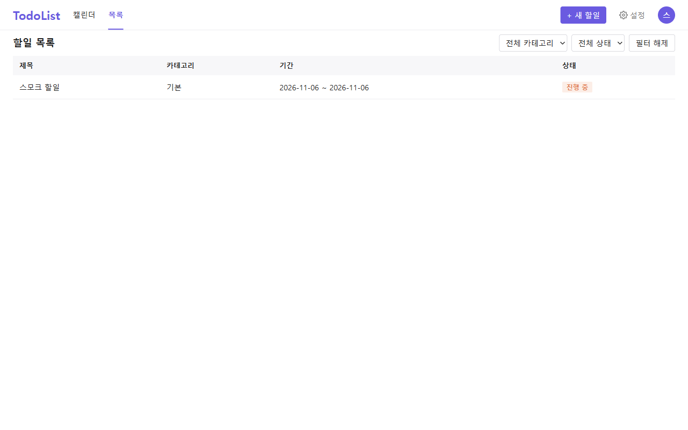
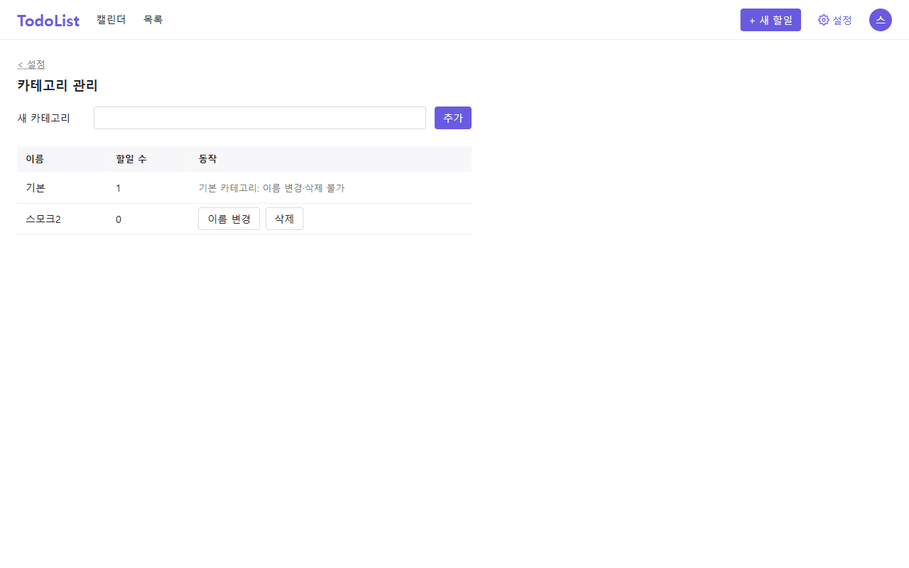
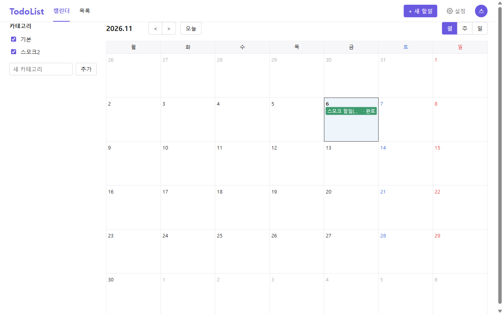
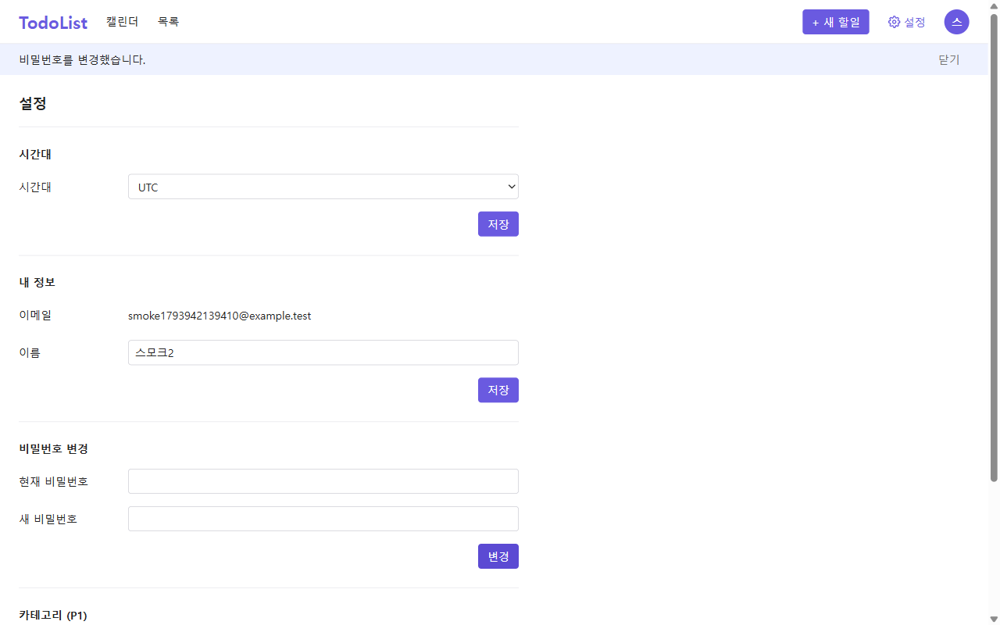
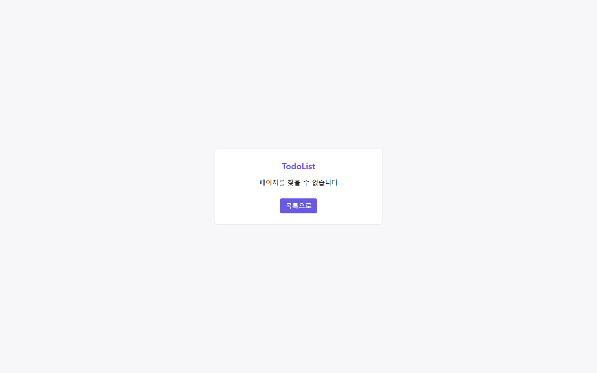

# 운영 스모크 테스트 (2026-11-06)

- 대상: https://todolist-ymj.vercel.app (화면) → https://todolist-ymj-be.vercel.app/api (API, 다른 사이트 직접 호출)
- 기준: [사용자 시나리오](../../docs/3-user-scenario.md) 주요 흐름, FR-11, FE-27
- 도구: Playwright(Chromium), 데스크톱 1280px + 모바일 360px
- 테스트 계정: `smoke1793942139410@example.test` (운영 DB에 남음. 만든 할일·카테고리는 테스트 끝에 삭제)

## 결과: 19 / 19 통과

| # | 시나리오 | 결과 | 소요 |
| - | -------- | ---- | ---- |
| 1 | SC-03 미인증 `/todos` → 로그인 화면 | 통과 | 1.1s |
| 2 | SC-01 가입 → 자동 로그인 → 빈 목록 | 통과 | 3.1s |
| 3 | 새로고침 후 로그인 유지 (다른 사이트 쿠키 `SameSite=None; Partitioned`) | 통과 | 1.6s |
| 4 | SC-05 할일 등록 | 통과 | 3.2s |
| 5 | SC-06·07 수정·완료 표시 | 통과 | 3.7s |
| 6 | SC-13 카테고리 등록·이름 변경 | 통과 | 3.8s |
| 7 | SC-10 월간 캘린더에 할일 표시 | 통과 | 2.5s |
| 8 | FR-11 사이드바 카테고리 체크 해제 → 숨김, 재체크 | 통과 | 0.1s |
| 9 | SC-12 시간대 `UTC` 저장 | 통과 | 2.3s |
| 10 | SC-14 이름 변경 → 프로필 팝업 반영 | 통과 | 1.4s |
| 11 | SC-14 비밀번호 변경 | 통과 | 3.0s |
| 12 | AC-22 액세스 쿠키 삭제 → 자동 갱신(refresh 200) 후 목록 조회 | 통과 | 4.0s |
| 13 | SC-04 로그아웃 → 로그인 화면, 뒤로 가기 시 로그인 요구 | 통과 | 2.3s |
| 14 | SC-02 이전 비밀번호 거부(ERR-03 문구) | 통과 | 1.5s |
| 15 | SC-02 새 비밀번호로 로그인 | 통과 | 1.7s |
| 16 | SC-08 할일 삭제(확인 대화상자) | 통과 | 4.5s |
| 17 | SC-13 카테고리 삭제 | 통과 | 3.8s |
| 18 | FE-27 없는 주소 → '페이지를 찾을 수 없습니다' | 통과 | 0.1s |
| 19 | 360px 목록 가로 스크롤 없음 | 통과 | 1.6s |

      

## 관찰 (결함 아님)

- 4xx 응답 8건은 모두 의도된 것이다: 미인증·로그아웃 직후의 `GET /users/me` 401과 그에 따른 `POST /auth/refresh` 401(쿠키 없음), 이전 비밀번호 로그인 401. 브라우저 콘솔 오류 8건은 이 401의 'Failed to load resource' 표시뿐이다
- 저장·삭제 한 번에 3~4.5초가 걸린다(화면 이동과 재조회 포함). 서버리스 첫 호출 지연과 미국 동부(iad1) 함수 ↔ 싱가포르 DB 거리 영향으로 보인다. NFR 응답 시간 기준과는 따로 재지 않았다

## 하지 않은 것

- Safari·Firefox(다른 사이트 쿠키 정책이 달라 Safari는 로그인이 안 될 수 있다, PRD NFR-15)
- 로그인 시도 제한(운영 계정 잠금을 피하려고), 주간·일간 캘린더, 목록 필터 조합
